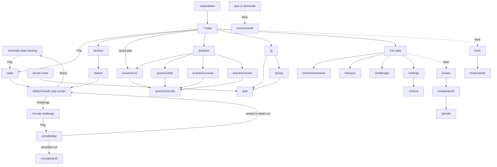

# [Name]: Product Requirements Document, v1

| | |
|---|---|
| Status | Approved for build. This is the single source of truth for what ships in v1 |
| Owner | Lead product manager |
| Date | 31 October 2026 |
| Inputs | [00-PROJECT-BRIEF.md](./00-PROJECT-BRIEF.md), [01-ENGINEERING-CONSTRAINTS.md](./01-ENGINEERING-CONSTRAINTS.md), [02-PRODUCT-DECISIONS.md](./02-PRODUCT-DECISIONS.md) (binding), [research/SYNTHESIS.md](./research/SYNTHESIS.md) and the gap reports it cites |
| Companion docs | DESIGN.md (visual system, glyphs, layouts), ARCHITECTURE.md (schema, RPCs, service worker), CONTENT_GUIDE.md (writing and checking rules) |

"[Name]" is a placeholder. The design team proposes names and the owner picks a short, coined, ownable one (decisions memo §12).

## How to read this document

**Precedence.** The decisions memo is binding and overrides the synthesis. This PRD turns both into buildable rules. If anyone finds a conflict between this PRD and the memo, the memo wins and this PRD gets corrected in the same pull request.

**Priorities.**

| Label | Meaning |
|---|---|
| **Must** | Blocks launch. Implemented, code-reviewed and covered by unit and E2E tests before release |
| **Beta** | Ships in v1 behind a visible "Beta" label, and only if it passes its automated gates (§9.2). If it fails, it stays behind a feature flag and the Daily launches without it |
| **Should** | Planned for v1. Cut only to protect the quality of a Must, and first in line for 1.1 |
| **Later** | Specified so the engine and data model leave room for it. Not built in v1 |
| **Won't** | Deliberately excluded from v1 (§1.4) |

**Numbers marked (tunable)** are starting values. They live in configuration (a `config` table or a typed constants module), never inline in components, so playtests and beta data can move them without a code change. Unmarked numbers are fixed rules.

**Acceptance criteria** have IDs such as `AC-DLY-07`. Each one is written so a QA engineer can automate it. Unless a criterion says otherwise, it runs as a Playwright or Vitest test against the `mock` backend with the injectable clock and seeded RNG. Tags mark the exceptions:

- **[SQL]** an SQL-level test run through `execute_sql` against the real project.
- **[Real]** the GitHub Actions job against the real Supabase project.
- **[Content]** a check run by `npm run content:check`, in sealed mode (CI's `content-sealed` job) where it needs sealed sources.
- **[Beta-manual]** a human check during the closed beta, reported as "not run" before then.

**Copy** in quotes is the intended wording. The design team may polish it, but must keep its meaning, its tone (§3.0.4) and anything it promises.

### Glossary

| Term | Meaning |
|---|---|
| Daily | One quiz per calendar date, the same for everyone. v1 composition: Mystery 1 (easy), Mystery 2 (medium), Mystery 3 (hard), then the Encore |
| Round | One unit of a Daily or a run: a mystery, an encore, or a single multiple-choice, true/false or comparison question |
| Run | One play-through: a Daily, an archive date, a challenge, a pack or a shared quiz, or one practice-family session (ten questions in Quick Play). This spec always says "run" for the whole session; player copy may still say "round" ("Try a practice round") |
| Mystery | A clue-ladder round: one answer, four clues from hardest to easiest, worth 4, 3, 2 or 1 points |
| Answer type | The kind of thing a mystery's answer is (a country, a film, a chemical element). Each type has a closed answer list |
| Closed answer list | A fixed, published list of every allowed answer for one answer type, with aliases. Guesses can only be entries from it |
| Encore | The closest-number round that ends every Daily. It scores no points. Its error is the first tiebreaker |
| Bullseye, Close | Encore bands: within 5% (or 2 years) and within 15% (or 5 years) (tunable) |
| Local date | The calendar date in the player's time zone, computed by the server from the IANA zone the client sends, and never earlier than the latest local date the server has already computed for that player (§4.4.1) |
| Global window | The roughly 50 hours during which a Daily date is "today" somewhere on Earth: from 00:00 at UTC+14 to 24:00 at UTC-12 |
| Ranked run | A player's first attempt at the Daily of their current local date. Only ranked runs enter percentiles, crowd stats and Group boards |
| Eligible run | A finished ranked run with no honest-play flag, from an identity that isn't low trust (§4.3.6) |
| Honest-play flag | A marker the server stores on a run when the tab was hidden for 5 seconds or more during a round, the visibility report is missing, a solve looks implausible, or the run started in a zone hop, right after the device's time zone moved its date backward (§4.3.6). It never bans, labels or punishes |
| Low-trust identity | A guest identity registered past the per-IP threshold (§3.10.1). It plays normally, but its reports weigh nothing and its runs stay out of the crowd's numbers until it is a day old or has finished 2 Dailies |
| Freeze | Earned protection that spends itself on a missed day |
| Repair | Restoring a broken streak by playing the missed Daily from the archive by the end of the second day after it, at most once per rolling 7 days |
| Paused streak | How a streak shows while a repair is still possible: the pre-break count with "paused" and the deadline, never 0 (§4.4.3) |
| Protected date | A date covered automatically because our service failed (§4.4.6) |
| Sealed | Served by RPC without the answer key. The key reaches the client only after the player commits |
| Group | A private board for the Daily, joined by link, up to 50 members |
| Room | A live, host-paced game on a big screen with phones joining by code (Beta) |
| Seat | A player's place in a room, kept across disconnects |
| Pack | A fixed, sealed set of questions: a room pack (15 multiple-choice questions) or a challenge pack (built from past Dailies; schema only in v1, §3.6.1) |
| Sync code | A 16-character code that restores a profile on another device |
| Claim link | A single-use, 10-minute link that moves an identity from an in-app browser to the system browser |
| Backup cookie | An `HttpOnly` first-party cookie, set by our own route handler, that silently restores an identity when local storage is wiped |
| Clean cohort | Players whose first finished Daily happened in a system browser, an Android Custom Tab or the installed app |

---

## 1. Vision, goals and non-goals

### 1.1 Vision

**Daily trivia that starts in one tap and ends in a result worth sending.**

Every day, everyone gets the same three Mysteries and one Encore. You read a hard clue and make a guess. Every miss gives you an easier clue, until the answer clicks. It takes a few minutes and needs no app or account, and it ends with a spoiler-free grid your group chat can react to. Between Dailies, Practice works offline and teaches you something with every answer. Around the Daily sit the small pieces that bring people back: a friend's challenge link, a private Group board, a streak that forgives a bad week, and stats that show you getting better.

What we will not do matters as much. No ads in play, nothing to buy to keep playing, no lives, no guilt-trip copy, and a natural end to every session. Strangers only ever appear as a percentile. Every answer carries a short, checked "why".

The positioning line from the research (SYNTHESIS §5.2): for people who love a daily puzzle and the group chat that comes with it, [Name] is daily trivia that starts in one tap, with no app and no account, and ends in a result worth sending.

### 1.2 Why this shape

- The daily breakouts closest to trivia ask players to recall or estimate, let every attempt narrow the answer, and share a path rather than a bare score (Framed, Worldle, Immaculate Grid, TimeGuessr). No large ten-question multiple-choice daily turned up in our competitor survey ([gap 1](./research/gap-1-daily-format-and-competitors.md)). The memo therefore locks the three-Mystery format (memo §2).
- Streaks that forgive outperform strict ones in published A/B tests: letting learners hold two freezes instead of one raised daily actives without raising days off ([Duolingo](https://blog.duolingo.com/improving-the-streak)), and repairable streaks softened the drop after a break across seven studies ([CU Boulder](https://www.colorado.edu/business/news/2023/04/20/research-streaks-marketing-tech-barasch)).
- Comparison inside small, chosen groups is the strongest social retention evidence we have, and none of it needs realtime ([Garcia and Tor](https://public.websites.umich.edu/~smgarcia/pubs/n-effect.pdf); SYNTHESIS §2 #8).
- The famous failures died of cash prizes, lag that eliminated players, ads after every answer and broken trust (SYNTHESIS §3). Our rules exclude each one.

### 1.3 Goals and measurable targets

All retention numbers are hypotheses: nobody has published a web baseline (SYNTHESIS §10.2). Cohorts are players who finished a first Daily, split by where that finish happened. Kill lines and gates read the clean cohort only, and only in weeks with at least 400 clean first finishers.

**North star: weekly habit players.** Unique players who finished the Daily on at least 3 of the last 7 days.

| # | Goal | Metric | Target | Floor or alarm |
|---|---|---|---|---|
| G1 | People come back tomorrow | D1 return, clean cohort | 30% (stretch 40%) | Two qualifying weeks under 20% trigger a core-loop review |
| G2 | The habit holds for a week and a month | D7 and D30 return, clean | 12% and 5% | Under 5% and under 2% |
| G3 | The habit survives day to day | Next-day continuation (finished yesterday, finishes today) | 70% (stretch 80%) | Under 55% |
| G4 | One tap really means one tap | Landing to question one on screen, p75 | Under 3 s on a mid-range Android phone over 4G | Over 4 s |
| G5 | Visitors start playing | Landing to first answer | 60% | Under 40% |
| G6 | The Daily is finishable | Daily start to finish | 90% | Under 80% |
| G7 | The Daily is short | Daily session length, median | 3 to 5 min | Over 7 min |
| G8 | Results are worth posting | Daily finishers who complete a share (sheet completed or copy succeeded) | 20% | Floor set from beta weeks 1 and 2 |
| G9 | Challenges convert | Challenge links opened that end in a finished run | 50% | Under 30% |
| G10 | Sessions end on purpose | Sessions ending on a stop or results screen | 80% | Under 65% |
| G11 | We respect time | "I played longer than I meant to" (sampled survey) | Under 10% | Over 20% |
| G12 | In-app players keep their identity | In-app first finishers who use the claim link | 25% | Under 10% |
| G13 | Habit players protect their progress | Players with three finished Dailies who save a sync code | 30% | Report weekly |
| G14 | Content is right | Confirmed key errors in scheduled Dailies | Zero | Any one triggers an incident review |
| G15 | Content is right, at scale | Confirmed errors per practice item | Under 1% | Over 2% pauses new practice publishing |
| G16 | We fix fast | Median time from first report to void or fix, Daily items | Under 12 hours | Over 24 hours |
| G17 | It feels fast | Core Web Vitals, p75 | LCP under 2.0 s, INP under 200 ms, CLS under 0.05 | Google's "good" lines |
| G18 | Rooms are reliable (Beta) | Room questions voided by our errors | Under 1% | Over 3% |

Monetization is not a v1 goal. The future "Plus" model is documented only (§1.5).

### 1.4 Non-goals for v1

| Not in v1 | Why | Revisit when |
|---|---|---|
| Cash prizes, sweepstakes, paid entry, login coins | HQ's prize bill and the main motive to cheat (SYNTHESIS §3) | Never |
| Lives, energy, paid strikes, pay-to-win, paid streak protection | The loudest complaints in reviews (SYNTHESIS §6.10) | Never |
| Ads of any kind, purchases, subscriptions | Memo §8: free at launch | Plus is documented only (§1.5) |
| Third-party analytics, trackers, pixels or fonts loaded from third-party hosts | Constraint 9 | Only if first-party SQL stops being enough |
| Global or all-time named leaderboards, leagues | The N-effect; cheaters own public top lists | Leagues when every cohort fills within a day |
| Open text chat; free text shown to strangers | COPPA-safe defaults (constraint 9) | Not planned |
| Public gallery or search of user quizzes; images or media in user quizzes | Moderation load and legal duties | After a moderation pipeline and legal review |
| AI quiz generation in the editor | No tested secret path; error risk. Bulk import lets hosts bring their own drafts | After an Edge Function secret path passes CI |
| Web push; the Edge Function secret spike; payments | Memo §10: none needed for launch | When installed weekly players reach 10% of habit players or 1,000 |
| Real-time public matchmaking, scheduled live shows | Liquidity and appointment risk | Peak waits under 20 s |
| Answer pages for past Dailies | They would publish sealed content that challenge packs and rooms reuse | When players search for our answers |
| Under-13 play, classroom mode | COPPA and school-privacy duties | After legal review |
| Native apps | The open web is our distribution | After product-market fit |
| XP and levels | Memo §4: cosmetic only if built; we are not building them | 1.1 at the earliest |
| Adaptive practice (F-ADP) | It would adapt on unmeasured estimates, which carry 13 to 21 points of error before play data exists (SYNTHESIS §7.10) | When 1,000 practice items have 100 first attempts each, the point where estimator v1 can train on our own data |
| Practice stats that follow a restored or claimed profile | Practice history, mastery and the review queue live on the device in v1, and the restore and claim copy says so (§3.10.2) | Once registered devices' authenticated practice uploads (§3.13.3) are enough to rebuild them in `get_my_stats` |
| Practice challenges | Practice answers ship to the client, so a head-to-head can't be trusted | As an unranked "friendly" mode, if asked for |
| Deep Cut, Confidence mode, Chaos mode, teams, preset reactions, Friend streaks, streak goals, weekly goals, first-month recap | Synthesis "Could" items | Friend streaks lead 1.1 |
| A four-arm Daily bake-off with real players | No players before launch (memo §10) | The engine keeps the Daily composition data-driven |

### 1.5 The future business model (documented, not built)

"Plus": the archive beyond 7 days, extra themed packs, deeper stats, cosmetic themes and bigger rooms; then host plans for pubs and office events. Plus switches on when clean D7 holds at 12% for four weeks, and pricing is decided by week 8 after real players arrive, whatever D7 shows (SYNTHESIS §12 #11). Nothing free is ever taken away: the last 7 days of the archive stay free forever. Payments need a webhook secret in an Edge Function and Vercel Pro, so none of this ships in v1. v1 code paths for the Daily must contain no entitlement or ad checks.

---

## 2. Personas and jobs to be done

The personas below are composites drawn from SYNTHESIS §5.1. Persona playtests (M1, M5) use them plus four profiles from the playtest panel: a first-time player who has never tried a daily puzzle, a screen-reader user, a player on a low-end Android phone over slow 4G, and a non-US English speaker.

### 2.1 Primary: Priya, the daily-ritual player

- **Who.** 31, lives in Manchester, plays Wordle and Connections on the bus and trades results in two WhatsApp groups (family, old uni friends). Plays on a phone in three-to-five-minute gaps. Often opens links inside WhatsApp or Instagram, not a browser.
- **Wants.** A calm game that is quick to learn and a result her friends will react to. Fairness to someone outside the US matters to her: she notices "soccer" and "03/04".
- **Hates.** Sign-up walls, ads between questions, "you lost your streak!" guilt, and quizzes with wrong answers.
- **What she gets.** The Daily one tap from any link, a forgiving streak, a share grid, Groups, and challenge links.

| Job to be done | How v1 serves it |
|---|---|
| When I have a few minutes on the bus, I want a quick, satisfying puzzle, so I can feel clever before work | The Daily: three Mysteries and an Encore, untimed, a few minutes long |
| When my friend posts a result, I want to play the same one in one tap, so I can join the conversation | Share links open straight into my own Daily, in any browser, in-app ones included |
| When I miss a day, I want my streak to survive, so I don't feel punished for having a life | Earned freezes, a free weekly repair, record-first copy |
| When I finish, I want to see how I did against my friends, not strangers, so it feels personal | Groups with a weekly board; strangers only as a percentile |
| When I get one wrong, I want to know why, so I learn something | A checked "why" of 35 words or fewer on every answer |

### 2.2 Secondary: Marcus, the host

- **Who.** 38, organizes the office Friday social and a monthly quiz night with friends, sometimes over a video call. Not technical. Has a laptop and a TV.
- **Wants.** Everyone on their own phone with no install, a big-screen view that looks good across a room, ready-made packs or his own questions, and control when things go wrong.
- **Hates.** Paying for a one-off party, guests typing rude names, lag that ruins a round, and setup that takes longer than the game.
- **What he gets (Beta).** Host rooms with six-digit codes and QR join, generated friendly names, host controls, the quiz editor with bulk import from a chatbot draft.

| Job to be done | How v1 serves it |
|---|---|
| When friends arrive, I want everyone playing within two minutes, so the energy doesn't drop | A room code and QR on the big screen; phones join with no account |
| When I want my own questions, I want to paste the list ChatGPT gave me, so I don't type 30 questions | Bulk import from pasted text or CSV, with lint and a preview |
| When someone joins with a rude name or a phone drops, I want to fix it in one tap, so the game goes on | Remove, rename and lock; rejoin to the same seat |
| When a guest needs more time, I want to give it without stopping the game, so nobody feels left out | "Off: host advances", and +50% time for one player or everyone |

### 2.3 Tertiary: Dee, the trivia buff

- **Who.** 52, pub-quiz regular for twenty years, plays LearnedLeague-style quizzes, knows a lot and wants that to show.
- **Wants.** Hard questions, a way to prove depth (solving on clue 1), per-category stats and mastery, and a fair tiebreak among people who all get everything right.
- **Hates.** Easy filler, ambiguous questions, wrong answer keys, and leaderboards owned by people using search engines.
- **What she gets.** The Mystery ladder (clue-1 solves are worth 4 points), the Encore tiebreak, Hard practice, Blitz and Survival, mastery tiers, achievements and detailed stats.

| Job to be done | How v1 serves it |
|---|---|
| When I know the answer from the first clue, I want that to count, so depth beats luck | 4 points on clue 1, and the share grid shows it |
| When I practice, I want to choose hard questions openly, so I'm not bored | Easy, Medium, Hard or Mixed, never adjusted behind her back |
| When everyone in my group scores 12, I want a fair tiebreak, so the board still means something | Encore error, then time |
| When I want to compete harder, I want an opt-in timed mode, so the calm modes stay calm | Blitz (60 s) and Survival (three strikes) |

### 2.4 Who v1 is not for

Children under 13 and classrooms (COPPA and school-privacy duties), exam-prep learners, prize hunters, and anyone looking for a social network. Teenagers from 13 to 17 may play, with the minors switch described in §3.10.6.

---

## 3. Feature specifications

### 3.0 Shared conventions

#### 3.0.1 Feature inventory

Every feature in the decisions memo and in the synthesis Must and Should lists appears here, with its section.

| ID | Feature | Priority | Section |
|---|---|---|---|
| F-DLY | The Daily: three Mysteries and the Encore | Must | 3.1 |
| F-DSS | Daily stop screen, percentile and crowd stats | Must | 3.1.6 |
| F-ENG | Data-driven round composition | Must | 3.1.2 |
| F-ARC | Daily archive, last 7 days | Must | 3.2 |
| F-RPR | Free streak repair | Must | 3.2.3 |
| F-PRA | Quick Play and category practice | Must | 3.3 |
| F-FMT | Formats: multiple choice, true/false, comparison | Must | 3.3.2 |
| F-DIF | Open difficulty choice (Easy, Medium, Hard, Mixed) | Must | 3.3.3 |
| F-ADP | Adaptive serving inside Mixed | Later (§1.4) | 3.3.3 |
| F-BLZ | Blitz | Should | 3.3.5 |
| F-SUR | Survival | Should | 3.3.6 |
| F-REV | Review my misses | Should | 3.3.7 |
| F-ORD | Ordering format | Later (engine leaves room) | 3.3.2 |
| F-STK | Streaks, milestones, record-first copy | Must | 3.4.1 |
| F-FRZ | Earned freezes | Must | 3.4.2 |
| F-STA | Stats page | Must | 3.4.3 |
| F-MAS | Category mastery tiers | Should | 3.4.4 |
| F-ACH | Achievements | Should | 3.4.5 |
| F-CAL | Calendar reminder | Should | 3.4.6 |
| F-SHR | Share result | Must | 3.5 |
| F-CHL | Challenge links | Must | 3.6 |
| F-GRP | Groups | Must | 3.7 |
| F-ROM | Host rooms | Beta | 3.8 |
| F-HSS | Host-screen sound | Should, with rooms | 3.8.7 |
| F-EDT | Quiz editor | Beta | 3.9 |
| F-IMP | Bulk import | Beta (Must within the editor) | 3.9.3 |
| F-LNT | Creator lint and slur filter | Beta (Must within the editor) | 3.9.4 |
| F-UGS | Unlisted quiz sharing, reports, takedown | Beta | 3.9.5 |
| F-IDN | Guest identity | Must | 3.10.1 |
| F-SYN | Sync code | Must | 3.10.2 |
| F-CKE | Backup cookie | Must | 3.10.3 |
| F-IAB | In-app browser handoff | Must | 3.10.4 |
| F-AGE | Age band and the minors switch | Must | 3.10.6 |
| F-DAT | Data export and deletion | Must | 3.10.7 |
| F-PWA | Installable PWA, offline practice | Must | 3.11 |
| F-INS | Install pitch | Should | 3.11.3 |
| F-SET | Settings: themes, motion, sound, haptics, stopwatch, shortcuts | Must | 3.12 |
| F-RTM | Readable text mode | Should | 3.12 |
| F-HCF | High-contrast feedback | Should | 3.12 |
| F-RDA | Read aloud | Should | 3.12 |
| F-A11Y | Accessibility baseline | Must | 3.12.4 |
| F-RPT | Report a problem, void and rescore | Must | 3.13 |
| F-HRT | Question heart (fun signal) | Must | 3.13.5 |
| F-LGL | Legal and trust pages | Must | 3.14 |
| F-INC | Incident banners and outage protection | Must | 3.15 |
| F-ANA | First-party analytics and the regret survey | Must | 3.16 |
| F-CAT | Indexable category pages | Should | 3.17 |
| F-PCK | Monthly themed pack | Should | 3.17 |
| F-CNT | Content the product depends on | Must | 3.18 |
| F-OPS | The weekly content run | Must | 3.18.5 |

#### 3.0.2 Standard UI states

Every screen implements these states. Feature sections list only what differs.

| State | Rule |
|---|---|
| Loading | Nothing for the first 300 ms, then a skeleton shaped like the final layout, so nothing shifts (CLS under 0.05). A server verdict that takes longer than 1.5 s shows "Checking..." |
| Empty | A one-line explanation plus one action. Never a blank screen |
| Error | Plain words, what still works, and a Retry button. Retries reuse the same idempotency key, so nothing double-counts. Errors never show stack traces or codes, except a short reference ID in small text |
| Rate limited | Silent backoff first: the client honors `Retry-After` (or waits 1, 2, 4 and 8 s, with jitter) and retries with the same idempotency key, so a refused request has used up nothing, a guess included. After 5 s of refusals it shows plain copy for that action and a Retry button, for example "Lots of players on your network right now. Trying again..." A wait longer than 60 s shows the action's own copy at once ("You've sent a lot of challenges today. Try again tomorrow."). A feature with a fallback offers it only after 30 s of refusals (the Daily's fallback is Practice, AC-IDN-04) |
| Offline | Detected from failed requests and `navigator.onLine`. A banner says what works and what doesn't (§3.15). Inputs that need the server are disabled, never silently queued, except reports, hearts and analytics, which queue |
| Success | Confirmation in a polite `role="status"` region, plus the visible change |
| Backend `off` mode | When `NEXT_PUBLIC_BACKEND_MODE=off`, online features show their offline state with the copy "This feature isn't available on this server." Practice works fully |

#### 3.0.3 The answer press and the reveal (all tap-to-answer screens)

These rules apply to multiple choice, true/false, comparison, the four options on a Mystery's last clue, room phones and user quizzes (SYNTHESIS §8.2 to §8.3).

- **Layout.** On phones the stem sits in the upper 40% and answers in the lower 55%. Answer buttons are full width minus 16 px gutters, at least 56 px tall (tunable), with 12 px gaps and 18 px left-aligned text that wraps and grows the button. Letter badges A to D mean nothing depends on color. From 768 px wide, a 720 px column; a 2 by 2 grid only when every option is under 24 characters.
- **Commit on release.** The pressed state appears on `pointerdown`; the answer commits on `click`, so sliding off cancels (WCAG 2.5.2).
- **Timing.** Pressed state in the same frame (INP target 200 ms or less). Lock-in state by 150 ms. Reveal at 400 ms (tunable): the right answer shows a check and the words "Correct answer"; a wrong pick shows an X and "Your answer"; other options dim but keep 4.5:1 text contrast. In sealed modes the reveal waits for the server verdict; past 1.5 s it shows "Checking...". A count-up of points runs from 400 to 900 ms with `tabular-nums`.
- **Explanation sheet.** Rises at about 1.2 s as an overlay, so nothing shifts. It holds the explanation (35 words or fewer), a "Learn more" link (a Wikipedia search for the answer, opened in a new tab), the heart toggle (§3.13.5) and "Report a problem" (§3.13). It stays until the player taps Continue, which sits where the answers were. Auto-advance is off unless the player turns it on (§3.12), and then waits 2 s plus 0.25 s per word.
- **Screen readers.** Focus moves to each new question's heading. Verdicts go to a polite status region: "Correct. Paris." or "Not quite. You chose Lyon. The answer is Paris." `role="alert"` is reserved for a lost connection during a sealed round.
- **Keyboard.** Keys A to D pick options, matching the badges, and digits 1 to 4 only where no option reads as a number (memo D6). They act only while focus is on an option or its options group (D20), and can be switched off (§3.12). In practice a key answers at once, and a legend above the options says so once a keyboard is in use: "Keys A to D answer at once.", naming only the letters on screen. On a Mystery's options, focus moves to the options group as they appear and the legend "Keys A to D choose. Enter locks in." shows above them from then on; a key chooses, and Enter or the same key again locks it in (D28). Enter activates Continue.
- **Motion.** A wrong pick gets a soft 6 px, two-cycle shake, which becomes a color fade under reduced motion. Nothing flashes more than three times a second.
- **Celebration.** Each correct answer: a pop, a count-up and (if sound is on) a chime. A perfect Daily (12/12) gets confetti, lazy-loaded and disabled under reduced motion. Never confetti on every answer, never "so close!" when it wasn't close, and every celebration can be skipped with a tap.

#### 3.0.4 Tone of voice

Warm and plain. Short sentences. No guilt, no fake urgency, no shouting in capitals and no exclamation marks in error copy. Streak copy stays neutral ("Your streak is safe. A freeze covered yesterday."). Offline copy says what still works and what doesn't count. We never call a looked-up answer cheating; we say solo play runs on the honor system. Months are spelled out ("1 November"), never numeric.

---

### 3.1 The Daily: three Mysteries and the Encore (F-DLY, Must)

**User story.** As Priya, I want one short, fair puzzle a day that everyone shares, so I can play in a few minutes and compare with my friends.

#### 3.1.1 Summary of rules

- One Daily per calendar date, the same for everyone. It unlocks at the player's local midnight and stays "today" for them until their next local midnight (§4.4.1).
- v1 composition: Mystery 1 (easy), Mystery 2 (medium), Mystery 3 (hard), then the Encore. Score out of 12 from the Mysteries; the Encore scores no points and is the first tiebreaker. Precise rules: Mystery §4.1, Encore §4.2, ranking and percentile §4.3.
- One ranked run per player per local date. No account, name or tutorial before the first clue.
- No time limit. A small stopwatch, hideable, measures time; nothing ever times out; time only breaks ties. The player-facing words are "no time limit", never "untimed", because the stopwatch runs (memo D27).
- Sealed. Clues are issued one at a time by RPC, and the answer reaches the client only when the round resolves. Validation and scoring happen in Postgres.
- Free forever. The Daily's code path contains no entitlement, paywall or ad check.
- Online only. If the backend is unreachable, the Daily shows its offline state and offers Practice. We never fake a Daily offline. (This departs from constraint 1 for the one ranked solo mode; CTO sign-off is open question Q1.)
- **Daily number.** Daily #1 is the first date of the closed beta (`DAILY_EPOCH`, set in config). Number = days since the epoch + 1. Every surface shows the number and the spelled-out date: "Daily #42 · Sunday 1 November".

#### 3.1.2 Round composition is data (F-ENG)

A Daily is an ordered list of rounds stored with the schedule: `[{type, difficulty, content_id}]`. Round types the engine supports in v1: `mystery`, `encore`, `mc`, `tf`, `comparison`. Each type declares its maximum points (mystery 4, mc/tf/comparison 1, encore 0) and its share-row renderer. The Daily's maximum score is the sum. Switching to another composition (for example synthesis arm B: five multiple-choice questions, one mystery, the encore) is a schedule change with no code change.

#### 3.1.3 The run

- **Start.** Tapping Play opens `/daily`, which calls `start_daily` with the IANA zone, the browser context, the app and the app version (ARCHITECTURE §1.4 item 11). The server computes the local date from the IANA zone, records the browser context for cohorts (§7.3), creates the attempt (idempotent per player and date), stores the per-attempt option shuffle, and returns Mystery 1's metadata and clue 1. The client preloads the three answer lists the Daily needs (§3.18).
- **Header.** Exit (returns home; progress is saved), a four-segment progress bar (M1, M2, M3, Encore; each segment shows a check, a cross or a number of points once done), the stopwatch, and settings. Sound, the stopwatch toggle and "How to play" sit in the overflow menu (sound and the stopwatch also in settings), never as surprise buttons.
- **How to play.** A sheet opened from the overflow menu, in this order: the clue ladder (four clues, hardest first; guess at any point, or tap Next clue for an easier one); the points (4, 3, 2 or 1 by the clue that solved it, and a wrong guess costs exactly what Next clue costs); clue 4 (four options to pick from, and a wrong pick scores 0); the Encore (one number, no points, the first tiebreaker, a bullseye within 5%); and the ranking (points, then the Encore, then total time, with no countdown; "so far today" because later time zones are still playing). It closes back to the same clue, and opening it logs `how_to_play_open`. `/how-scoring-works` carries the same text.
- **Stopwatch.** Shows total active Daily time as `m:ss` with `tabular-nums`, `aria-live="off"`: the sum of the rounds' active intervals so far, each capped at 15 minutes (§4.3.2). It runs only while a clue or the Encore is open, and it freezes between rounds and while a reveal is open, because that is what breaks ties. It is the device's own measure; the server's figure decides. A "Hide stopwatch" control hides it everywhere and the choice persists. First Daily only, a one-line hint beside it: "Take your time. Time only breaks ties."
- **Between rounds.** After each round's reveal the player reads the explanation and taps Continue ("Next mystery" or "On to the Encore"). Continue renders the next round's layout at once (round label, category chip, answer type, the stake indicator) from data that came with the verdict. The round's clue 1, or the Encore's question, comes from `begin_round` one round trip later, behind a skeleton clue card, with "Checking..." after 1.5 s (§8.1). The round's interval starts when that clue is issued, so reading time never counts, and a lookup on the next clue can only happen inside an active round, where honest-play flags can see it (ARCHITECTURE D7).
- **Resume.** All state lives on the server. Reloading, switching tabs or reopening the app resumes at the exact clue, with earlier guesses shown. A second tab on the same identity shows the same state; a stale tab's submission is rejected and the tab refreshes to the current state.
- **Finish.** The run is finished when all three Mysteries have resolved and the Encore is locked in. Only finished runs count for streaks. An unfinished run stays resumable until the date's global window closes, then becomes abandoned. An abandoned attempt is resumed, never replayed (one attempt per date, §3.2.1): its archive tile reopens it where it stopped, with its earlier guesses, as an unranked archive play, and finishing it while the date can still be repaired counts as the repair (§4.4.4).
- **Honest play.** With every round action the client reports how long the page was hidden or the window lost focus while a clue or the Encore was open. The server stores it and applies the checks in §4.3.6. Nothing visible changes for the player.
- **Lost connection mid-round.** The input disables, a `role="alert"` message says "You're offline. Your progress is saved, and we'll pick up where you left off.", and the client retries with backoff (2, 5, 10, 30 s). Guesses are never queued offline, because each one needs the server to reveal the next clue.
- **Rate limited mid-round.** A guess, pick or Lock in that meets `rate_limited` follows §3.0.2: silent retries with the same idempotency key, then plain copy and Retry. The refused request used up nothing, so the clue it was made on is still open when it goes through.

#### 3.1.4 Mystery screen

Rules for guessing, suggestions, clue reveal, the options on clue 4 and scoring are in §4.1. This section covers what the player sees.

**Layout, top to bottom.** Round label ("Mystery 2 of 3 · Medium") with the stake indicator at its right, category chip ("Film & TV"), the answer-type line ("The answer is a film"), the clue stack (revealed clues, newest last and highlighted, each labelled "Clue 1" to "Clue 4"), the guess area, and the actions row ("Guess", "Next clue").

**The stake indicator.** Always on screen while a Mystery is open: the values "4 3 2 1" with the current one marked and the spent ones struck through, and "points now" beneath (DESIGN.md's worth scale). Screen readers hear it as one phrase, "Worth 3 points now", and the status region repeats the new value after each wrong guess or Next clue. The Next clue button names what the next clue is worth: "Next clue · then worth 3" on clue 1, "Next clue · then worth 2" on clue 2, and "Last clue and options · then worth 1" on clue 3. With `options_from_clue` set to 3, clue 2's button reads "Next clue and options · then worth 2" and clue 3's "Last clue · then worth 1". A wrong guess costs exactly what Next clue costs (§4.1.2), so having a go never scores less than passing, and the copy says so instead of steering newcomers toward Next clue.

**With the keyboard open.** Typing on phones is the format's main risk (SYNTHESIS §6.1). While the on-screen keyboard is open (tracked through `visualViewport`), the newest clue, the input, at least three whole suggestion rows and Next clue stay inside the visual viewport without scrolling, and older clues collapse to one line each. The design may slim the header, shrink clue type or move Next clue beside the field to make that fit at 360 by 640 (DESIGN.md §10.3). After a wrong guess, focus stays in the field so the keyboard stays up, and the status region reads the new clue in full; after Next clue, focus moves to the new clue's heading, because the button the player pressed is gone (DESIGN.md §6.4).

| State | What the player sees |
|---|---|
| Loading clue | The round's layout and stake indicator at once, then a skeleton clue card; "Checking..." after 1.5 s |
| Guessing (clues 1 to 3) | A combobox labelled "Your guess", placeholder "Start typing a film". Suggestions appear as the player types (§4.1.3). Guess is disabled until a suggestion is selected. "Next clue" is always enabled and names the next clue's worth (above) |
| First Daily only | Under clue 1: "Get it from this clue for 4 points. A wrong guess costs the same as Next clue, so have a go." Shown once per player |
| Submitting | Guess button shows a spinner; input disabled; "Checking..." after 1.5 s |
| Wrong guess | The guess appears as a stamped chip with an X ("Not Heat"), readable and never struck through. The next clue slides in (a fade under reduced motion), the stake indicator moves down one value, focus stays in the field, and the status region says "Not Heat. Clue 3, now worth 2: ..." with the clue's full text |
| Clue 4 with options | The combobox is replaced by four answer buttons (A to D) following §3.0.3. An option the player already guessed shows disabled with "Already guessed". If any option shows a descriptor ("Queen (band)"), all four do |
| Solved | Reveal card: the answer in large type, "Solved on clue 2 · 3 points", all four clues (unneeded ones labelled "Not needed"), the explanation, "Learn more", the sources line when the item has source labels, heart, "Report a problem", and Continue |
| Missed | Reveal card: "The answer was Heat (1995)", "0 points", then the same content as Solved |
| Crowd stat (after commit) | On the reveal card: a five-bar chart "How everyone did: clue 1 14%, clue 2 31%, clue 3 22%, clue 4 18%, missed 15%" and, when it qualifies (§4.1.5), "Most common wrong guess: Collateral". Before `crowd_min_n` eligible answers (50 at launch): "Only 23 players have finished this one. Check back later for the numbers." |
| Withdrawn (voided) | "This Mystery was withdrawn because we got it wrong. Everyone gets 4 points." and Continue (§3.13.4) |
| Offline | Input disabled; alert copy from §3.1.3 |
| Rate limited | Silent retries with the same idempotency key, then plain copy and Retry (§3.0.2). The clue stays open and nothing is used up |
| Error | "We couldn't check that guess. Try again." with Retry (same idempotency key) |

#### 3.1.5 Encore screen

Rules for input, tolerance and display are in §4.2.

**Layout.** Round label ("Encore"), the question, the unit ("in kilometres"), a numeric field with the parsed preview beneath it ("You're answering 1,250 km"), and "Lock in". First Daily only: "Closest guess wins the tiebreak. Within 5% is a bullseye."

| State | What the player sees |
|---|---|
| Empty | Field focused (desktop) or ready (touch, numeric keypad via `inputmode`); Lock in disabled |
| Invalid input | Inline message under the field (§4.2.1), for example "Numbers only, please.", "Positive numbers only.", "Check the dots and commas." or "That's more digits than we can take."; Lock in disabled |
| Valid | Preview line in words and digits; Lock in enabled |
| Locking in | Spinner; field read-only |
| Result | "Your guess 1,200 km · Answer 1,250 km · 4% off", the band label ("Close", "Bullseye" or nothing), the number line (below), the explanation, crowd stats once `crowd_min_n` have answered ("Median guess 1,100 km. 18% hit the bullseye and 41% were close."), heart, report, and "See your results" |
| Withdrawn (voided) | "The Encore was withdrawn, so ties fall to time." and "See your results" (§3.13.4) |
| Offline, rate limited, error | As in §3.1.4 |

**The number line.** The Encore is the last beat of every Daily, the part the peak-end rule says players remember (SYNTHESIS §2 #10), so its result is drawn as well as written. A horizontal line on a ratio scale from half the answer to double it, matching how "% off" is measured (§4.2.2); for years, an even scale 20 years either side. The close band and the bullseye band are shaded around the answer, with marks for the player's guess, the answer and, once crowd stats qualify, the crowd's median guess. On the reveal a needle eases from the guess to the answer, which becomes a static drawing under reduced motion. A guess beyond either end sits at the edge with an arrow. Screen readers get the same facts as text: "Your guess 1,200 km. Answer 1,250 km. Median guess 1,100 km. Bullseye means within 5%, close within 15%."

#### 3.1.6 The stop screen (F-DSS)

Opens when the Encore resolves. Content order, top to bottom (Appendix B records why this order differs from memo §2's list):

1. **Comparison card, when one applies.** After a ranked or repair challenge run (§3.6.3): the head-to-head card, with the verdict ("You win on the Encore: 4% off against 9%."), both grids and Rematch (secondary style here, since "Done for today" stays the screen's only primary button). After a Daily started from a share landing for the same number (§3.5.3): "vs the result you opened: 9/12" with both grids, labelled as a shared result. Never both.
2. **Best-moment line and score card.** The line names the best thing that happened, in this priority:
   1. a perfect 12/12 ("12 out of 12. A perfect Daily.");
   2. a new best Daily score, only when the player has at least 3 earlier finishes ("Your best Daily yet."), so a newcomer's first result is never praised for beating nothing;
   3. the player's first finish ever, which is also the day-1 milestone ("Daily #42 done. Day 1 of your streak.");
   4. a later streak milestone (§3.4.1);
   5. a freeze earned ("You earned a freeze. It covers a missed day, automatically.");
   6. a clue-1 solve of Mystery 3;
   7. an Encore bullseye;
   8. a mastery tier reached;
   9. otherwise "Daily #42, done."

   The card shows the score ("9/12"), the three Mystery rows and the Encore line exactly as the share renders them (§3.5), the streak line and freezes held. The streak line reads "Streak 6", "Streak 7 · You earned a freeze" when this finish earned one, or "Streak 23 · paused · repair by the end of Monday" while a repair is possible (§4.4.3). The **Share** button sits directly under the card (secondary style). "Challenge a friend" sits beside it (§3.6).
3. **Percentile.** "You beat 64% of players so far today." Rules in §4.3. Cold start (fewer than `percentile_min_n` eligible finishers, 50 at launch): "You're one of the first 23 players today. Come back later to see how you compare." Beside it, once the player has 3 or more earlier finishes, a personal comparison: "Today 9/12 · your average 7.4 · your best 11". Error: "We couldn't load today's numbers." with Retry; the rest of the screen still renders.
4. **Your Groups.** One line per Group the player belongs to, up to three in `/g`'s order, then "See all": "Uni lot: 2nd of 6 so far today · 2 not yet · See board". The rank uses the Daily ranking rule (§4.3.1) over members who finished today, ties share a rank ("=2nd"), and "not yet" counts members who haven't finished. The row refetches with the stop screen and is hidden when the player is in no Group and on archive or other unranked results, since Group boards count only ranked runs. Small-group comparison is the strongest social retention evidence we have (SYNTHESIS §2 #8), so it sits right after the percentile instead of two taps away.
5. **How everyone did.** A 13-bar histogram of scores 0 to 12 among eligible finishers, the player's bar marked "You" with a pattern as well as color, and an accessible table equivalent. Hidden below `percentile_min_n` finishers.
6. **Rounds.** One row per Mystery (category, answer, "Solved on clue 2", the crowd's clue distribution) and the Encore (guess, answer, error, band, crowd median, and the number line from §3.1.5).
7. **Review your misses.** Every missed Mystery and the Encore if it wasn't a bullseye, each with its explanation and "Learn more". Empty state: "Nothing to review. Clean sheet."
8. **One offer card**, at most, chosen by priority: "Repair your streak" while a repair is possible (§3.2.3; hidden for the 13 to 17 band, who keep the option on the streak sheet), then the in-app claim link (§3.10.4), then the sync code (§3.10.2), then the install pitch (§3.11.3), then the calendar reminder (§3.4.6), then "Start a Group for your chat" (only when the player is in no Group and has finished 2 or more Dailies). Each card has one action in the secondary style and "Not now".
9. **"You're done for today."** The one primary-styled button on the screen, "Done for today", returns home. Beneath it: "Next Daily in 5h 12m" (counts down to the player's next local midnight, §4.4.1, using server-corrected time).
10. **A soft Practice offer.** A text link: "Want more? Try a practice round." Nothing autoplays into another run.

The stop screen stays available all day from the home card ("See results"). Percentile, charts and the Groups row refetch on each visit, because they are "so far today".

#### 3.1.7 Home Daily card

| State | Card |
|---|---|
| Not started | "Daily #42 · Sunday 1 November · About 4 minutes · no time limit" (D27), the one-line rule "Fewer clues, more points. Then one number.", one chip per round from `get_today` (answer type and difficulty, such as "A film · Medium" and "Encore · a number"; answer types aren't secret, since each Mystery names its type at clue 1), the played count ("4,812 played": finished ranked runs so far today, shown from 50), one Play button above the fold at 360 by 640, and a "Past 7 days" link to `/archive` |
| In progress | "Continue Daily #42 · Mystery 2 of 3", Continue, and the Past 7 days link |
| Finished | "Done for today · 9/12" with the mini grid, Share (secondary, the same text as §3.5.1, so a player can re-post when the chat wakes up), "See results", one Group line for the first Group in `/g`'s order ("Uni lot: 2nd of 6 so far today", hidden when the player is in no Group), "Next Daily in 5h 12m" and the Past 7 days link |
| Offline | "The Daily needs a connection. Practice works offline, but it isn't today's Daily." with Try again, and the Practice card promoted. The number, date, minutes and rule line still render; chips show their placeholders, and the played count and Group line are hidden |
| Outage (backend unhealthy) | "We're having trouble on our side. Your streak is protected today." (§3.15) |
| Loading | The number, date, minutes and rule line render at once from `DAILY_EPOCH` and the device's date (ARCHITECTURE §1.4 item 9). Chips show placeholders (Easy, Medium, Hard, Number) and the played count is absent until `get_today` answers. The Play button is live immediately and starts the Daily on tap, even if streak data hasn't loaded |

**The minutes figure** is a config value (`daily_minutes`, tunable), starting at 4, because three typed Mysteries with reveals plus an Encore may well run past 3 minutes. It is reset from the median finished-Daily session length of the M1 persona timings, then of the closed beta (goal G7).

#### 3.1.8 Acceptance criteria

- **AC-DLY-01** Given a brand-new guest on `/` with the mock backend, when they tap Play once, then Mystery 1's clue 1 heading is visible and no interstitial, form, carousel or account prompt appeared in between.
- **AC-DLY-02** p75 of 20 runs of "load `/` then tap Play" shows clue 1 within 3 s of navigation start, on Lighthouse's mobile profile (4x CPU slowdown, 150 ms round trip, 1.6 Mbps down and 750 Kbps up: the `mobileSlow4G` preset that npm `lighthouse` 12.8.2 takes from `@paulirish/trace_engine` 0.0.59) with the mock backend's latency fixed at 300 ms per call. A [Real] variant in `e2e-real` measures the same path against the real project, where the round trip to us-east-1 dominates G4.
- **AC-DLY-03** Before a Mystery's options are issued (clue `options_from_clue`), no response contains its answer id, answer name or any alias, its accepted or distractor ids, or any later clue. The response that issues the options lists all four in the attempt's stored shuffle, and no field, flag, ordering or timing distinguishes the key. Explanations and crowd stats appear only after resolution. [SQL] and an E2E network-log assertion.
- **AC-DLY-04** The Encore answer value appears in no response before Lock in. [SQL] and E2E. Every secrecy scan (this one, AC-DLY-03, AC-SHR-02 and AC-CNT-07) matches numbers by value in numeric JSON fields and as whole formatted tokens in text, so an answer of 12 never matches "9/12" or "Daily #12", and matches names and aliases as whole tokens after `normalizeName`. Scan fixtures use answers that can't collide with UI copy or category labels.
- **AC-DLY-05** Calling `start_daily` twice for the same player and local date returns the same attempt id and creates one row. [SQL]
- **AC-DLY-06** After a player finishes the Daily, `start_daily` for the same date returns the finished attempt, and the home card shows the Finished state.
- **AC-DLY-07** Reloading mid-Mystery resumes at the same clue with the same guess chips; no guess is lost or duplicated.
- **AC-DLY-08** With the mock clock at 23:59:30 local, a run started then and finished at 00:03 the next day counts for the earlier date, and the home card then offers the new date's Daily.
- **AC-DLY-09** A Daily scheduled as `[mc ×9, encore]` from a fixture renders, scores out of 9 and shares with one row of nine choice glyphs (consecutive choice rounds collapse into one row, §3.5.1), with no code change. `[mc ×5, mystery, encore]` scores out of 9 and shares one row of five choice glyphs, then one Mystery row.
- **AC-DLY-10** With the network cut, tapping Play shows the offline copy from §3.1.7 and a link to Practice; no Daily content renders.
- **AC-DLY-11** Cutting the network mid-Mystery disables the input and announces the alert text; restoring it re-enables input without a reload.
- **AC-DLY-12** The stopwatch can be hidden; after a reload it stays hidden; it has `aria-live="off"`. Under the mock clock it shows the running total across rounds, doesn't advance while a reveal is open or before the next round's clue arrives, and adds at most 15 minutes for any one round.
- **AC-DLY-13** No element on a round screen (a Mystery or the Encore) counts down or times out. A run left idle for 30 minutes of mock time can still be finished. The stop screen's "Next Daily in" counts toward tomorrow and limits nothing, so it is out of scope.
- **AC-DLY-14** The stop screen renders its sections in the §3.1.6 order; "Done for today" is the only primary-styled button, and every offer-card action and the comparison card's Rematch use the secondary style.
- **AC-DLY-15** With `percentile_min_n` minus 1 eligible finishers (49 at launch) the percentile and histogram are replaced by the cold-start copy; with `percentile_min_n` they render. The test reads the threshold from config, so a beta change needs no test edit.
- **AC-DLY-16** The stop screen shows at most one offer card, chosen by the §3.1.6 priority with "Repair your streak" first (fixture per combination).
- **AC-DLY-17** "Next Daily in" reaches 0:00 at the player's local midnight under the mock clock, and the home card then shows the new Daily.
- **AC-DLY-18** Each round's reveal moves focus to the reveal heading and writes the verdict to the polite status region.
- **AC-DLY-19** The Daily route's code imports no entitlement, paywall or ad module (static import-graph check in CI).
- **AC-DLY-20** A percentile fixture table covers ties, P = 100, a tied top (no run better, some tied, so P is under 100 and the copy still reads "Nobody has beaten you so far today."), P under 5, and the fallback to the all-bands pool when the player's band has fewer than `percentile_min_n`. [SQL] plus engine tests on the same fixture.
- **AC-DLY-21** For each honest-play flag (5 s or more of hidden play in a round, a missing visibility report, a Mystery 3 clue-1 solve after more than 120 s while fewer than 50 such solves exist, a typed solve within 1.5 s of its clue) and for a low-trust identity's run: the run is stored not eligible and is absent from the percentile pool, the histogram and crowd stats; it still extends the streak and counts on Group boards; its owner still sees a percentile; and nothing on screen differs from an eligible run. [SQL] plus E2E.
- **AC-DLY-22** At D 00:00 UTC+14 the Daily for D opens. An attempt started at 23:59 UTC-12 on D can be finished until D+1 12:00 UTC, and is then marked abandoned. [SQL]
- **AC-DLY-23** A round whose client interval is more than 400 ms per request faster than the server's is scored at the server interval minus 400 ms per request, never less (§4.3.3). [SQL]
- **AC-DLY-24** A round action that arrives with no visibility report flags the run and makes it not eligible. [SQL]
- **AC-DLY-25** 4.9 s of hidden play in each of two rounds flags nothing; 5.0 s in one round flags the run (`honest_play_hidden_ms` read from config). A clue-4 option picked 0.8 s after the options appeared flags nothing; a typed guess that solves 1.2 s after its clue was issued flags the run. [SQL] plus engine tests.
- **AC-DLY-26** A Mystery's crowd stats appear once `crowd_min_n` eligible runs have resolved it and not one run before. The most common wrong guess shows at 5% of eligible wrong guesses and not at 4.9%. [SQL]
- **AC-DLY-27** A player's first finish shows "Daily #42 done. Day 1 of your streak." and never "Your best Daily yet."; "Your best Daily yet." appears for a new best only when the player has 3 or more earlier finishes (fixtures with 0, 2 and 3 earlier finishes).
- **AC-DLY-28** A finish that earns a freeze on a non-milestone day (fixture: six earlier finishes, streak 1 before today) shows "You earned a freeze. It covers a missed day, automatically." as its best-moment line, and the score card reads "Streak 2 · You earned a freeze".
- **AC-DLY-29** On clue 1 the stake indicator marks 4 and is named "Worth 4 points now". After a wrong guess it marks 3, is named "Worth 3 points now", the status region announces the new worth, and Next clue reads "Next clue · then worth 2". After Next clue on clue 2 it marks 2 and the button reads "Last clue and options · then worth 1". On clue 4 it marks 1.
- **AC-DLY-30** The Daily's overflow menu opens "How to play", which covers the clue ladder, the points, the clue-4 options, the Encore and the ranking in that order, returns focus to the same clue when closed, and logs one `how_to_play_open`. The Not started home card shows "Fewer clues, more points. Then one number."
- **AC-DLY-31** With a two-Group fixture (in Uni lot the viewer is 2nd of 3 finishers with 3 members not yet; in Family the viewer ties for 1st with one other finisher and 2 members not yet), the stop screen's Your Groups row reads "Uni lot: 2nd of 3 so far today · 3 not yet" and "Family: =1st of 2 so far today · 2 not yet", each linking to its board, and the Finished home card shows the Uni lot line. With no Group, neither renders.
- **AC-DLY-32** At 360 by 640 with a simulated 300 px keyboard (the visual viewport cut to 340 px), in Chromium and WebKit, a Mystery on clue 2 whose clue is 140 characters long shows the whole newest clue, the input, three whole suggestion rows and Next clue inside the visual viewport with no scrolling, and clue 1 collapses to one line.
- **AC-DLY-33** The Not started card renders its number, date, minutes (read from `daily_minutes`) and rule line with the backend unreachable. Its chips match `get_today`'s round list once it answers. The played count shows at 50 finished ranked runs, not at 49, and never offline.
- **AC-DLY-34** In cold start, a player whose earlier finishes scored 6, 7 and 11 sees "Today 9/12 · your average 8.0 · your best 11" beside the cold-start copy; a player with 2 earlier finishes sees the cold-start copy alone.
- **AC-DLY-35** The Encore result draws the number line with the guess, the answer and (once crowd stats qualify) the median marked and both bands shaded. Under reduced motion the needle doesn't move. The text equivalent names the guess, the answer, the median and the bands.
- **AC-DLY-36** A fixture Daily with `options_from_clue` set to 3 plays and scores with no code change: options replace typing from clue 3, a wrong pick on clue 3 reveals clue 4 with that option disabled, a correct pick on clue 3 scores 2, and the share cells match §4.1.7.
- **AC-DLY-37** A guess that meets HTTP 429 is retried with the same idempotency key after `Retry-After`. Once it goes through, the Mystery is in exactly the state it would have reached without the 429 (one wrong guess on that clue, or the solve), and the refusal used up no clue.
- **AC-DLY-38** Continue renders the next round's label, category chip and answer type within 100 ms (a Playwright timing test aimed at the layout, not the clue text). With the mock's latency fixed at 300 ms, the clue text renders within 100 ms of the `begin_round` response, behind a skeleton clue card. In a practice run, Continue puts the next stem on screen within 100 ms.

---

### 3.2 Daily archive and repair

#### 3.2.1 The archive (F-ARC, Must)

**User story.** As Priya, when I missed a few days, I want to play the Dailies I missed, so I can keep up with what my group talked about and save my streak.

**Rules.**
- The archive lists the 7 local dates before today (T-1 to T-7). Older Dailies are not shown and not offered for sale. Header copy: "The last 7 days are always free."
- One attempt per player per date, ranked or archive. A date the player already played shows its result and cannot be replayed. An abandoned attempt (§3.1.3) is resumed, never replayed: its tile reopens it where it stopped, with its earlier guesses and clues, as an unranked archive play.
- **Entry points:** the "Past 7 days" link on the home Daily card (§3.1.7) and in Me (§3.4.3), plus the repair card when one applies.
- Archive plays are sealed and scored exactly like the Daily (§4.1, §4.2), and are **unranked**: they never enter percentiles, crowd stats or Group boards.
- An archive play of a missed date inside the repair window repairs the streak if the repair rules allow (§4.4.4).
- Challenge links can open a Daily older than 7 days for the people they were sent to (§3.6). That play is challenge-only and never touches streaks.

**Tile states.**

| State | Tile |
|---|---|
| Played | "Daily #40 · Friday 30 October · 8/12" plus mini grid; tap opens its result |
| Not played | "Daily #39 · Thursday 29 October · Play" |
| Repair available | "Daily #41 · Saturday 31 October · Repair your streak · until the end of Monday" with a badge. If the date holds an abandoned attempt, the tile resumes it |
| Repair used this week | "Play (unranked)" plus the note "You've used your free repair this week. The next one is available Tuesday 3 November." |
| Abandoned | "Daily #38 · Finish it (unranked)", which resumes the attempt where it stopped |
| Loading, offline | Skeleton tiles; offline copy "The archive needs a connection." |

**Archive results.** The stop-screen layout with an "Archive · unranked" label, the final distribution chart for that date, and "You'd have beaten 58% of players" when `percentile_min_n` or more eligible finishers exist. While the date's global window is still open somewhere: "Numbers are still coming in for this one." Share is allowed and the text adds "(archive)".

#### 3.2.2 Archive acceptance criteria

- **AC-ARC-01** The archive lists exactly the 7 dates before the player's local date, newest first, and none older.
- **AC-ARC-02** An archive play never changes the date's percentile population, crowd stats or any Group board. [SQL]
- **AC-ARC-03** A date with a finished attempt shows its result and offers no Play action.
- **AC-ARC-04** Archive plays are served sealed: before a Mystery's options are issued, no response contains its answer id, answer name or any alias, its accepted or distractor ids, or any later clue; the options response lists all four in the stored shuffle with nothing that distinguishes the key; explanations and crowd stats appear only after resolution; and the Encore value appears in no response before Lock in (the AC-DLY-03 and AC-DLY-04 assertions).
- **AC-ARC-05** The share text for an archive result contains "(archive)".
- **AC-ARC-06** Offline, the archive route shows its offline copy and a Practice link.
- **AC-ARC-07** An attempt abandoned on D with one wrong guess on Mystery 2 reopens from D's archive tile at the same clue with the same guess chip, as an unranked archive play. Finishing it while D is repairable repairs the streak (§4.4.4); finishing it after the repair window adds nothing to the streak. [SQL] and E2E.
- **AC-ARC-08** The home Daily card (every state except Loading and Offline) and Me each link to `/archive` with "Past 7 days".

#### 3.2.3 Free streak repair (F-RPR, Must)

**User story.** As Priya, when life gets in the way and my streak breaks, I want one free way back, so a single bad day doesn't erase weeks of play.

**Rules.** The full state machine is §4.4. In short: if a missed date was not covered by a freeze or an outage, the streak pauses, and the player can repair it by finishing that date's Daily from the archive within 48 hours of the end of that date (until the end of the second day after it, local time), at most once per rolling 7 days. Repair is free, separate from freezes, and never sold. A repaired date counts as a played day. While a repair is possible, every surface shows the streak as paused at its pre-break count, never as 0 (§4.4.3): Silverman and Barasch found that seeing a broken streak is what cuts later engagement, and that repairability softens it ([CU Boulder](https://www.colorado.edu/business/news/2023/04/20/research-streaks-marketing-tech-barasch); SYNTHESIS §2 #1).

**UI.** Every repair string names the last day as "by the end of Monday" (or "until the end of Monday"), with the weekday computed in the player's zone. "Midnight Monday" reads as the start of Monday to many players, a day early.
- **Streak chip and score card:** "Streak 23 · paused · repair by the end of Monday". The 13 to 17 band sees "Streak 23 · paused", with no deadline (§3.10.6).
- **Home card** (hidden for the 13 to 17 band, §3.10.6): "Your 23-day streak can be saved. Play Saturday's Daily by the end of Monday." Buttons: "Repair now", "Not now" (hides the card until the next visit).
- **Stop-screen offer card** (first priority, §3.1.6; hidden for the 13 to 17 band, who keep the option on the streak sheet): "Repair your streak" and "Play Saturday's Daily by the end of Monday and you're back on 25 days." [Repair now] (secondary style) [Not now]. The number is the count the repair would give (the old chain plus 1 plus the new chain so far), so it reads 24 before today's Daily is played and 25 after. Shown whether or not the player has already finished today's Daily.
- **Archive tile:** the Repair available state above.
- **Success:** "Streak repaired. You're back on 25 days." The counter animates from the paused 23 to 25, which is the old chain plus the repaired date plus the new chain (a fade under reduced motion).
- **Window passed, or the cap blocks repair:** the repair offer disappears and the break becomes final. From then on, record-first copy applies ("Best streak: 23 days · 41 days played · Today: day 1 of a new run").
- **Two or more uncovered days:** no repair offer, and the break is final at once. Copy on the streak detail: "This break was longer than one day, so it can't be repaired. Your best streak stays on record: 23 days."

#### 3.2.4 Repair acceptance criteria

- **AC-RPR-01** Given a 10-day streak ending on D-1, no freezes, and no play on D, when on D+1 the player finishes D+1's Daily and then finishes D from the archive, then the streak reads 12. The same repair made at 23:59 on D+2, after D+1 and D+2 were both finished on time, gives 13. [Engine unit test and E2E]
- **AC-RPR-02** The same play at 00:00:01 on D+3 is an unranked archive play and the streak stays broken.
- **AC-RPR-03** A second repair within 7 × 24 hours of the first is refused, and the tile shows the "used this week" copy with the correct next date.
- **AC-RPR-04** A break covering two consecutive uncovered dates offers no repair.
- **AC-RPR-05** When a freeze is held, it is spent on the missed date automatically and no repair is offered for that date.
- **AC-RPR-06** No repair UI exists in the 13 to 17 band's home screen; the streak detail still shows the option.
- **AC-RPR-07** No code path attaches a price, entitlement or purchase to repair (static check).
- **AC-RPR-08** While a repair is possible, the stop screen shows the "Repair your streak" offer card ahead of every other offer, and its action opens the missed date's archive play; for the 13 to 17 band the card is absent and the streak sheet still offers the repair.
- **AC-RPR-09** While a repair is possible, no surface (streak chip, home, stop screen, streak sheet, stats page, Group week tab) renders the current streak as 0 or the words "new run"; each shows the pre-break count with "paused". After a successful repair the count reads old + 1 + the new chain (fixture: 23, then today finished, then the repair: 25).

---

### 3.3 Practice

#### 3.3.1 Quick Play and category practice (F-PRA, Must)

**User story.** As Priya, when I've done the Daily and want more, or I'm offline on a train, I want a quick ten-question round on anything or on my favorite subject, so I can keep playing without it counting against me.

**Rules.**
- A practice run is 10 questions, mixed or from one of the 12 categories (§3.18), at a chosen difficulty (§3.3.3).
- **One tap from home:** the Practice card's "Quick play" starts a Mixed-category, Mixed-difficulty run at once. "Choose a category" opens `/practice`, where the category grid and the difficulty control (remembered per device) sit above a Start button.
- Composition per run: at most 1 true/false, at most 2 comparisons, the rest multiple choice. The first question is never true/false and is the easiest in the run.
- Untimed. Options appear with the stem (no read beat). Feedback follows §3.0.3.
- Score is 1 point per correct answer, out of 10. No speed points, no streak bonus.
- **Offline after first load.** Practice packs ship to the client and are precached (§3.11). Answers are checked on the device.
- **Seen-tracking.** The device stores each item's last-seen date. Selection prefers items never seen, then items not seen for 60 days. If the filter has too few, it fills with the least recently seen and shows: "You've seen most Medium Geography questions, so a few repeats are mixed in."
- **Short Hard filters.** Each category holds only about 25 Hard items (CONTENT_GUIDE §1), so a player who picks Hard in one category would meet repeats by their third run. Before any repeat, a short Hard filter fills first with the hardest unseen Medium items from the same category, with the note "You've played every Hard Geography question. Here are the toughest ones left." If those run out too, the setup offers Hard Mixed first: "You've played every Hard and Medium Geography question. Try Hard Mixed?" [Play Hard Mixed] [Play with repeats]. Repeats come only from the second button, with the repeats note.
- **Pulled items** (§3.13) are excluded through a denylist fetched on each online load and cached.
- **Calibration upload.** First attempts (item id, correct, chosen option, time bucket, the mode, and whether the player chose the category, since a self-chosen category counts half in calibration, CONTENT_GUIDE §8.6) upload in batches of up to 50 when online, through `log_practice_answers`. A device with a registered identity sends its secret with the batch; one without sends none and stays unregistered (§3.10.1). Nothing else leaves the device.
- Practice is always labelled as practice. Offline it says: "You're offline. Practice works fine, but it isn't today's Daily."
- Results can be shared as text (§3.5.4) but never issued as a challenge.

**Results screen.** Best-moment line ("10 out of 10. Flawless." or "New best in Geography: 8/10"), the score, the run's questions with verdicts and explanations, "Play again" (primary, same settings), "Change category", Share (secondary) and, if any misses were added, "3 misses saved for review" (when F-REV ships).

| State | Copy or behavior |
|---|---|
| Pack loading (first visit, online) | Skeleton; the first question renders as soon as its category pack arrives |
| Pack missing offline (never cached) | "This category isn't saved on your device yet. Connect once and it'll work offline." plus "Play Mixed instead" |
| Empty category (pool exhausted and all repeats) | Not reachable at 100 or more items per category; if it happens: "You've played everything here. Try Mixed." |
| Error loading pack | "We couldn't load these questions." with Retry |

#### 3.3.2 Question formats (F-FMT, Must)

| Format | Rules |
|---|---|
| Multiple choice | Four options, or three when a fourth would be filler. Never "all of the above" or "none of the above". Options shuffle per serve, except numbers and dates, which always sort ascending |
| True or false | Myths and surprising truths only. At most 1 in 10 per run and per pack. Buttons read "True" and "False" |
| Comparison | Two items: "Which came first?" or "Which is bigger?" (or another explicit relation). Two large buttons, each naming its item; which side shows first is shuffled per serve. The reveal shows both checked values ("by 1096" and "around 1325") |
| Ordering | Later (1.1): four items placed by tap, no drag (WCAG 2.5.7), partial credit per correct adjacent pair. The engine reserves the `ordering` round type; no content is written for v1 |

#### 3.3.3 Difficulty choice (F-DIF, Must); adaptive Mixed (F-ADP) is Later

- **The choice is open.** A segmented control: Easy, Medium, Hard, Mixed (default Mixed). We never change a chosen band behind the player's back.
- **Bands** use each item's current predicted correct rate *p* (seeded by the estimator, updated by the weekly re-tune and shipped with the packs): Easy *p* ≥ 0.75, Medium 0.45 ≤ *p* < 0.75, Hard *p* < 0.45 (tunable).
- **Mixed:** 4 Easy, 4 Medium and 2 Hard, shaped for a peak near the end and a kinder last question, as the Daily is (SYNTHESIS §7.4): positions 1 to 4 hold the Easy items and 5 to 7 three of the Mediums, in non-increasing *p*, so question 1 is the easiest; positions 8 and 9 hold the two Hard items, the hardest at 8 or 9 (by seed); position 10 holds the Medium with the highest *p*, so most runs end on a question players get. The composition rules in §3.3.1 still apply (the first question is never true/false).
- **Adaptive Mixed (F-ADP) is Later** (§1.4). It would adapt on estimates that carry 13 to 21 points of error before play data exists (SYNTHESIS §7.10). We revisit it once 1,000 practice items have 100 first attempts each; the engine's selection interface keeps room for an ability input.

#### 3.3.4 Practice acceptance criteria

- **AC-PRA-01** From `/`, one tap on "Quick play" renders question one of a 10-question Mixed run.
- **AC-PRA-02** With the network disabled after one online visit (service worker installed), a full run in every category completes and shows results.
- **AC-PRA-03** Across 1,000 seeded runs, no run has more than 1 true/false or more than 2 comparisons, and no run starts with true/false.
- **AC-PRA-04** Numeric and date options always render in ascending order; other options vary in order across seeds.
- **AC-PRA-05** An item seen today is not served again within 60 days while unseen items remain in the filter (seeded engine test over a fixture pool).
- **AC-PRA-06** When the filter runs short, the repeats note appears and the least recently seen items fill the run.
- **AC-PRA-07** An item on the pulled denylist is never served.
- **AC-PRA-08** A Hard run contains only items with *p* < 0.45, except the Medium fill of a short Hard filter (§3.3.1); an Easy run only *p* ≥ 0.75 (engine test).
- **AC-PRA-10** Practice answers batch-upload when online and never block play; offline answers upload after reconnecting (mock backend records the batch).
- **AC-PRA-11** The practice results screen has no challenge action.
- **AC-PRA-12** No clock is visible in Quick Play or category practice.
- **AC-PRA-13** Across 1,000 seeded Mixed runs, each run holds 4 Easy, 4 Medium and 2 Hard items by *p*; question 1 has the highest *p* in its run; positions 1 to 7 are in non-increasing *p*; the run's hardest item sits at position 8 or 9; and position 10 is a Medium (engine test).
- **AC-PRA-14** With a fixture category holding 3 unseen Hard items, a Hard run in it serves those 3, fills with the 7 hardest unseen Medium items and shows "You've played every Hard Geography question. Here are the toughest ones left."; with no unseen Hard or Medium items left, the setup offers Hard Mixed before any repeat, and repeats appear only after "Play with repeats" (engine test and E2E).

#### 3.3.5 Blitz (F-BLZ, Should)

**User story.** As Dee, I want an opt-in race against the clock, so I can test speed without making the calm modes stressful.

**Rules.**
- 60 seconds. The length is a config value (`blitz_seconds`, tunable), and personal bests are kept per length, so a change starts fresh bests. There is no second, "relaxed" length in v1.
- Category and difficulty filters as in practice. Multiple choice, true/false and comparison only.
- A correct answer scores `100 + max(0, round(50 × (1 - t / 8)))`, where `t` is the seconds from options shown to the press, measured on the device (Blitz is unranked). A wrong answer scores 0. No penalty, no strikes.
- The verdict shows for 600 ms (tunable), then the next question appears automatically. The countdown pauses during that verdict flash, so the run's 60 seconds are all answering time. Explanations wait for the end-of-run review list.
- The countdown also pauses while the tab is hidden and while read aloud is speaking. A question showing when time runs out is unscored and not marked seen.
- Display: a bar plus a seconds label; at 10 s left it turns amber and striped, so the warning isn't color alone; ticks only in the last 5 s if sound is on; `aria-live="off"`.
- Results: score, correct out of answered, accuracy, personal best, and every question with its explanation.

**Copy.** Setup: "Blitz: answer as many as you can in 60 seconds. Speed earns bonus points."

**Acceptance criteria.**
- **AC-BLZ-01** With the mock clock, a run ends at exactly `blitz_seconds` (60.0 s) of countdown time, the 600 ms verdict flashes excluded (a run with 10 answers ends 66.0 s after it started), and a question on screen at that moment is unscored.
- **AC-BLZ-02** An answer at t = 0 scores 150, at t = 4 s scores 125, at t ≥ 8 s scores 100; a wrong answer scores 0.
- **AC-BLZ-03** Hiding the tab for 10 s of mock time does not reduce the remaining time.
- **AC-BLZ-04** The amber state carries a stripe pattern and the text label, verified in forced-colors emulation.
- **AC-BLZ-05** Personal bests are stored per Blitz length: with `blitz_seconds` changed in config, the old best stays on record and a new one starts.

#### 3.3.6 Survival (F-SUR, Should)

**User story.** As Dee, I want to see how far I can go before three mistakes, so I can push myself without a clock.

**Rules.**
- Untimed. Three strikes end the run. Strikes show as three X slots, never hearts, and are never sold or refilled.
- Difficulty ramps on its own (the difficulty control is hidden): questions 1 to 5 Easy, 6 to 12 Medium, 13 onward Hard (tunable). Category filter allowed. Because the control is hidden, the setup says so: "Questions get harder as you go. Three wrong and you're out."
- Score = correct answers. Explanations show as in practice.
- The run also ends when the pool runs out: "You've answered every question we have here. Remarkable."
- Results: score, personal best for that category filter, the three questions that cost strikes with explanations.

**Acceptance criteria.**
- **AC-SUR-01** The run ends immediately after the third wrong answer and never earlier.
- **AC-SUR-02** Questions 1 to 5 are Easy, 6 to 12 Medium and 13 onward Hard in a seeded run.
- **AC-SUR-03** No UI offers to restore, buy or earn a strike (static and E2E check).

#### 3.3.7 Review my misses (F-REV, Should)

**User story.** As Priya, I want questions I got wrong to come back later, so the facts actually stick.

**Rules.**
- Practice items only (all practice modes). Daily misses live in the Daily's own miss review and the archive.
- A missed item is due again 1, 3, 7 and 21 days later (local dates). Right at a review moves it to the next interval; wrong resets it to 1 day. Right at the 21-day review marks it learned and removes it.
- The queue holds up to 200 items; beyond that the oldest are dropped. Stored on the device (lost if storage is lost; acceptable in v1).
- A review session serves up to 10 due items, oldest due first, untimed, offline-capable, with normal feedback. Review answers don't count toward mastery (first attempts only).
- Entry points: a home card "5 questions to review" when at least one is due, and a button on `/practice`.

**Acceptance criteria.**
- **AC-REV-01** An item missed on day 0 is due on days 1, 4, 11 and 32 when answered right each time (intervals 1, 3, 7, 21).
- **AC-REV-02** A wrong review answer makes the item due the next day.
- **AC-REV-03** The home card appears when at least one item is due and not otherwise.
- **AC-REV-04** A review session works offline and holds at most 10 items.

---

### 3.4 Habit and progression

#### 3.4.1 Streaks, milestones and record-first copy (F-STK, Must)

**User story.** As Priya, I want a streak that rewards showing up and forgives the odd miss, so the habit feels like mine rather than a chore.

**Rules.** The full state machine, including time zones, is §4.4. Summary:
- Any finished Daily extends the streak, at any score. Archive plays extend it only as a repair.
- Freezes (§3.4.2) and outage protection cover missed dates without adding to the count. A repair adds the repaired date.
- Streaks are computed and stored on the server, so clearing the browser never loses one while the identity survives (§3.10).
- **Milestones** at 1, 3, 7, 14, 30, 50, 100, 200 and 365 days. A milestone becomes the stop screen's best-moment line and animates the counter once. The day-1 milestone is the first-finish line (§3.1.6).
- **Paused, then record-first.** While a missed date can still be repaired, every surface shows the pre-break count as paused (§4.4.3), never 0 and never "new run". Once the break is final (the repair window closed, the cap blocks repair, or two or more dates went uncovered), every surface leads with the record, never a big zero.

**Where it shows.** Home: a streak chip ("Streak 6") with the freeze count ("2 freezes"), tapping opens the streak sheet. Stop screen: the score card line. Stats page: the full sheet. Group boards: the This week tab's streak column (§3.7.2).

**Streak sheet.** Current streak, best streak, days played, freezes held with progress ("4 of 7 Dailies to your next freeze"), repair status, and a 14-day strip where each date shows an icon and a word: Played, Repaired, Freeze, Protected, Missed, Today.

| Situation | Copy |
|---|---|
| Streak extended | "Streak 7. That's a full week." (milestone) or "Streak 6." |
| Freeze earned | "You earned a freeze. It covers a missed day, automatically." (best-moment line, §3.1.6); score card "Streak 7 · You earned a freeze" |
| Freeze spent | "Your streak is safe. A freeze covered yesterday." |
| Protected date | "We had a problem on Tuesday, so that day is covered for everyone. Your streak is safe." |
| Streak paused, repair possible | Chip and score card: "Streak 23 · paused · repair by the end of Monday" (13 to 17: "Streak 23 · paused"). Home card: "Your 23-day streak can be saved. Play Saturday's Daily by the end of Monday." |
| After a break, once it is final | "Best streak: 23 days · 41 days played · Today: day 1 of a new run" |
| First visit | Streak chip hidden until the first finish |

**Acceptance criteria.**
- **AC-STK-01** Finishing a Daily with 0/12 extends the streak by one.
- **AC-STK-02** The streak survives clearing local storage when the backup cookie restores the identity (E2E: clear storage, reload, same streak).
- **AC-STK-03** Each milestone value triggers the milestone line exactly once.
- **AC-STK-04** After a break that is final (the repair window closed, the cap blocks repair, or two uncovered dates), no screen renders the current streak as the largest number on the screen; the best streak and days played appear first (DOM order and font-size assertion on home, stop screen and stats). While the break can still be repaired, AC-RPR-09 applies instead.
- **AC-STK-05** The 14-day strip shows a text label for every state, alongside its icon and color.
- **AC-STK-06** No copy string in the streak and repair namespaces contains "lost", "don't break", "hurry", "midnight" or an exclamation mark (lint test on the copy file), and every repair deadline renders as "by the end of" (or "until the end of") a weekday computed in the player's zone (copy fixtures in London, New York and Sydney).
- **AC-STK-07** A player in London plays D-1, misses D, and opens the app at D+1 00:30 local (D is marked Missed). At D+1 01:00 UTC a request with zone UTC-12 (local date D) still gets local date D+1: `start_daily` can't start D as ranked, the home card shows D+1's state, and "Next Daily in" counts to the first UTC-12 midnight after D+1. D stays playable only from the archive, under the repair rules. [SQL]
- **AC-STK-08** Two eastward jumps of 12 or more hours within 30 days, each followed by a request in the new zone, protect one gap date, not two. A jump that lasts one request (the next request is back in the old zone) protects nothing, and its candidate date then counts as an ordinary gap date. A jump with no change of zone name protects nothing. [SQL] and engine fixtures.
- **AC-STK-09** A Daily started in a zone hop (the request's zone gives an earlier local date than the stored zone's, §4.4.7) is absent from the percentile pool and crowd stats. Started less than 20 hours after the player's previous request, it neither extends the streak nor adds to the Group week tab once finished; in a fixture where it starts 20 hours or more after the previous request, it does both. [SQL] and engine fixtures.

#### 3.4.2 Earned freezes (F-FRZ, Must)

**Rules.**
- Earn 1 freeze per 7 finished Dailies (on-time finishes and repairs count; other archive plays don't). Hold up to 2.
- While a player holds 2, progress pauses at 0 of 7 and resumes after one is spent. Copy: "Freezes full (2 of 2). Progress resumes when one is used."
- A held freeze spends itself on a missed date, automatically, only if a streak of 1 or more is alive. It keeps the streak but doesn't add to it.
- Freezes are never sold, gifted or granted by support. Outage protection never consumes one.

**Acceptance criteria.**
- **AC-FRZ-01** The 7th, 14th and 21st finished Dailies grant a freeze until 2 are held; with 2 held, the 21st grants nothing and progress shows 0 of 7.
- **AC-FRZ-02** One missed date with 1 freeze held: the freeze is spent, the streak count is unchanged, and the next visit shows the freeze copy.
- **AC-FRZ-03** Two missed dates with 2 freezes: both are spent and the streak survives. Three missed dates with 2 freezes: the freezes cover the first two, the third breaks the streak, and a repair is offered for the third (it is the single uncovered date).
- **AC-FRZ-04** With no live streak, a missed date spends no freeze.
- **AC-FRZ-05** A protected date spends no freeze. [SQL]

#### 3.4.3 Stats page (F-STA, Must)

**User story.** As Dee, I want to see how I'm doing over time and where I'm strong, so progress feels real.

**Contents of `/me`.**
1. Streak sheet (§3.4.1).
2. Days played, Dailies finished, average Daily score.
3. Daily score history: the last 30 played Dailies as a bar chart with a table equivalent, plus the distribution of the player's scores from 0 to 12.
4. Mystery solves by clue: how often the player solved on clue 1, 2, 3, 4 or missed.
5. Encore: bullseyes, closes and median error.
6. Accuracy by category: first-attempt accuracy across Daily Mysteries and practice, with the number of distinct questions behind each figure, and mastery tiers when F-MAS ships.
7. Practice: runs played, questions answered, best scores for Blitz and Survival.
8. Achievements summary: "12 of 30" and a link to `/me/achievements`.
9. Links: "Past 7 days" (`/archive`), Your sync code, Challenges, Settings.

**Data.** Daily figures come from the server. Practice figures come from the device, so after a restore or a claim they start empty on the new device, and the restore and claim copy says so (§3.10.2). The page shows when server data was last refreshed.

| State | Behavior |
|---|---|
| New player | "Play your first Daily to start your stats." plus Play |
| Offline | Last cached server figures with "Updated 2 hours ago"; practice figures live |
| Error | Practice figures render; the Daily section shows Retry |

**Acceptance criteria.**
- **AC-STA-01** After 3 seeded Dailies (scores 9, 6 and 12), the history shows three bars and the table lists the same values; the average reads 9.0.
- **AC-STA-02** Category accuracy counts each item's first attempt only (fixture with repeats).
- **AC-STA-03** Every chart has a table equivalent reachable by keyboard and screen reader.
- **AC-STA-04** Offline, the page renders from cache with the "Updated" line.

#### 3.4.4 Category mastery (F-MAS, Should)

**Rules.** Per category, counted on first attempts at distinct items, from practice (every mode except review) and Daily Mysteries (a solve on any clue counts as correct):

| Tier | Distinct questions | First-attempt accuracy | Extra |
|---|---|---|---|
| Bronze | 20 | 50% or more | |
| Silver | 40 | 60% or more | |
| Gold | 70 | 70% or more | |
| Platinum | 100 | 80% or more | At least 20 Hard items answered correctly |

Thresholds are tunable. A tier, once reached, is kept even if accuracy later dips. Progress shows both conditions: "Silver: 31 of 40 questions · 64% (needs 60%)". Tiers show on the stats page, as badges in the category picker, and as a best-moment line when reached.

**Acceptance criteria.**
- **AC-MAS-01** 20 distinct first attempts at 50% accuracy reach Bronze; 19 at 100% don't.
- **AC-MAS-02** Repeated items don't change counts or accuracy.
- **AC-MAS-03** A tier stays after accuracy falls below its threshold.
- **AC-MAS-04** Platinum requires the 20 Hard correct answers (fixture at 100 distinct, 90% accuracy, 19 Hard correct: not Platinum).

#### 3.4.5 Achievements (F-ACH, Should)

**Rules.** 30 at launch (tunable). The "How to earn" column is the rule; player copy may say "round" where this table says "run". Each shows its progress ("7 of 10"). Four can be earned in a first session (marked ●). None rewards spending, hearts or reports, so those signals stay honest. Achievements that depend on a Beta or Should feature are hidden while that feature is off. An unlock appears on a results or stop screen, never mid-question. Unlocks are recorded on the server when online (idempotent `record_achievements`), so they survive storage loss. Practice-based progress is computed on the device; an unlock it earns is recorded the same way, while partial progress stays on the device.

| ID | Name | How to earn | Progress |
|---|---|---|---|
| A01 ● | First Clue | Finish your first Daily | 0 or 1 |
| A02 | Three in a Row | Reach a 3-day streak | x of 3 |
| A03 | Full Week | Reach a 7-day streak | x of 7 |
| A04 | Thirty Days | Reach a 30-day streak | x of 30 |
| A05 | Fifty Days | Finish the Daily on 50 different days | x of 50 |
| A06 | Centurion | Finish 100 Dailies | x of 100 |
| A07 ● | Straight Away | Solve a Mystery on clue 1 | 0 or 1 |
| A08 | Twelve | Score 12/12 on a Daily | best score of 12 |
| A09 ● | Bullseye | Hit an Encore bullseye | 0 or 1 |
| A10 | Sharpshooter | Hit 10 Encore bullseyes | x of 10 |
| A11 | Deep Knowledge | Solve Mystery 3 on clue 1 or 2, five times | x of 5 |
| A12 | Safety Net | Earn your first freeze | x of 7 Dailies |
| A13 ● | Warm-Up | Finish your first practice run | 0 or 1 |
| A14 | Perfect Ten | Score 10/10 in a practice run | best of 10 |
| A15 | Explorer | Finish a single-category practice run in 6 different categories | x of 6 |
| A16 | Every Corner | Finish a single-category practice run in all 12 categories | x of 12 |
| A17 | Bronze | Reach Bronze in any category (F-MAS) | best tier |
| A18 | Gold | Reach Gold in any category (F-MAS) | best tier |
| A19 | Platinum | Reach Platinum in any category (F-MAS) | best tier |
| A20 | Hard Going | Score 7 or more in a practice run set to Hard | best of 7 |
| A21 | Blitz 1,000 | Score 1,000 or more in a 60-second Blitz (F-BLZ) | best of 1,000 |
| A22 | Survivor | Answer 25 correctly in one Survival run (F-SUR) | best of 25 |
| A23 | Second Time Lucky | Learn 10 review items (F-REV) | x of 10 |
| A24 | Challenger | Someone finishes a challenge you sent | 0 or 1 |
| A25 | Head to Head | Win a challenge | 0 or 1 |
| A26 | Founder | Create a Group that reaches 3 members | members of 3 |
| A27 | Good Week | Finish 5 Dailies in one Group week | best of 5 |
| A28 | Top of the Group | Finish a week first on a Group board with 3 or more members | 0 or 1 |
| A29 | Host | Host a room with 3 or more players to the end (Beta) | 0 or 1 |
| A30 | Quizsmith | Save a quiz with 10 or more questions (Beta) | best of 10 |

**Acceptance criteria.**
- **AC-ACH-01** Each achievement unlocks on its exact threshold and not one step earlier (table-driven unit test over all 30).
- **AC-ACH-02** A fresh guest who finishes one Daily (solving one Mystery on clue 1 and hitting a bullseye) and one Quick Play run (Mixed, which counts toward no category for A15 or A16) has exactly A01, A07, A09 and A13.
- **AC-ACH-03** With the rooms flag off, A29 is absent from `/me/achievements`; same for A30 with the editor flag off and A21 to A23 with their features off.
- **AC-ACH-04** No unlock toast renders while a question is on screen.
- **AC-ACH-05** Unlocks survive clearing local storage once synced (E2E with backup-cookie restore).

#### 3.4.6 Calendar reminder (F-CAL, Should)

**User story.** As Priya, I want a gentle daily nudge without notifications, so I remember to play at my usual time.

**Rules.**
- Offered once, as the stop screen's offer card after the first finished Daily in a system browser or the installed app. Never inside an in-app browser. Never offered to the 13 to 17 band (§3.10.6). Always available in Settings under "Daily reminder".
- Asks the age band first if it is unknown (this is a moment where it matters). An answer of 13 to 17 gets "Thanks. Daily reminders are for players 18 and over, so we won't add one." The card then closes, is never offered again, and the Settings row stays hidden. An answer of Under 13 follows §3.10.6.
- Time picker defaults to the time the player just finished, rounded down to the half hour.
- **Android and desktop Chrome:** a Google Calendar template link with `action=TEMPLATE`, title "[Name] Daily", a 5-minute event at the chosen time, `recur=RRULE:FREQ=DAILY`, `ctz` set to the player's IANA zone, and our home URL (path only) in the details.
- **Apple devices:** an `.ics` download with the same rule (`DTSTART;TZID=...`, `RRULE:FREQ=DAILY`, 5 minutes, an alarm at the start time).
- **Desktop:** both options.
- We never send notifications. The card says so.

**Copy.** "Want a nudge? Add a daily reminder to your calendar. We never send notifications." Buttons: "Add to calendar", "Not now".

**Acceptance criteria.**
- **AC-CAL-01** The Google link contains `recur=RRULE:FREQ=DAILY` and a `ctz` equal to the browser's IANA zone.
- **AC-CAL-02** The `.ics` file parses with a standard parser and contains one VEVENT with `RRULE:FREQ=DAILY`.
- **AC-CAL-03** With an in-app browser user agent (WhatsApp fixture), no calendar offer renders anywhere.
- **AC-CAL-04** With the age band set to 13 to 17, no calendar offer renders on the stop screen.
- **AC-CAL-05** Choosing "Add to calendar" logs `calendar_add` with the method.
- **AC-CAL-06** With the age band unknown, tapping the calendar card and answering 13 to 17 shows "Thanks. Daily reminders are for players 18 and over, so we won't add one.", closes the card, produces no calendar link or file, and afterwards no stop screen offers the reminder and Settings shows no "Daily reminder" row.

---

### 3.5 Share result (F-SHR, Must)

**User story.** As Priya, when I finish, I want to post my result to the group chat in one tap without spoiling it, so my friends react and play too.

#### 3.5.1 Daily share text

Text first, the link last, no answers and no clue text. Shape (the design team owns the glyphs; the semantics below are fixed):

```
[Name] Daily #42 · 9/12 · Encore 4% off
Geography 🟩⬜⬜⬜
Film & TV 🟥🟩⬜⬜
Science & Tech 🟥🟥🟩⬜
https://[domain]/s/42/k3x9q
```

- **Line 1:** product name, "Daily #N", score out of the Daily's maximum, and the Encore token: "Encore 4% off", "Encore 3 years off", "Encore spot on" for an exact answer, plus the bullseye glyph when inside the bullseye band. Archive results add "(archive)" after the number.
- **One row per Mystery:** the category's short name, then four squares, one per clue: *passed* (a wrong guess, a wrong pick or Next clue) 🟥, *solved* 🟩, *unused* ⬜. A miss is four *passed* squares. A voided Mystery uses the design team's *voided* row.
- **Choice rounds** (`mc`, `tf` and `comparison`, in compositions that have them): consecutive choice rounds collapse into one row with one glyph per question (*correct*, *wrong* or *voided*), under a label DESIGN.md sets. So `[mc ×9, encore]` shares one row of nine glyphs, matching ARCHITECTURE §4.10.
- **Words before squares,** because screen readers read squares one by one. The design team must confirm the glyphs read well in WhatsApp and iMessage and aloud in VoiceOver and TalkBack.
- **No percentile, no streak, no time** in v1's text. They stay on the preview image's alt text and the stop screen.
- **The link** is path-only: `/s/{number}/{code}`, where `code` (at most 8 characters) encodes only the result shown in the text. No query string, fragment or tracking tag, ever.

#### 3.5.2 Methods and counting

- **Web Share:** `navigator.share({ text })` with the link as the text's last line, so every app keeps text-then-link order.
- **Fallback:** `navigator.clipboard.writeText(text)` and the status message "Copied. Paste it into your group chat." If the clipboard fails too, a read-only text box shows the text selected, with "Copy this text".
- **Counting:** `share_complete` fires only when `share()` resolves or the clipboard write succeeds. An `AbortError` logs `share_cancel`. A button tap alone logs `share_open` and is never counted as a share.

#### 3.5.3 Preview image and share landing

- **Preview image** (`/s/{number}/{code}/opengraph-image`): 1200 by 630, generated statelessly from the URL alone (Node runtime, one subset font, under 500 KB), cached. Shows the wordmark, "Daily #42", the score, the grid and the Encore token. Never an answer or clue. Alt text: "Daily #42 result: 9 out of 12. Geography solved on clue 1. Film and TV solved on clue 2. Science and Tech solved on clue 3. Encore 4% off."
- **Share landing** (`/s/{number}/{code}`, static, works when the database is paused): the grid, "Someone scored 9/12 on Daily #42", and one primary button, "Play today's Daily", which starts the reader's Daily in one tap.
  - **Reader behind** (their local Daily is #41): "Your Daily today is #41. #42 unlocks at midnight your time."
  - **Reader ahead** (common when people scroll back through a chat): when #42 is one of the reader's last 7 days and they haven't played it, a secondary "Play #42 (archive)" sits beside "Play today's Daily", under the line "Your Daily today is #43. You can still play #42 from the archive." The landing works out the reader's Daily number on the device (ARCHITECTURE §1.4 item 9). Whether #42 was played needs the backend, so while that is unknown, or the database is paused, the button still shows and the archive route answers with the result if it was.
  - **Reader already finished today:** "You scored 10/12 today" and "See your results".
  - **Comparing with the friend.** When the reader starts Daily #42 (today's, or the archive copy) from this landing, the tab keeps the landing's number and code, and the stop screen shows "vs the result you opened: 9/12" with both grids, labelled as a shared result (§3.1.6). It is decoded from the stored code with no server call, so, like the landing, it claims nothing about who scored it.

#### 3.5.4 Practice and mode shares

Text only, path-only link to `/practice`, never a challenge:
- "[Name] Practice · Geography · Hard · 8/10"
- "[Name] Blitz · 1,240 points in 60 s"
- "[Name] Survival · 31 correct"

#### 3.5.5 Acceptance criteria

- **AC-SHR-01** For a fixture result (M1 clue 1, M2 clue 3, M3 missed, Encore 4.4% off), the share text equals the expected string byte for byte, with the link last. The test builds the expected string from the product-name constant and the default glyph table in `src/features/share/glyphs.ts`, so it runs today and stays right when the name (Q8) or the glyphs (Q5) change.
- **AC-SHR-02** No share text, preview image or share landing contains any answer name, alias, clue text or the Encore's true value (fixture scan across 200 generated results, with AC-DLY-04's matching rules).
- **AC-SHR-03** Every generated share URL matches `^/s/\d+/[0-9a-z]{1,8}$` with no `?` or `#`.
- **AC-SHR-04** With `navigator.share` stubbed to resolve, one `share_complete` is logged; stubbed to reject with `AbortError`, zero `share_complete` and one `share_cancel`.
- **AC-SHR-05** With `navigator.share` absent, the clipboard path runs and logs `share_complete` with method `clipboard`.
- **AC-SHR-06** The share landing renders with the backend in `off` mode, and its Play button reaches clue 1 in one tap when the backend is on.
- **AC-SHR-07** The preview image route responds with an image under 500 KB for every result code.
- **AC-SHR-08** Practice shares contain no `/c/` link.
- **AC-SHR-09** With the reader's local Daily at #43 and #42 unplayed, `/s/42/{code}` offers "Play today's Daily" and "Play #42 (archive)", and the second starts an archive play of #42 in one tap. With #42 outside the reader's last 7 days, only "Play today's Daily" shows.
- **AC-SHR-10** Starting Daily #42 from `/s/42/{code}` and finishing it shows "vs the result you opened: 9/12" with both grids and the shared-result label, and the network log shows no request for it. Starting from home shows no such card.
- **AC-SHR-11** The Finished home card's Share produces the same text as the stop screen's and logs `share_open` with surface `home`.

---

### 3.6 Challenge links (F-CHL, Must)

**User story.** As Priya, I want to dare a friend to beat my score on the exact same quiz, with no account for either of us, so we have something to argue about.

#### 3.6.1 What a challenge replays

| Source | When it's available | How the recipient's play counts |
|---|---|---|
| A Daily date the challenger finished | Today's Daily or any earlier date the challenger played | Same date as the recipient's local today: a normal ranked Daily (streak and percentile). Within the last 7 days: an archive play (unranked; repair rules apply). Older: challenge-only, no streak effect |
| A challenge pack | Once 30 past Dailies have closed everywhere and content ops publishes a pack. A pack is 3 Mysteries and 1 Encore assembled by theme from past Dailies. The challenger plays it first | Unranked pack play, challenge-only |

Practice runs can never be issued as challenges, because their answers ship to the client.

**Packs in v1 are plumbing only.** No pack can exist until about 30 days after the closed beta starts, so v1 builds the pack schema, `start_pack_run` and one fixture E2E, and no pack UI at all. The entry point, once the first pack is published, will be a "Packs" section on `/challenges`, where a challenger picks a pack, plays it and sends it.

#### 3.6.2 Rules

- **Creating.** "Challenge a friend" on the stop screen, an archive result or a pack result calls `create_challenge` with that run's attempt, which returns an 8-character code. The share sheet opens with "I scored 9/12 on [Name] Daily #42. Can you beat me?" and the link `/c/{code}` last. Limit: 20 challenges per player per day.
- **The challenger's name.** At the first challenge, the player confirms a display name: "What should your friends see?" with a generated friendly name prefilled ("Plucky Otter"). Typing a custom name asks the age band first (§3.10.6) and passes the slur filter. The 13 to 17 band keeps generated names. The name can be changed later in Settings (§3.12.1).
- **Recipients' names.** Each recipient appears on the challenger's list under their generated friendly name, unless they have set a display name (custom names follow §3.10.6). Recipients never see each other: a recipient's head-to-head shows only them and the challenger, and no recipient-facing response carries another recipient's name. So a forwarded link never shows a stranger the names of the challenger's other friends (memo §5).
- **One link, many friends.** Up to 50 players can accept one challenge; each gets a head-to-head with the challenger.
- **Expiry.** 30 days after creation. Then: "This challenge has ended. Today's Daily is ready." and Play.
- **Not open yet.** If the challenged date is later than the recipient's local date: "This one unlocks at midnight your time, in 3h 10m. Play today's Daily while you wait."
- **Already played.** If the recipient already finished that source, the head-to-head shows at once, with no replay.
- **Self.** Opening your own challenge shows everyone who played it.
- **Scoring and fairness.** Sealed and server-scored with the Daily's RPCs. The winner follows the Daily ranking rule: points, then Encore error, then time (§4.3.1).

#### 3.6.3 Screens and states

- **Landing** (`/c/{code}`): "Plucky Otter challenged you on Daily #42", their score, their grid, and one primary button, "Play". One tap starts the run. A rematch on a date neither player has played reads "Rematch on Daily #40. Play it and Plucky Otter sees how you did." with Play, and shows no score yet.
- **After the run.** A ranked or repair challenge run ends on the normal stop screen (§3.1.6) with the head-to-head card at the top: the verdict, both grids and Rematch, plus a link to the full head-to-head screen. The stop screen keeps everything else, the percentile, the misses, the streak line, the offer card and "Done for today" included. Challenges mostly arrive inside WhatsApp, so the in-app claim card on that screen matters most here. Any other challenge run (an unranked archive date, a challenge-only date or a pack) opens the head-to-head screen.
- **Head-to-head** (`/c/{code}/result`): two columns (You, Plucky Otter) with scores, grids and Encore errors, and a verdict line: "You win on the Encore: 4% off against 9%." or "Plucky Otter wins, 10 to 9." or "Dead heat." Buttons: "Rematch" (primary), "Share", "Play today's Daily".
- **Head-to-head share text:** "[Name] Daily #42 · I won 10 to 9", "I lost 9 to 10", "I won 9 to 9 on the tiebreak" or "We tied 9 to 9", then the challenge link `/c/{code}` as the last line. No names, no grids and no answers, so it spoils nothing and names nobody.
- **Rematch** creates a new challenge from the player who tapped it to the other player, on the most recent date in today plus the last 7 days that neither has finished; failing that, a pack that neither has played and that draws from no Daily either of them has played (packs reuse past-Daily Mysteries, so a pack built from a solved Daily would be a replay); failing that, tomorrow's Daily (playable at each player's local midnight). It lands on the other player's shelf and gets its own link to send. Either side may play first; the head-to-head fills in when both have finished.
- **Open-challenges shelf** (`/challenges`): Received (to play), Waiting (sent, nobody finished yet), Finished (last 30 days), newest first, 50 at most per section. Home shows a count badge for unplayed received challenges.
- **Challenger's list:** everyone who played, under the names in §3.6.2, with scores and win or loss, refetched on focus.

| State | Copy |
|---|---|
| Invalid code | "We couldn't find that challenge. Check the link, or play today's Daily." |
| Full (50 accepted) | "This challenge is full. Play today's Daily and send your own." |
| Offline | "Challenges need a connection. Practice works offline." |
| Loading, error | Standard (§3.0.2) |

#### 3.6.4 Acceptance criteria

- **AC-CHL-01** A recipient with no prior identity opens `/c/{code}` and reaches clue 1 with one tap.
- **AC-CHL-02** When the challenged date equals the recipient's local date, the recipient's run is their ranked Daily: it extends their streak and enters the percentile. [SQL]
- **AC-CHL-03** When the challenged date is 3 days before the recipient's local date, the run is unranked and never enters percentile or crowd stats. [SQL]
- **AC-CHL-04** When the challenged date is after the recipient's local date, Play is unavailable and the unlock countdown matches the mock clock.
- **AC-CHL-05** The head-to-head verdict follows points, then Encore error, then time (table-driven fixture of 12 pairings, including an exact tie).
- **AC-CHL-06** The 51st player to accept sees the full copy and no Play button. [SQL]
- **AC-CHL-07** A 21st challenge in one day for one player is refused with "You've sent a lot of challenges today. Try again tomorrow." [SQL]
- **AC-CHL-08** No RPC or UI accepts a practice run as a challenge source. [SQL]
- **AC-CHL-09** Rematch picks the most recent date neither player finished (fixture with both players' histories).
- **AC-CHL-10** Challenge plays are sealed on `/c/` routes: before a Mystery's options are issued, no response contains its answer id, answer name or any alias, its accepted or distractor ids, or any later clue; the options response lists all four in the stored shuffle with nothing that distinguishes the key; explanations and crowd stats appear only after resolution; and the Encore value appears in no response before Lock in.
- **AC-CHL-11** A challenge link older than 30 days shows the ended copy.
- **AC-CHL-12** A recipient whose challenge run is their ranked Daily (and, in a second fixture, a repair) lands on the stop screen with the head-to-head card at the top (verdict, both grids, Rematch in the secondary style), the percentile, the offer card and "Done for today"; an unranked archive challenge run lands on the head-to-head screen.
- **AC-CHL-13** On the challenger's list, a recipient with no display name appears under their generated friendly name and one with a display name under that name. A recipient's head-to-head and every response it reads contain no other recipient's name. [SQL] and E2E
- **AC-CHL-14** A rematch on a date neither player has played lands with "Rematch on Daily #40. Play it and Plucky Otter sees how you did."; either player can play first, and the head-to-head fills in for both once the second finishes.
- **AC-CHL-15** The head-to-head share text matches "[Name] Daily #42 · I won 10 to 9" (and the lost, tiebreak and tied forms), ends with the `/c/` link, and contains neither player's name, any grid glyph or any answer.
- **AC-CHL-16** Rematch skips a pack that draws from a Daily either player has played and picks the next eligible pack (fixture with two packs and both players' histories). [SQL]
- **AC-CHL-17** `start_pack_run` plays a fixture pack end to end, sealed and server-scored, and no route or link mentions packs while no pack is published.

---

### 3.7 Groups (F-GRP, Must)

**User story.** As Priya, I want a private board for my group chat, so we can see who's winning this week without strangers or realtime pressure.

#### 3.7.1 Rules

- **Create** (`/g/new`): a group name (3 to 30 characters, slur filter) and your nickname in this group. Creating or joining a group is a moment where age matters, so the age band is asked first if unknown. Under 13 gets the single message and behavior in §3.10.6. 13 to 17: generated nicknames only.
- **Invite** by link only: `/j/{code}` (10 characters). The share text: "Join our [Name] Group, Uni lot, and compare Daily scores." with the link last.
- **Join:** the landing shows only the group's name and member count. "Join" asks for the age band (if unknown) and a nickname (generated default, editable for 18 and over), then opens the board.
- **Limits:** 50 members per group; 10 groups per player; 3 new groups per player per day. Nicknames are unique within a group (a duplicate gets " 2").
- **Visibility:** the board and nicknames are visible to members only; the RPCs check membership with the player's secret. Strangers never appear by name.
- **What counts:** only ranked runs (on-time Dailies). Repairs and archive plays don't count.
- **No realtime.** The board refetches on focus and visibility change, on pull to refresh, and after the viewer finishes a Daily. No polling.
- **Admin:** the creator is admin and can rename the group, remove members, regenerate the invite link (the old link stops working), hand admin to another member, and delete the group. Deleting asks twice: "Delete Uni lot? Everyone loses this board, and the invite link stops working." then "This can't be undone. Delete Uni lot for all 6 members?" Members then see "This group was deleted." once, in place of its row in `/g`. A removed member can't rejoin through the invite that was current when they were removed ("This invite doesn't work for you any more. Ask the admin if you'd like to rejoin."); a regenerated invite works for them. If the admin leaves, the longest-standing member becomes admin. When the last member leaves, the group is deleted.

#### 3.7.2 The board

- **Today tab:** for the Daily of the viewer's local date. Members who finished are sorted by the Daily ranking rule (§4.3.1) and show nickname, score and grid. Until the viewer has finished that Daily, grids and scores are hidden: "8 members have played. Finish today's Daily to see how they did." Members who haven't played show "Not yet".
- **This week tab:** Daily dates from Monday to Sunday of the week containing the viewer's local date. Columns: rank, nickname, points (out of 84), days played ("5 of 7") and current streak (a paused streak shows as "23 · paused", §4.4.3). Order: points, then days played; equal on both shares a rank. The week rolls over when the viewer's local date reaches Monday. Until the viewer finishes today's Daily, This week shows totals through yesterday, so nobody's score today can be worked out by difference.
- **Last week's winner** shows as a banner all week: "Last week: Dee won with 71 points." A tie names everyone tied: "Last week: Dee and Priya tied on 71 points." (four or more: "Last week: 4 members tied on 71 points.").
- **Your Groups** (`/g`) lists each Group with its member count and your place this week; its empty state is in the table below.

| State | Copy |
|---|---|
| No Groups (`/g`) | "No Groups yet. Start one for your chat, or open an invite link to join." plus Start a Group |
| Only you | "It's just you so far. Share the invite link with your chat." plus Share invite |
| Full | "This group is full (50 of 50). Ask the admin to make room." |
| Invite no longer valid | "This invite link doesn't work any more. Ask for a new one." |
| Removed | "You're no longer in this group." |
| Removed, using the old invite | "This invite doesn't work for you any more. Ask the admin if you'd like to rejoin." |
| Deleted | "This group was deleted." |
| Offline | Last cached board and "Updated 10 minutes ago" |
| Loading, error | Standard |

#### 3.7.3 Acceptance criteria

- **AC-GRP-01** A player opening `/j/{code}` can join in at most three screens (landing, age band if unknown, nickname) and lands on the board.
- **AC-GRP-02** The 51st join attempt fails with the full copy. [SQL]
- **AC-GRP-03** A non-member calling the board RPC with a valid player secret gets no member names. [SQL]
- **AC-GRP-04** The week tab sums only ranked runs from Monday to Sunday by Daily date; a repair inside the week adds nothing (fixture). [SQL]
- **AC-GRP-05** At the viewer's local Monday 00:00 (mock clock), the week tab shows the new week and the banner names last week's winner.
- **AC-GRP-06** Before the viewer finishes today's Daily, the Today tab exposes no member scores or grids in the DOM or the RPC response, and the This week tab's points are totals through yesterday, so no member's score today can be derived by difference. After the viewer finishes, both include today. [SQL] and E2E
- **AC-GRP-07** A group name or nickname containing a slur-list term is rejected with "Please choose a different name." (fixture list), and accepted after the change.
- **AC-GRP-08** With the 13 to 17 band, the nickname field is replaced by a generated-name picker.
- **AC-GRP-09** No Realtime subscription or polling timer exists on group routes (E2E network assertion over 2 minutes idle, excluding the app-wide `get_service_status` health check of §3.15.1).
- **AC-GRP-10** Regenerating the invite makes the old `/j/` link show the invalid copy.
- **AC-GRP-11** When the admin leaves, the longest-standing member becomes admin. [SQL]
- **AC-GRP-12** `/g` for a player in no Group shows "No Groups yet. Start one for your chat, or open an invite link to join." and Start a Group, which opens `/g/new`.
- **AC-GRP-13** Only the admin sees Delete group; it takes both confirm steps; afterwards the board RPC refuses every former member, and each sees "This group was deleted." once. [SQL] and E2E
- **AC-GRP-14** A removed member opening the invite that was current at removal sees the removed-invite copy and isn't joined; after the admin regenerates the invite, the new link joins them. [SQL]
- **AC-GRP-15** A week that ends with two members tied on points shows "Last week: Dee and Priya tied on 71 points."

---

### 3.8 Host rooms (F-ROM, Beta)

**User story.** As Marcus, I want to run a quiz on the TV while everyone answers on their own phone, so a party or a video call gets a game in two minutes.

Rooms ship under a visible "Beta" label only if they pass the gate in §9.2. Otherwise the `rooms` flag stays off, every entry point is hidden, and the Daily launches without them.

#### 3.8.1 Creating a room

- `/host` (labelled Beta). Choose a source: **Our packs** (8 sealed room packs of 15 multiple-choice questions, §3.18) or **My quizzes** (the host's quizzes saved to the server, §3.9; needs the editor flag and the 18+ confirmation in §3.9.5).
- Settings, all on one screen with defaults preselected:
  - Timer: 10, 20 (default), 30 or 60 seconds, or "Off: host advances".
  - Scoring: Classic (default) or Accuracy. Accuracy is forced, and the control disabled, when the timer is off.
  - Final question counts double: always on, and announced to players before it starts.
  - Guests type their own names: off by default (see §3.8.2).
- "Create room" opens the host screen at `/host/{roomId}` and creates the `AudioContext` on that tap. Limit: 5 rooms per identity per hour.
- **The host token stays on the host device** (stored with the room id), so reopening `/host/{roomId}` on that device, after a reload or a laptop that went to sleep, restores host control where the game stands.

#### 3.8.2 Joining

- The host screen's join panel shows the 6-digit code in large type and a QR code for `/join/{code}`. Phones can also open `/join` and type the code on a numeric keypad.
- **Names.** A joining phone gets a generated friendly name ("Brave Otter") and can tap "Shuffle name" for another. With the host's "Guests type their own names" setting on (off by default), a phone may instead type a name of 1 to 16 characters, which passes the slur filter. Typing a name is a moment where age matters (§3.10.6): the phone asks the age band if it doesn't know it (kept on the guest's profile when the phone has one, otherwise on the seat for that room), and the 13 to 17 band stays on generated names. The host can still rename or remove anyone.
- **Rejoin:** the phone stores a seat token for the room (the database keeps only its hash). Reopening the room or entering the code again on the same device restores the same seat, name and score at any point before the game ends.
- **Late joiners.** Joins stay open until the host locks the room, during the game too. A phone that joins mid-game starts on 0 and plays from the next question ("You're in as Brave Otter. You'll join from the next question."). Until the room is locked, the host screen keeps a small code and QR in a corner, so latecomers never need the host to stop.
- **Limits.** Up to 20 players. A party's guests share the host's Wi-Fi and scan the QR together, so only failed joins (unknown codes) count against an IP address, at 10 per minute. Successful joins are bounded by the room's 20 seats, not by IP, and seat-token rejoins are exempt from every join limit. A phone over the failed-join limit retries on its own, honoring `Retry-After`.

| State | Phone copy |
|---|---|
| Wrong code | "No room with that code. Check the big screen." |
| Room full | "This room is full (20 of 20). Want to play today's Daily instead?" |
| Room locked | "This room is locked. Ask the host to let you in." |
| Removed by host | "The host removed you from this room." and the seat token stops working |
| Game ended | "That game has finished." plus "Play today's Daily" |
| Waiting in lobby | "You're in as Brave Otter. Waiting for the host to start." |
| Joined mid-game | "You're in as Brave Otter. You'll join from the next question." |
| Too many tries | "Too many tries from this network. Trying again..." with automatic retries |
| Host away | "Waiting for the host..." once the host screen has sent no heartbeat for 60 s, with the current phase kept on screen |
| Reconnecting | "Reconnecting..." with the current phase kept on screen |

#### 3.8.3 Game flow

Phases per question: **read beat** (the stem alone for 0.25 s per word, clamped to 1.5 to 5 s, tunable; the host can skip it) → **answering** → **reveal** → **standings**. Then the final podium.

- **Answering.** Every phone shows the full question and options as text, never as shapes alone, following §3.0.3. An answer locks on tap and can't be changed. The host screen shows the timer and "12 of 15 answered". With a timer, answering ends at the server deadline plus a 500 ms grace, or as soon as every connected player has answered. With the timer off, it ends when the host taps "Reveal".
- **Reveal.** Host screen: the correct answer with its letter and shape, answer distribution bars, and the explanation. Phones: the verdict, points earned ("Correct. +912") and the explanation.
- **Standings.** Host screen: the top five. Each phone: rank and the gap to the player above ("4th, 120 behind Brave Otter").
- **Final question** is announced on every screen: "Final question: double points."
- **End.** The host screen shows a podium (top three), then two buttons for everyone: "Play today's Daily" and "Host your own".
- Scoring rules are §4.5.

#### 3.8.4 Host controls

Start; skip the read beat; "+50% time" for everyone on the current question; "Extra time" for one player (that player's deadline extends by 50% on every question until switched off); "Reveal now"; Next; Pause (only between questions); remove a player; rename a player (from generated names, or typed text through the slur filter); lock and unlock; end game. Sound toggle on the host screen.

#### 3.8.5 Resilience

- Room state changes only through RPCs. Clients learn about changes from Realtime notifications that carry only room id, phase, version and deadline, then refetch by RPC. They poll every 3 s while the channel is down or a phase is more than 1 s overdue, and every 15 s otherwise.
- Phones send a heartbeat every 5 s; a seat is shown as disconnected (greyed, still listed) after 15 s without one.
- **The host screen heartbeats too.** If it falls silent for 60 s (a reload, a closed lid, a lost connection), phones show "Waiting for the host..." and nothing advances past the current phase except a running timer reaching its reveal. Reopening `/host/{roomId}` on the host device restores control (§3.8.1). After 15 minutes without the host, the room ends and phones show "That game has finished." with "Play today's Daily" (tunable).
- **Our errors void the question.** If any of our RPCs fails in a way that affects a question (answers not recorded, a deadline not set, a phase stuck), that question is voided: nobody scores on it, streak bonuses carry over as if it never happened, and every screen says "We had a problem with that question, so it doesn't count. Sorry about that."
- A room ends after 30 minutes idle in the lobby or 4 hours in total (tunable).

#### 3.8.6 Room accessibility

"Off: host advances" is always one tap away. The countdown is a bar plus a seconds label, turns amber and striped at 5 s, never flashes, and has no pulse under reduced motion. Timer announcements are off by default; when switched on they speak at 10 s and 5 s. Host-screen type: the question at least 48 px at 1080p, answers at least 36 px.

#### 3.8.7 Host-screen sound (F-HSS, Should with rooms)

Effects are on by default on the host screen with a visible toggle: a join pop, an answer-lock click, a reveal chime, ticks in the last 5 s of a countdown. Music is a separate toggle, off by default, and never autoplays. Phones stay silent by default (§3.12).

#### 3.8.8 Acceptance criteria

These include every rooms gate item in memo §9.

- **AC-ROM-01** Mock backend, 1 host and 5 phone contexts: all five join by code, play a 15-question pack to the podium, and every phone's final score matches the host's standings.
- **AC-ROM-02** A phone that closes during question 3 and reopens during question 5 returns to the same seat with its score; questions 3 and 4 score 0 for it.
- **AC-ROM-03** With Realtime blocked (polling-only mode), the same 5-phone game completes, and every phase change reaches every phone within 4 s.
- **AC-ROM-04** Injecting an RPC failure during question 7 voids it: no player's score changes on question 7, the notice shows on all screens, and streak bonuses on question 8 behave as if question 7 didn't exist.
- **AC-ROM-05** Remove, rename, lock and unlock each take effect on all clients within 4 s; a removed phone can't rejoin with its seat token; a locked room refuses new joins but accepts existing seats.
- **AC-ROM-06** The 21st phone sees the full copy. Ten wrong codes in a minute from one IP block further new joins from it for that minute (AC-ROM-14). [SQL]
- **AC-ROM-07** With the timer off, nothing advances until the host taps Reveal, and Accuracy scoring applies.
- **AC-ROM-08** An answer arriving 400 ms after the deadline is accepted with no speed bonus; one arriving 600 ms after is rejected. [SQL]
- **AC-ROM-09** No room payload sent before a question's reveal contains its correct option. [SQL] and E2E network assertion
- **AC-ROM-10** Every room RPC (create, join, rejoin, heartbeat, start, answer, reveal, next, extra time, remove, rename, lock, end) has SQL tests for its success path, its permission check and its rate limit where one applies. [SQL]
- **AC-ROM-11** A GitHub Actions job runs a multi-client game (1 host, 10 phones) against the real Supabase project and passes. [Real]
- **AC-ROM-12** The host screen starts with effects on and music off; phones start silent.
- **AC-ROM-13** With the `rooms` flag off, no route, link or achievement mentions rooms, and `/host` returns the not-found page.
- **AC-ROM-14** 20 phones from one IP join one room within a minute with no refusal. After 10 unknown codes from one IP in a minute, every further new join from it that minute is refused before its code is checked (so guessing stays blocked), shows "Too many tries from this network. Trying again...", and goes through on its own retry once the minute passes. Seat-token rejoins are never refused by this limit. [SQL] and E2E
- **AC-ROM-15** A phone that joins during question 5 of an unlocked room starts on 0, can't answer question 5, and answers from question 6. The host screen shows the corner code and QR until the room is locked, then hides them, and a locked room refuses new seats.
- **AC-ROM-16** Reloading `/host/{roomId}` on the host device restores host control in the current phase. With host heartbeats stopped, phones show "Waiting for the host..." at 60 s of mock time, and the room ends at 15 minutes.
- **AC-ROM-17** With "Guests type their own names" off, phones offer only generated names. With it on, an 18-or-over phone can set a 1 to 16 character name; a slur-list name is refused; an unknown band is asked first; a 13 to 17 phone gets the generated-name picker; and the host can still rename or remove any player.
- **AC-ROM-18** A real-backend run of 3 concurrent rooms, each with 1 host and 20 headless phones, plays a full pack and records peak Realtime messages per second, disconnects and polling fallbacks. It passes when the peak stays under 80 messages a second (the Free plan's cap is 100, beyond which Supabase disconnects clients across the project, [Supabase](https://supabase.com/docs/guides/realtime/limits)), no project-wide disconnect happens, every phase change reaches every phone within 4 s, and phones spend under 10% of the game on the polling fallback. [Real]

---

### 3.9 Quiz editor (F-EDT, Beta)

**User story.** As Marcus, I want to write or paste my own questions, check them, play them myself, host them in a room and send them to friends, so my quiz night has my in-jokes in it.

Ships under a "Beta" label only if lint, the slur filter and the report flow pass their tests (§9.2). Otherwise the `editor` flag stays off.

#### 3.9.1 Editing rules

- `/create` lists the player's quizzes (device drafts and server copies) with "New quiz" and "Import".
- **Limits:** title 3 to 60 characters; description up to 200; 1 to 50 questions; 50 quizzes per player; 30 server saves per player per hour.
- **Question types:** multiple choice with 3 or 4 options and exactly one correct, or true/false. Stem 1 to 200 characters. Options 1 to 80 characters. Explanation up to 280 characters.
- **Editing:** add, duplicate, delete (with "Undo" for 10 s), and reorder with Move up and Move down buttons (no drag needed). Options shuffle at play time, so their order in the editor doesn't matter.
- **Autosave on the device** within 1 s of any change. A status line reads "Saved on this device" or, after a server save, "Saved".
- **Save to the server** (`save_quiz`) requires every blocking check to pass (§3.9.4), including the slur filter on every field. Saves carry a version; a stale save is refused with "This quiz changed on another device. Load the newer version, or keep yours as a copy."
- **Play solo:** "Play" runs the current draft on the device with the practice engine, even unsaved and offline.
- **Host in a room:** server-saved quizzes appear under My quizzes in `/host`, after the 18+ confirmation (§3.9.5).

| State | Copy |
|---|---|
| No quizzes | "Make your first quiz. Write questions here, or paste ones you already have." with New quiz and Import |
| Offline | Editing and solo play work; "You're offline. Your changes are saved on this device and you can save them online later." |
| Blocking problems | Save disabled; a count ("3 things to fix") that jumps to the first one |

#### 3.9.2 Acceptance criteria (editor)

- **AC-EDT-01** A 50-question quiz saves; a 51st question can't be added ("Quizzes can have up to 50 questions.").
- **AC-EDT-02** Closing the tab mid-edit and reopening restores every field from the device.
- **AC-EDT-03** A draft plays solo offline from start to results.
- **AC-EDT-04** A stale server save shows the conflict copy and offers both choices.
- **AC-EDT-05** A quiz with any blocking problem can't be saved to the server [SQL: `save_quiz` rejects it too].

#### 3.9.3 Bulk import (F-IMP, Must within the editor)

Hosts paste rows or upload a CSV in a documented plain-text format that any chatbot can produce, so they can bring AI drafts without us holding a model key.

**Format A, text blocks** (one question per block, blank lines between blocks):

```
Q: What is the capital of Australia?
A: Canberra
W: Sydney
W: Melbourne
W: Perth
E: Canberra was built as a compromise between Sydney and Melbourne.

Q: The Great Wall of China is visible from the Moon with the naked eye.
A: False
E: It's far too narrow to see from the Moon, which is about 384,000 km away.
```

`Q:` stem, `A:` the correct answer, `W:` wrong answers (2 or 3), `E:` explanation (optional, linted). An `A:` of True or False with no `W:` lines makes a true/false question. Prefixes are case-insensitive, and `Q1.` or `1)` numbering is stripped.

**Format B, CSV:** columns `question, correct, wrong1, wrong2, wrong3, explanation`, header row optional, comma, semicolon or tab detected automatically, RFC 4180 quoting, UTF-8 with any BOM stripped. `correct` of true or false with empty wrong columns makes a true/false question.

**Rules.** Up to 200 KB and as many rows as fit under the 50-question limit (rows beyond it are listed as skipped). The preview lists every row as OK, Warning or Error with the reason ("Row 4: add a correct answer (A:)"). Lint and the slur filter run on every imported row. "Add 23 questions" adds the OK and Warning rows; Error rows stay in the preview to fix or drop. `/create/help/import` documents both formats and offers a copyable prompt: "Write 20 multiple-choice trivia questions about [topic]. Use exactly this format: ..."

- **AC-IMP-01** A fixture of 20 Format A blocks and one of 20 Format B rows each import as 20 questions with fields intact (including quoted commas and line breaks in CSV).
- **AC-IMP-02** Rows with no correct answer, one wrong answer, or more than three wrong answers are Errors with row numbers.
- **AC-IMP-03** Importing 60 rows into an empty quiz adds 50 and lists 10 as skipped.
- **AC-IMP-04** A row containing a slur-list term is an Error and can't be added until edited.
- **AC-IMP-05** A 201 KB file is refused with "That file is too big. The limit is 200 KB."

#### 3.9.4 Creator lint and the slur filter (F-LNT, Must within the editor)

**Blocking problems** (Save disabled): missing title or stem; fewer than 3 options in multiple choice; an empty option; duplicate options (case and whitespace ignored); no correct answer, or more than one; a field over its limit; a slur-filter hit in any field.

**Warnings** (non-blocking, shown inline with a fix hint):

| Lint ID | Trigger | Message |
|---|---|---|
| L1 | An option reads "all of the above" or "none of the above" (and close variants) | "Avoid 'all/none of the above'. Players can guess it from the pattern." |
| L2 | Negative stem: "not", "never", "except" or "isn't" as a word in the stem | "Negative questions are easy to misread. Can you ask it the other way round?" |
| L3 | Option-length gap: the correct option is the longest by more than 50% and more than 15 characters | "The right answer is much longer than the others, which gives it away." |
| L4 | Missing explanation | "Add a one-line 'why'. It's the best part for players who got it wrong." |
| L5 | Explanation longer than 35 words | "Try to keep the 'why' to 35 words or fewer." |
| L6 | A numeric date such as 03/04/2025 or 2025-04-03 in any field | "Write dates with the month spelled out, like 3 April 2025. 03/04 means different days in different countries." |
| L7 | Time words: "current", "currently", "latest", "now", "today", "this year", "recent", "newest", "reigning" | "This might go out of date. Tie it to a fixed year, like 'in 2010'." |
| L8 | Stem longer than 120 characters | "Long questions are hard to read on a phone." |

**The slur filter** runs on every user text field in the product: quiz fields, imports, Group names, nicknames and host renames. Text is normalized before matching (case, diacritics, common character swaps such as 0 for o and @ for a, repeated letters collapsed, separators removed). Short terms match on word boundaries only, with an allowlist to avoid false hits inside innocent words. The list lives in the repo, reviewed by the content team; every hit returns the same neutral message: "Please choose different wording." The filter runs in the client for instant feedback and again in SQL, which is authoritative.

- **AC-LNT-01** Each lint rule L1 to L8 fires on its positive fixtures and stays silent on its negative fixtures (at least 5 of each per rule).
- **AC-LNT-02** Every blocking rule disables Save and is enforced again by `save_quiz`. [SQL]
- **AC-LNT-03** The slur filter catches every term in the test list under each normalization (case, diacritics, swaps, repeats, separators), and passes an allowlist fixture of 100 innocent words containing short listed strings. Client and SQL return the same verdicts. [SQL]

#### 3.9.5 Sharing by unlisted link, reports and takedown (F-UGS, Beta)

- **Who can share.** Sharing a quiz with anyone else (an unlisted link, or hosting it in a room) needs a self-declared age band of 18 or over and a confirmation, once per quiz: "I'm 18 or older, and this quiz follows the content policy." (with a link to `/content-policy`). The 13 to 17 band sees: "Sharing quizzes is for players 18 and over. You can still play your quiz yourself."
- **The link** is `/q/{code}` (10 characters), unlisted: `noindex`, never in the sitemap, never listed anywhere. There is no gallery or search.
- **Playing a shared quiz.** One tap from the landing. Served sealed by RPC and scored on the server, unranked. Results show the score and the explanations.
- **Creator stats:** "Played 14 times · average 7.2 out of 10".
- **Report** sits on the landing, on every reveal and on the results screen. Reasons: hateful or offensive; sexual content; harassment or personal information; spam or misleading; wrong answers; something else (optional note up to 280 characters). Weighted reports summing to 3.0 or more (§3.13.3) hide the quiz pending review: "This quiz is being reviewed." The creator sees "Hidden while we review reports" on `/create`.
- **Takedown.** The owner removes a quiz with an SQL function (`admin_takedown_quiz(quiz_id, reason)`) that only the database owner role can execute through the Supabase MCP, never `anon`. The creator can also unshare (the link stops working) or delete at any time.
- **Launch report flag:** "Legal review recommended before marketing UGC sharing."

- **AC-UGS-01** Without an 18+ band, the Share and Host actions for a user quiz are unavailable, and `share_quiz` refuses. [SQL]
- **AC-UGS-02** A shared quiz's pages carry `noindex`, and the sitemap contains no `/q/` URL.
- **AC-UGS-03** A shared quiz's correct options appear in no response before each answer is submitted. [SQL]
- **AC-UGS-04** Weighted reports summing to 3.0 hide the quiz for new visitors, who see the review copy; six half-weight reports do the same, and 2.5 doesn't. [SQL] and E2E
- **AC-UGS-05** `admin_takedown_quiz` is not executable by `anon` or `authenticated`. [SQL]
- **AC-UGS-06** Unsharing makes the link show "This quiz isn't available." within one reload.

---

### 3.10 Identity, sync code, backup cookie and in-app handoff

There are no accounts in v1. Supabase Auth is unavailable to us (constraints), and a sign-up wall would break principle 1. Identity is a guest profile owned by our database.

#### 3.10.1 Guest identity (F-IDN, Must)

- **Minting.** On first load the client creates a player id (UUID v4) and a 256-bit secret (`crypto.getRandomValues`, base64url) and stores both in local storage. Nothing is sent until the first online write.
- **Registration.** The first write RPC (usually `start_daily`) registers the identity. The database stores a SHA-256 hash of the secret, never the secret.
- **Limits are abuse brakes, never a gate on the Daily.** Offices, campuses, party Wi-Fi and carrier-grade NAT put dozens of real people behind one address, and that is exactly where the share loop spreads. So (all tunable):
  - The first 60 new identities per IP address per hour register normally. An IPv6 address is keyed by its /64 prefix, the block a single household or phone usually holds.
  - Past 60 in the hour, new identities still register, as **low trust**: their reports weigh 0 (§3.13.3), and runs they finish stay out of percentiles, histograms and crowd stats until the identity is 24 hours old or has finished 2 Dailies (§4.3.6). They play, keep streaks, join Groups and see their own percentile exactly as everyone else does.
  - Registration is refused only above a burst of 20 new identities per IP per minute, or above a project-wide ceiling of 5,000 new identities per hour, which also alerts the owner. A refusal returns `rate_limited` with `Retry-After`, and the client handles it as in AC-IDN-04.
- **Every write RPC** takes the player id and secret and checks the hash, with these exceptions by design: `log_events` and `log_practice_answers` need no secret, so practice-only players never register (AC-IDN-01); room seat and host RPCs authenticate with the seat or host token (§3.8.1, §3.8.2); and redeeming a sync code or a claim link authenticates with the code or token being redeemed (§3.10.2, §3.10.4). A device that already holds a registered identity sends its secret with practice batches, and only those authenticated answers count as having answered an item for report weight (§3.13.3). Reads that expose private data (Group boards, the challenge shelf) check the secret too.
- **Friendly name.** Registration assigns a generated name from curated adjective and animal lists ("Plucky Otter"), reviewed so no combination is offensive. It is the default nickname everywhere.
- **Devices.** A player can hold up to 10 device credentials (one per restored or claimed device). An 11th prunes the least recently used one, which then needs a sync code to write again.
- **No personal data.** No email, phone number, real name or birth date is collected. The age band (§3.10.6) is the only demographic field.

**Acceptance criteria.**
- **AC-IDN-01** A first visit followed by only practice makes zero identity requests to the backend.
- **AC-IDN-02** The players table contains no secret column; a stored credential matches `sha256(secret)`. [SQL]
- **AC-IDN-03** Every write RPC except the exceptions in §3.10.1 (`log_events`, `log_practice_answers`, the room seat and host RPCs, and the sync-code and claim redemptions) rejects a wrong secret with the same generic error and no data change, and `log_practice_answers` with a wrong secret stores its rows as unauthenticated. [SQL, table-driven over all write RPCs]
- **AC-IDN-04** When `start_daily` returns `rate_limited`, the client retries silently with backoff, honoring `Retry-After`; after 5 s it shows "Lots of new players on your network right now. Trying again..." (or "Lots of new players right now. Trying again..." when the project-wide ceiling refused it); only after 30 s of refusals does it offer Practice, with "We couldn't set up your profile right now. Practice still works." and Try again. The first accepted retry reaches clue 1 with no extra tap. On the server, registrations past the per-IP threshold succeed as low trust, and only the burst limit or the project-wide ceiling returns `rate_limited`. [SQL] and E2E
- **AC-IDN-05** On the mock backend, 30 fresh identities from one IP within 10 minutes each reach clue 1 in one tap, with no refusal.
- **AC-IDN-06** From one IP, the 61st new identity in an hour registers as low trust: its report on an item it answered stores weight 0, its first finished Daily is stored not eligible and stays out of the pool, and its second finished Daily (or a finish once it is 24 hours old) is eligible. Nothing on its screens differs. [SQL] and E2E
- **AC-IDN-07** Two IPv6 addresses in the same /64 share one identity counter, and addresses in different /64s don't. [SQL]

#### 3.10.2 Sync code (F-SYN, Must)

- **Format.** 16 Crockford base32 characters shown as four groups: `K7QX-2M9P-T4RW-8HNC` (80 bits). Input is case-insensitive, ignores spaces and hyphens, and reads I and L as 1 and O as 0.
- **Storage.** The server keeps only a hash. The device keeps the code itself and shows it at `/me/sync`. "Make a new code" replaces the old one, which stops working.
- **When we offer it** (an offer card, §3.1.6): after the third finished Daily in a system browser; after the first server-saved quiz; right after the first finish inside an in-app browser (behind the claim link) or a detectable private window; and before the iOS install pitch. Each trigger offers once. If the player has never saved a code, we offer again at the 10th finished Daily. Never on a first visit in a system browser.
- **Saving** counts when the player taps "Copy code" or "I've saved it".
- **What moves, and what doesn't.** A restore or a claim brings the server profile: the streak, Daily history, Groups, challenges and achievements. Practice stats, mastery progress, the review queue and seen-tracking live on the device in v1 (§3.3.7, §3.4.3), so they stay behind. Every surface that offers a restore or a claim says so in one line: "Your streak, Daily history, Groups, challenges and achievements come with you. Practice stats stay on this device." Rebuilding them on the server is Later (§1.4).
- **Restoring** at `/restore` (also linked from Settings and the installed app's first screen): the device mints a new secret and sends it with the code, and `redeem_sync_code` stores its hash as a new credential and returns the player id and profile. A secret only ever travels from the device to the server (ARCHITECTURE §1.4 item 12). If this device already has progress, the player confirms first: "This device has its own progress (streak 2). Restoring replaces it with the profile from your code. Your streak, Daily history, Groups, challenges and achievements come with you. Practice stats stay on this device." There is no merge in v1.
- **Limits:** 5 failed attempts per IP per 15 minutes and 20 a day.

| Moment | Copy |
|---|---|
| Offer after three Dailies | "Keep your streak safe. Save your sync code to restore your progress on another device or if your browser clears its data. Your streak, Daily history, Groups, challenges and achievements come with you. Practice stats stay on this device." [Show my code] [Not now] |
| Code screen | The code, [Copy code], [I've saved it], and "Anyone with this code can play as you, so keep it private." |
| Restore success | "Welcome back, Plucky Otter. Your 23-day streak is here." |
| Restore failure | "That code didn't work. Check for typos, or make a new code on your other device." |
| Too many attempts | "Too many tries. Please wait 15 minutes." |

**Acceptance criteria.**
- **AC-SYN-01** A code created on context A restores the same player id, streak and Daily stats on a fresh context B.
- **AC-SYN-02** Input variants (lowercase, no hyphens, I for 1, O for 0) redeem the same code.
- **AC-SYN-03** After "Make a new code", the old code fails. [SQL]
- **AC-SYN-04** The sixth failed attempt in 15 minutes from one IP is refused without checking the code. [SQL]
- **AC-SYN-05** In a system browser the first offer appears on the third finished Daily, not before; inside a WhatsApp fixture it appears after the first finish, below the claim offer.
- **AC-SYN-06** Restoring onto a device with progress shows the confirm step; cancelling keeps the device's identity.
- **AC-SYN-07** The sync-code offer, the restore confirm step, the claim card and the installed app's first screen each show "Your streak, Daily history, Groups, challenges and achievements come with you. Practice stats stay on this device." After a restore onto a fresh context, `/me` shows the source profile's streak, Daily history and achievements, and its practice figures start empty.

#### 3.10.3 Backup cookie (F-CKE, Must)

- **Set.** When an identity is registered or gains a new credential, the client posts it to `/api/identity`, a Next.js route handler on our own origin. It sets `__Host-pid` to the player id and secret with `HttpOnly`, `Secure`, `SameSite=Lax`, `Path=/` and a 400-day `Max-Age`. The client refreshes it at most once every 7 days.
- **Restore.** On load with no identity in local storage, the client calls `GET /api/restore`. The handler answers only same-origin requests (`Sec-Fetch-Site: same-origin`), returns the identity with `Cache-Control: no-store`, and never contacts Supabase. The client stores it and logs `identity_restored` (source `cookie`) and `storage_lost`.
- **Why.** WebKit deletes script-written storage after about 30 days of browser use without a tap on our site (7 after a tracker's decorated link), but server-set cookies survive that pass ([gap 2](./research/gap-2-web-retention-and-identity.md), read from WebKit's source).
- **Delete.** "Delete my data" calls `DELETE /api/identity`, which expires the cookie.

**Acceptance criteria.**
- **AC-CKE-01** After registration, the response from `/api/identity` sets a cookie with `HttpOnly`, `Secure`, `SameSite=Lax`, `Path=/` and a Max-Age of 34,560,000.
- **AC-CKE-02** Clearing local storage (not cookies) and reloading restores the same identity with no visible prompt, and logs both events.
- **AC-CKE-03** `/api/restore` returns 403 when `Sec-Fetch-Site` is `cross-site` or missing.
- **AC-CKE-04** No other cookie is ever set by the app (E2E cookie-jar assertion across all routes).

#### 3.10.4 In-app browser handoff (F-IAB, Must)

- **Detect** on every landing with the inapp-spy user-agent rules plus Telegram's window-object check ([inapp-spy](https://github.com/shalanah/inapp-spy)), and log the context (`browser`, `installed`, `in_app` with the app name, or `unknown`). SFSafariViewController can't be told apart and counts as `browser`.
- **Play first, in any container.** No "open in your browser" wall, ever.
- **After the first finished Daily inside a detected in-app browser,** the top offer card reads: "Playing inside WhatsApp? Open [Name] in your browser to keep your streak." with the line from §3.10.2 ("Your streak, Daily history, Groups, challenges and achievements come with you. Practice stats stay on this device."). Tapping "Keep my streak" mints a single-use token on the device and calls `create_claim`, which stores only its hash, valid for 10 minutes. The page swaps its address to `/claim/{token}` with `history.replaceState`, so the app's own "Open in browser" menu carries it, and shows the two taps for that app. On Android it also offers "Open in Chrome" through an `intent://` link. The sync code sits below as the fallback. After 10 minutes the address swaps back.
- **In the system browser,** `/claim/{token}` shows a confirm step: "Continue as Plucky Otter? Streak 1 · Daily #42 done." [Continue] [This isn't me]. Continue mints a new secret in this browser and calls `redeem_claim`, which adds it as a credential for the same player id; the browser then sets the backup cookie and lands on home: "You're all set. Your streak is safe in this browser." The in-app copy keeps working.
- **Never pitch** install, push or a calendar file inside an in-app browser.

| State | Copy |
|---|---|
| Expired or used token | "This link has expired. Go back to the app where you played and tap 'Keep my streak' again, or use your sync code." [Enter a sync code] |
| Browser already has progress | The restore confirm step from §3.10.2 |

**Acceptance criteria.**
- **AC-IAB-01** With each in-app fixture (WhatsApp iOS and Android, Instagram, Facebook, TikTok, Telegram), `landing_view` logs `context=in_app` and the right app; with a Safari fixture, `browser`.
- **AC-IAB-02** In an in-app fixture, Play reaches clue 1 in one tap with no handoff prompt.
- **AC-IAB-03** After the first in-app finish, the claim card is the offer shown; after tapping it, `location.pathname` matches `/claim/[A-Za-z0-9_-]{32,}`.
- **AC-IAB-04** Redeeming the claim in a second context yields the same player id; a second redemption of the same token fails; a redemption at 10 min 1 s of mock time fails. [SQL]
- **AC-IAB-05** No install, push or calendar UI renders on any route in an in-app fixture.

#### 3.10.5 Private windows

When a private window can be detected (best effort), the sync-code offer appears after the first finish: "Private window? Your progress disappears when you close it. Save your sync code to keep it." Detection failure changes nothing else.

#### 3.10.6 Age band and the minors switch (F-AGE, Must)

- **Asked only when it first matters,** at five moments: setting a custom display name (at the first challenge, or in Settings), creating or joining a Group, adding a calendar reminder, sharing or hosting a user quiz, and typing your own name in a room (§3.8.2). Never at entry. Question: "How old are you?" [Under 13] [13 to 17] [18 or over]. Stored on the server profile (in a room, on the seat when the phone has no profile).
- **Under 13.** One message at every moment: "[Name] is for players aged 13 and over. You can still play Practice on this device." Once we know a player is under 13 we stop collecting anything under a persistent identifier: the device sends no further server write and no analytics event (practice uploads, reports and hearts included), calls `delete_player` first if a profile exists, expires the backup cookie (`DELETE /api/identity`), clears its local identity and keeps only a device-side flag. Offline Practice is all that remains; the Daily card shows the same message in place of Play. The answer can't be changed on that device, because FTC staff advise neutral age screens that stop a child going back to enter a different age ([FTC COPPA FAQ](https://www.ftc.gov/business-guidance/resources/complying-coppa-frequently-asked-questions)); clearing the site's data removes the flag. The launch report lists this behavior among the legal-review items (§9.1).
- **13 to 17 (the minors switch):** generated nicknames only; no calendar reminder offers; no streak nudges beyond the counter (no repair card on home or on the stop screen, and the paused line drops its deadline: "Streak 23 · paused"; no milestone pushes beyond the stop-screen line); no sharing or hosting of user quizzes. Rooms (with generated names) and Groups are allowed.
- **Changing it:** Settings shows the band and lets the player correct it between 13 to 17 and 18 or over; moving up to 18 or over asks them to confirm "I'm 18 or older".
- **AC-AGE-01** The band question appears at each of the five moments when unknown, and at none of them once known.
- **AC-AGE-02** With 13 to 17 set, each restriction in this section holds (one E2E per restriction).
- **AC-AGE-03** No route asks for age before any of the five moments (crawl every route as a new guest).
- **AC-AGE-04** Answering Under 13 on a device with a registered profile: `delete_player` runs and afterwards no table holds the player id [SQL]; `DELETE /api/identity` expires the backup cookie; local storage holds no identity; over a following session of Practice online, the network log shows no RPC and no `log_events` call; Practice still plays; the Daily card, the Group, challenge-name, reminder, quiz-sharing and room-name moments all show "[Name] is for players aged 13 and over. You can still play Practice on this device."; and the age question doesn't offer itself again on that device.

#### 3.10.7 Data export and deletion (F-DAT, Must)

- **Download my data** (Settings): a JSON file with the server profile, attempts, streak history, Group memberships, challenges and quizzes, plus the device's practice data.
- **Delete my data** (Settings, two confirm steps): `delete_player` deletes the profile, credentials, sync code, memberships, challenges and quizzes, and detaches attempts from the player id (aggregate counters stay). The client then clears local storage and expires the cookie. Copy: "This deletes your streak, stats, Groups and quizzes for good. It can't be undone." Then: "Your data has been deleted."
- **AC-DAT-01** The export contains every field the privacy page lists, for a seeded player.
- **AC-DAT-02** After deletion, no table holds the player id. [SQL]

---

### 3.11 PWA, offline and install

#### 3.11.1 Installable PWA (F-PWA, Must)

- **Manifest:** name and short name "[Name]", `start_url` "/", `scope` "/", `display` standalone, theme and background colors for each theme, icons at 192 and 512 px plus a maskable 512 px icon, an Apple touch icon at 180 px, categories games and entertainment.
- **Service worker** (Serwist configurator mode, or the small hand-written fallback if the week-one spike fails):
  - Precache the app shell, the shell of every route the offline table below marks as working (`/`, `/practice` and its runs, `/me`, `/settings` and the legal pages among them), `/offline`, fonts and the sound sprite.
  - After first load, at idle, precache all 12 practice packs (budget: 400 KB gzipped in total). The pulled-item denylist comes from an RPC on each online load and is kept in device storage, never in the worker's cache.
  - Never cache RPC calls or `/api/*`. Practice packs and answer lists are cache-first: their URLs carry a content hash, so a cached copy is never stale, and a new version arrives under a new URL (ARCHITECTURE §10.7). Navigations are network-first with a cached shell, or `/offline`, as fallback.
  - A new worker activates only at a safe point (home, a results screen or a stop screen), never mid-question.
- **`navigator.storage.persist()`** is called only when the app runs in standalone mode, the one context where it resolves true on WebKit.
- **Installed first run** with no identity: "Already playing in your browser? Enter your sync code to bring your streak with you. Your streak, Daily history, Groups, challenges and achievements come with you. Practice stats stay on this device." [Enter code] [Start fresh].

**What works offline after first load.**

| Route | Offline behavior |
|---|---|
| Home | Renders; the Daily card shows its offline state; Practice is promoted |
| Practice, Blitz, Survival, Review | Fully playable |
| Stats | Cached server figures plus live practice figures |
| Daily, archive, challenges, Groups, rooms, shared quizzes | Offline state with the copy for that feature and a Practice link |
| Editor (Beta) | Editing and solo play work; server save waits |
| Settings, legal pages | Fully available |

**Acceptance criteria.**
- **AC-PWA-01** The manifest passes Lighthouse's installability checks.
- **AC-PWA-02** After one online visit and an idle period, going offline and opening each route in the table gives the stated behavior.
- **AC-PWA-03** The service worker never serves an RPC or `/api/*` response from cache (E2E with a request log).
- **AC-PWA-04** A deployed update never activates while a question is on screen. A waiting worker activates at the next safe point (home, a results screen or a stop screen); the page reloads into it only on home, so a results or stop screen keeps its content until the player navigates home (ARCHITECTURE §10.7).
- **AC-PWA-05** `persist()` is called in standalone emulation and never in a browser tab.

#### 3.11.2 Offline copy

"You're offline. Practice works, but it isn't today's Daily." The Daily never renders fake or cached content offline.

#### 3.11.3 Install pitch (F-INS, Should)

- Offered after the third finished Daily in a system browser, not in an in-app browser and not when already installed.
- **Chromium:** the offer card ("Put [Name] on your home screen for one-tap play.") calls the saved `beforeinstallprompt` event's `prompt()`.
- **iOS Safari:** the card shows the sync code first ("Your home-screen app starts fresh, so copy your sync code before you add it."), then two illustrated steps (Share, then Add to Home Screen). The steps are checked on a real device before the copy is final.
- **Other browsers:** no pitch.
- "Not now" defers it by 7 days; it is offered at most twice in total.
- **AC-INS-01** No pitch appears before the third finished Daily, inside in-app fixtures, or in standalone mode.
- **AC-INS-02** On iOS Safari emulation, the sync code renders before the install steps.
- **AC-INS-03** `install_prompt_shown` and `install_accepted` (on `appinstalled`) are logged.

---

### 3.12 Settings and accessibility features

#### 3.12.1 Settings (F-SET, Must; individual Should items marked)

`/settings`. Every setting applies at once, persists on the device (the age band also lives on the server), and logs `settings_change`.

| Setting | Options | Default | Notes |
|---|---|---|---|
| Theme | System, Light, Dark | System | Dark surfaces near #121212 with desaturated accents, never pure black with neon (DESIGN.md owns tokens) |
| Reduce motion | System, On, Off | System | Overrides `prefers-reduced-motion` either way. On: fades instead of movement, no shake, no confetti |
| Sound effects | On, Off | Off | The host screen has its own control, on by default (§3.8.7) |
| Haptics | On, Off | Off | Shown only where `navigator.vibrate` exists (Android). Tap 10 ms, correct 20 ms, wrong 30-40-30 ms. Nothing depends on it |
| Readable text (F-RTM, Should) | On, Off | Off | Letter spacing 0.05 em, line height 1.6 and an off-white background in light theme (a warm, slightly lighter surface in dark). Applies everywhere |
| High-contrast feedback (F-HCF, Should) | On, Off | Off | Correct and incorrect switch from green and red to blue and orange. Icons and words stay. Share squares use the matching high-contrast glyph set |
| Read aloud (F-RDA, Should) | On, Off | Off | Adds a "Read aloud" button to questions, clues, options and explanations, using `speechSynthesis`. Pauses the Blitz countdown while speaking. In rooms the shared timer keeps running, and the button says so |
| Daily stopwatch | Shown, Hidden | Shown | Same control as the in-game "Hide stopwatch" |
| Keyboard shortcuts (1 to 4) | On, Off | On | Listen only while focus is inside a question |
| Auto-advance after explanations | On, Off | Off | Practice only. Waits 2 s plus 0.25 s per word |
| Room timer announcements | On, Off | Off | Speaks at 10 s and 5 s left |
| Daily reminder (F-CAL, Should) | Opens the calendar flow | | Hidden inside in-app browsers and for the 13 to 17 band |
| Display name | The name friends see on challenges, and the default nickname for new Groups | The generated friendly name | Custom names follow §3.10.6: the age band is asked first if unknown, 18 and over may type 1 to 24 characters through the slur filter, and 13 to 17 pick from generated names (`set_nickname`). Group nicknames stay per Group (§3.7.1) |
| Your profile | Sync code, Restore from a code, Age band, Download my data, Delete my data | | §3.10 |
| About | Links to every page in §3.14 | | |

**Acceptance criteria.**
- **AC-SET-01** Each setting persists across reloads and applies without a reload.
- **AC-SET-02** Reduce motion On with the OS set to no preference disables the shake, slide and confetti; Off with the OS set to reduce re-enables them.
- **AC-SET-03** Sound is off on first load on every device profile except the host screen.
- **AC-SET-04** High-contrast feedback changes the correct and incorrect tokens to the blue and orange pair, and the share text to the high-contrast glyph set.
- **AC-SET-05** Readable text sets letter spacing 0.05 em and line height 1.6 on question and explanation text (computed-style assertion).
- **AC-SET-06** With read aloud on, `speechSynthesis.speak` is called with the visible question text, and the Blitz countdown doesn't move while speaking (stubbed synthesis).
- **AC-SET-07** The Haptics row is absent where `navigator.vibrate` is undefined.
- **AC-SET-08** The Display name row asks the age band when unknown; with 18 or over it saves a typed name that then shows on new challenges and on the challenger's list; a slur-list name is refused with "Please choose a different name."; with 13 to 17 it offers only generated names.

#### 3.12.2 Theme and contrast rules

Light and dark follow the system with an override. Semantic tokens (correct, incorrect, selected, warning) hold 3:1 against neighbors in both themes and under protan and deutan simulation. Text holds 4.5:1, dimmed options included. In `forced-colors` mode, borders and icons carry every state.

#### 3.12.3 Typed answers

The Mystery combobox follows the ARIA 1.2 combobox pattern with a listbox popup: arrow keys move through suggestions, Enter selects, Escape closes, the count of suggestions is announced, and the accessible name matches the visible label. Every Mystery can be finished without typing, through "Next clue" and the four options on clue 4. Nothing depends on typing speed.

#### 3.12.4 Accessibility baseline (F-A11Y, Must)

Target WCAG 2.2 AA everywhere.

| Area | Rule |
|---|---|
| Targets | Answer buttons at least 56 px tall (tunable); other key controls at least 44 px; nothing under 24 px |
| Input | Commit on release (§3.0.3); no drag-only interaction; every pointer action has a keyboard path |
| Color | Never color alone: every state has an icon and a word |
| Time | Nothing times out outside rooms and the opt-in Blitz. Rooms always offer Off, a 60 s setting and per-player extra time |
| Motion | `prefers-reduced-motion` and the in-app override; never more than three flashes a second |
| Keyboard | Every mode playable by keyboard; visible focus ring at least 2 px with 3:1 contrast; a skip link on every route |
| Screen readers | Focus moves to each new question's heading; verdicts in a polite status region; timers silent unless announcements are on; accessible names match visible text; one `h1` per route and a unique page title |
| Reflow | Works at 320 px wide, at 200% text, and with WCAG text-spacing overrides; sticky footers never hide focus |
| Language | `lang="en"` on every page |

**Acceptance criteria.**
- **AC-A11Y-01** Zero serious or critical axe findings on every route, in light and dark themes.
- **AC-A11Y-02** Keyboard-only E2E completes the Daily, a practice run, Blitz, Survival, review, the archive, a challenge, joining a Group, the sync-code flow and the settings page, with no pointer events.
- **AC-A11Y-03** Accessibility-tree snapshots for every screen match their baselines.
- **AC-A11Y-04** The Daily and a practice run pass under forced-colors and reduced-motion emulation, at a 320 px viewport, and at 200% text. "No clipping" is a DOM check, not a screenshot: every visible text or interactive element sits inside the viewport horizontally, any of them whose overflow is hidden has `scrollWidth` ≤ `clientWidth` and `scrollHeight` ≤ `clientHeight`, and the page has no horizontal scroll.
- **AC-A11Y-05** Every interactive element on the question screens measures at least 44 by 44 px; answer buttons at least 56 px tall.
- **AC-A11Y-06** With the WCAG 1.4.12 text-spacing styles applied (1.5 line height, 0.12 em letter spacing, 0.16 em word spacing, 2 em paragraph spacing), every route passes the AC-A11Y-04 DOM check.
- **AC-A11Y-07** VoiceOver and TalkBack users finish every Must mode. [Beta-manual]

---

### 3.13 Report a problem, void and rescore (F-RPT, Must)

**User story.** As Dee, when I'm sure an answer is wrong, I want to tell you in two taps and know you'll fix it, so I can trust the scores.

#### 3.13.1 Where

On every reveal: Daily Mysteries and the Encore, archive and challenge plays, the practice explanation sheet, room phones, and shared quizzes. Also on each round in the stop screen.

#### 3.13.2 The sheet

"What's wrong?" with five reasons: Wrong answer, Ambiguous, Out of date, Offensive, Typo. On a Mystery reveal a sixth reason comes first, because it is the likeliest complaint: "My guess should have counted" (an alias or an equivalent answer missing from the list). Picking it lists the player's wrong guesses on that Mystery to choose from, plus "I couldn't find my answer in the suggestions"; the report carries the chosen guess's entity id. An optional note ("Anything else? Optional.", up to 280 characters, links stripped). Submit. One report per identity per item.

- Success: "Thanks. We read every report, and if we got it wrong we'll fix everyone's scores."
- Offline: the report queues: "We'll send this when you're back online."
- Error: "We couldn't send that. Try again."

#### 3.13.3 Weighting and thresholds

- A report counts only from an identity that answered that item. Identities under 24 hours old count half, and low-trust identities (§3.10.1) count 0 (tunable). For practice items, "answered" means a first attempt uploaded with the identity's credential: practice answers uploaded without one never count toward report weight, since anyone can upload them for any player id.
- **One network, one weight.** Weight counts once per IP address: a second report on the same item from an address that already gave it weight that day adds to the raw count but not to the weight. The address is kept only as a salted hash, for 48 hours (§8.3).
- **Practice items:** weighted reports summing to 3.0 or more (six half-weight reports count the same as three full ones) pull the item pending review. Pulled items join the denylist that clients fetch on load. At most 10 items are pulled automatically a day across the project; any further pull waits in the owner's queue (ARCHITECTURE §8.12).
- **Daily and other sealed items:** 3 reports (a raw count) page the content queue at once. Weighted reports from 2% or more of that date's players (and at least 10) raise an alert, not a void. A void or key change happens only after a fresh checker re-verifies the reported claims with external evidence (WebSearch allowed; CONTENT_GUIDE §9.10), by an agent run or the owner, because about one item in four is written so the obvious guess is wrong, and confident players report exactly those (SYNTHESIS §7.11).
- **"My guess should have counted"** reports go to the list builder as well as the content queue, with the guessed entity id, so an alias or an accepted-id fix can follow. An accepted id added after play rescores earlier guesses of that entity the way a key correction does (§3.13.4); it keeps the primary answer, so the clue-4 options stay fair and the options rule doesn't apply.
- **Any item** whose report rate passes 1% of plays goes to review.
- The median time from first report to void or fix on Daily items is tracked (target under 12 hours).

#### 3.13.4 Void and rescore

- **Voided Mystery:** every finished attempt for that date scores 4 on it. Percentiles, crowd stats, head-to-heads and Group boards recompute.
- **Voided Encore:** Encore error drops out of ranking for that date (everyone ties on it), so ranking falls to time.
- **Players who haven't reached it yet.** A date stays open somewhere for up to about 50 hours, so a void usually lands while people are still playing. Once a round is voided, every player who hasn't resolved it skips it: in its place a card says "This Mystery was withdrawn because we got it wrong. Everyone gets 4 points." (for the Encore: "The Encore was withdrawn, so ties fall to time."), then Continue. Nobody sees the wrong reveal. The same applies to archive, challenge and pack plays of that date later on.
- **Players in the middle of it.** An attempt in the middle of a voided round resolves the same way on its next request: the server answers with the withdrawal card instead of judging whatever was sent.
- **Corrected key:** allowed only when the corrected answer was one of the four clue-4 options. Otherwise the round is voided instead, because a player who reached clue 4 had no way to pick the true answer. A correction applies at once to new guesses and picks in open attempts, and finished attempts are re-checked against it: the solve clue becomes the first clue at which the player guessed it (or picked it among the options).
- **Notice:** affected players see a one-time note on their next visit: "We fixed a problem with Daily #42, Mystery 2. Everyone gets full points for it, so your score is now 10/12."
- **Practice:** corrected items ship with the next pack build; past practice stats are not rewritten.
- **Streaks** never change because of a void or rescore.

**Acceptance criteria.**
- **AC-RPT-01** The report action is present on every reveal type listed in §3.13.1 (one E2E per type).
- **AC-RPT-02** A report from an identity with no answer on that item is stored with weight 0. An identity created 2 hours earlier reports with weight 0.5. [SQL]
- **AC-RPT-03** Weighted reports summing to 3.0 on a practice item (three full, or six half-weight) add it to the denylist, and a new run never serves it; reports summing to 2.5 don't. [SQL] and E2E
- **AC-RPT-04** Weighted reports from 2% of a Daily's players (at least 10) raise the alert flag and do not change any score. [SQL]
- **AC-RPT-05** Voiding Mystery 2 of a fixture date changes a 6/12 attempt (with 0 on Mystery 2) to 10/12, recomputes the percentile, and shows the notice once. [SQL] and E2E
- **AC-RPT-06** A key correction rescores a player who guessed the corrected answer on clue 2 to 3 points on that Mystery. [SQL]
- **AC-RPT-07** A report submitted offline is sent after reconnecting.
- **AC-RPT-08** On a Mystery reveal after two wrong guesses, "My guess should have counted" lists both guesses; the stored report carries the chosen entity id and appears in the list builder's queue as well as the content queue. The reason doesn't appear on Encore or practice reveals. [SQL] and E2E
- **AC-RPT-09** With Mystery 2 of a fixture date voided, a player who starts that date afterwards sees the withdrawal card in place of Mystery 2, scores 4 on it, and never receives its clues or reveal. [SQL] and E2E
- **AC-RPT-10** A player on clue 2 of Mystery 2 when it is voided gets the withdrawal card on their next guess or Next clue, the guess isn't judged, and the round scores 4. [SQL] and E2E
- **AC-RPT-11** `admin_correct_key` refuses an answer that isn't one of the four options and changes nothing; the same correction made with one of the four options rescores finished attempts and judges new guesses in open attempts against it. [SQL]
- **AC-RPT-12** A practice answer uploaded without a credential gives the reporter no weight on that item (weight 0); the same answer uploaded with the identity's credential gives the normal weight. [SQL]

#### 3.13.5 Question heart (F-HRT, Must)

Every explanation sheet and reveal has a heart toggle labelled "I liked this one". One per identity per item, undoable, queued offline, never shown as a public count, and never tied to an achievement. It is our per-question fun signal (§7).

- **AC-HRT-01** Toggling the heart twice leaves no heart and logs both events; the toggle has an accessible name and pressed state.

---

### 3.14 Legal and trust pages (F-LGL, Must)

Static, prerendered, linked from the home footer and from Settings, and readable offline.

| Route | Must contain |
|---|---|
| `/privacy` | What we store (player id, hashed secrets, gameplay records, the age band, nicknames, quizzes, reports, first-party analytics events, the one functional cookie); what we don't (no personal contact data, no trackers, no ads); retention (raw analytics events 7 days, then daily aggregates; each Daily attempt's round-by-round detail 30 days, then only its totals and share code, until it is deleted 400 days after it ends); where data lives (Supabase in us-east-1, Vercel); export and deletion in Settings; contact address |
| `/terms` | Players must be 13 or older; sharing or hosting a user quiz needs 18 or older; acceptable use; the license creators grant us to host and show their quizzes; honest play; no warranty; how terms change. Flagged for legal review |
| `/content-policy` | What isn't allowed in quizzes, Group names and nicknames; how to report; what happens next and the response times we aim for (first review within 72 hours, Daily items within 12 hours); the takedown contact |
| `/credits` | Fonts and their licenses; the data behind the answer lists, from each list's `provenance`: CLDR (Unicode licence), GeoNames (CC BY 4.0), MoMA and Tate (CC0, credit requested), and Wikidata (CC0) wherever the enrichment job or a dataset supplied its ids; sound credits; and generated open-source license notices |
| `/accessibility` | The WCAG 2.2 AA target, the features in §3.12, known limitations, how to contact us, and the date of the last review |
| `/how-scoring-works` | The How to play text (§3.1.3); Mystery points, and that a wrong guess costs the same as Next clue; Encore bands and how "% off" is measured (2 times too high and 2 times too low both read "100% off", §4.2.2); the ranking order; the "so far today" percentile and its threshold; the honest-play disclosure, including that brand-new profiles created in bulk from one network join the crowd's numbers after a day or a second Daily; how time zones work, including that a Daily started right after the device's zone moved its date backward stays out of the crowd's numbers and extends the streak only if 20 hours have passed since the last visit (§4.4.7); practice, Blitz, Survival and room scoring; and voids |
| `/about-our-questions` | CONTENT_GUIDE's wording (Appendix A, item 2): "Questions are drafted with AI assistance. Each one is accepted only after two independent checks, and any fact that is uncertain or easy to get wrong is checked against published data or sources." Then: nothing time-sensitive; how to report; how corrections and rescoring work. We never market the product as AI |

**Honest-play disclosure** (on `/how-scoring-works`, verbatim intent): "Solo play runs on the honor system. We can't see what's on your other screen, and with nothing to win there's little point looking things up. If your tab was hidden for more than a few seconds in the middle of a round, that run stays out of the crowd's numbers. Nothing else happens: no penalty, no label, no ban."

**Acceptance criteria.**
- **AC-LGL-01** All seven routes return 200, are prerendered, pass axe, and are linked from home and Settings.
- **AC-LGL-02** `/terms` contains the 13+ and 18+ rules; `/how-scoring-works` contains the honest-play disclosure and the "% off" explanation; `/about-our-questions` contains "Each one is accepted only after two independent checks, and any fact that is uncertain or easy to get wrong is checked against published data or sources." and mentions AI-assisted drafting; no page contains "stored sources"; and `/credits` names every source in the shipped answer lists' `provenance` fields (text assertions).
- **AC-LGL-03** Each page renders offline after one online visit.

---

### 3.15 Incident banners and outage protection (F-INC, Must)

**User story.** As Priya, when your servers break, I want to know what still works and that my streak is safe, so I don't panic or give up.

#### 3.15.1 Health check

- `get_service_status()` returns `state` (`ok`, `degraded`, `outage` or `maintenance`), a message id, a start time and any protected dates. The client calls it on load, every 5 minutes while visible, and after any failed RPC.
- If two RPCs fail within 30 s while the browser reports it is online, the client enters `unreachable` and retries the health check after 5, 15, 30 and 60 s.

#### 3.15.2 Banners

Shown below the header on every route as a polite status region. A banner known at load renders in place; one that appears later slides in as a fixed overlay, so nothing shifts. Degraded and maintenance banners can be dismissed for an hour; outage and unreachable banners can't.

| State | Copy |
|---|---|
| Degraded | "Some things are slow right now. Your progress is safe." |
| Outage | "We're having trouble on our side. Practice still works, and your streak is protected today." |
| Unreachable | "We can't reach our servers right now. Practice still works, and your streak is protected if this is our fault." |
| Maintenance | "We're doing maintenance at 03:00 your time for about 20 minutes. Practice keeps working." |
| Offline (the device) | "You're offline. Practice works, but it isn't today's Daily." |
| Content fix | "We fixed a mistake in today's Daily. Scores have been updated." |

#### 3.15.3 Outage protection

Our outages never cost a streak, and they never spend a freeze.

- **Detected automatically:** a `pg_cron` job writes a heartbeat every 5 minutes; any gap of 10 minutes or more becomes an incident window.
- **Declared:** the owner records incidents the heartbeat can't see (a broken deploy, a Vercel outage, a Daily that failed to publish) with `declare_incident(start, end, kind, note, track)`, executable only by the database owner role.
- **Applied per player:** a local date D is protected for a player if an incident window overlaps D in that player's time zone. A protected date with no finished Daily keeps the streak alive without adding to it (§4.4.6).
- **Copy** (next visit, once): "We had a problem on Tuesday, so that day is covered for everyone. Your streak is safe."

**Acceptance criteria.**
- **AC-INC-01** Each `state` value renders its banner copy; `ok` renders none.
- **AC-INC-02** Two failed RPCs within 30 s show the unreachable banner, and a successful health check removes it.
- **AC-INC-03** A heartbeat gap of 12 minutes overlapping a player's local date D, with no play on D, leaves the streak intact and the freeze count unchanged. [SQL]
- **AC-INC-04** `declare_incident` can't be executed by `anon` or `authenticated`. [SQL]
- **AC-INC-05** A late banner causes no layout shift (CLS assertion stays under 0.05).

---

### 3.16 First-party analytics and the regret survey (F-ANA, Must)

**User story.** As the product team, we want to know whether people come back, finish, share and enjoy each question, without tracking anyone, so we can improve the game and keep our privacy promise.

**Rules.**
- **Derive first, log second.** Everything the server already records (attempts, guesses, streak changes, challenges, Groups, rooms, quizzes, reports) is derived in SQL. The client logs only what the server can't see. The full dictionary is §7.
- **Transport.** Events queue in memory and local storage (at most 200; the oldest drop first) and flush through the `log_events` RPC every 10 s, at 20 events, or on `visibilitychange` to hidden (with `fetch` `keepalive`). Errors from `window.onerror` and the vitals reporter use the same queue. Server errors caught by `onRequestError` skip it: the server posts them to `log_events` itself, as `client_error` with kind `server` under a reserved server id (ARCHITECTURE §8.14).
- **Validation in SQL.** Only allowlisted event names and properties are stored; enum properties must match their lists; unknown fields are dropped. Rate limits: 60 events a minute per identity and 300 per IP per 5 minutes.
- **No personal data.** Every event carries the random player id, a session id (random, per tab), the route, the app version and the client timestamp. No free text, no IP address stored with events, no user-agent string (only the parsed context and platform), no third-party script and no analytics cookie.
- **Retention.** Raw event rows drop after 7 days; daily aggregates stay. Thirty days of raw events would have been the largest table on the free plan's database (ARCHITECTURE §8.1).
- **Sampling.** `web_vitals` and `explanation_dwell` are sampled at 25% of sessions (tunable).
- **Regret survey.** One question on 5% of stop-screen views, at most once per 30 days per player: "Did you play longer than you meant to today?" [Yes] [No] [Not sure], with a close button. Never during play.

**Acceptance criteria.**
- **AC-ANA-01** Across a full E2E session (Daily, practice, share, settings), the browser makes zero requests to any origin other than ours and the Supabase project.
- **AC-ANA-02** `log_events` drops an event with an unknown name or property, and stores a valid one. [SQL]
- **AC-ANA-03** Events logged offline are sent after reconnecting, in order, without duplicates (each event carries a client-generated id with a unique constraint).
- **AC-ANA-04** No stored event property contains a value matching an email, phone or URL-with-query pattern (fixture scan). [SQL]
- **AC-ANA-05** The survey appears on at most one stop screen per 30 days of mock time per player.

---

### 3.17 Indexable category pages (F-CAT) and the monthly themed pack (F-PCK), Should

**Category pages.** `/categories/{slug}` for each of the 12 categories (§3.18): an original introduction of 100 to 200 words, three example topics, one playable sample question (a practice item, with its explanation after the answer, marked in the HTML with `data-qz-sample`), and a "Play Geography" button that starts a practice run in one tap. Static, in the sitemap, with a unique title and description. No answer lists and no question dumps.

**Monthly themed pack.** From the first to the last day of each month, `/practice` shows a card for that month's pack (30 practice items chosen by tag, for example "Space month"). Finishing three runs of the pack earns that month's badge, shown on a separate "Seasonal badges" shelf (not one of the 30 achievements). Packs ship through the normal static pack pipeline.

**Acceptance criteria.**
- **AC-CAT-01** All 12 category pages are prerendered, in the sitemap, with unique titles, and their Play button reaches question one of that category in one tap.
- **AC-CAT-02** A category page's HTML contains exactly one element with `data-qz-sample`, and no other question stem or answer from the practice packs.
- **AC-PCK-01** The pack card shows on the first and last day of its month and not on the next month's first day (mock clock); three finished pack runs award the badge.

---

### 3.18 Content the product depends on (F-CNT, Must)

The content team works from CONTENT_GUIDE.md. These are the parts the product's behavior depends on.

#### 3.18.1 Categories

Twelve categories (memo §11): **Geography; History; Science & Tech; Nature & Animals; Film & TV; Music; Art & Design; Books & Literature; Sport & Games; Food & Drink; Language & Words; Society & Culture.**

This splits two of the synthesis's ten (Science & Nature, Arts & Literature) because animals and books are Mystery answer types with their own closed lists, and each half can carry 125 practice items. "General knowledge" is a mix of categories, not a category. Free-form tags ("Flags", "1990s", "Space") drive themed packs.

#### 3.18.2 Launch volumes (memo §11)

| Pool | Launch target | Rules |
|---|---|---|
| Practice (ships to clients) | 1,500 items | At least 100 per category (target 125). Per category about 40% Easy, 40% Medium, 20% Hard by predicted rate. About 80% multiple choice, at most 10% true/false, about 10% comparison |
| Scheduled Dailies (sealed) | 100 Dailies: 300 Mysteries and 100 Encores | Mystery 1 easy, 2 medium, 3 hard; three different categories per Daily; every category in the mystery slots at least once in any 6 consecutive Dailies and at most twice in any 7; Film & TV, Music or Food & Drink in a mystery slot in at least 4 of every 7 Dailies (the Encore doesn't count toward this rule); `global` region items only; no answer entity repeats as a Mystery answer within 60 days (CONTENT_GUIDE §10.5); no item repeats within a year |
| Spare days (sealed) | 20 Dailies' worth | 20 spare sets assembled ahead of time, each obeying the single-Daily rules on its own and carrying a passing pass D. For every scheduled date the scheduler ranks them (`spareOrder`); if that Daily can't publish, the first unused spare in its order fills the date automatically and an alert names any week rule it breaks (CONTENT_GUIDE §10.7) |
| Room packs (sealed) | 8 themed packs of 15 multiple-choice questions | Served only through room RPCs |
| Challenge packs | None at launch | Assembled from past Dailies once 30 have closed everywhere (§3.6.1) |

**Runway alert:** the content queue alarms when fewer than 30 scheduled Dailies remain.

**Runway at public launch.** `DAILY_EPOCH` is the first day of the closed beta (Q2), so the beta spends Dailies from the same 100. The runway at public launch, in days of scheduled Dailies, is `100 - B + 7W`, where B is the closed beta's length in days and W the number of weekly content runs completed by then (§3.18.5). With a four-week beta and no runs, that is 72 days, and the 30-day alarm fires about six weeks after public launch. The 20 spare days sit on top for emergencies; they aren't runway. With the weekly run working from the first beta week, the runway holds near 100.

#### 3.18.3 Item fields the product reads

- **Every item:** id, category, tags, region, volatility class and `reviewBy` date, seeded difficulty (1 to 5), predicted correct rate with its spread and estimator version, explanation (35 words or fewer), the answer name used for the "Learn more" Wikipedia search link (never a hand-typed URL), and verification records: two independent checks, with the dataset records, search results or calculations they relied on, and dataset, web or calculation evidence for every high-risk claim (CONTENT_GUIDE §9.8 and §9.9). A standard claim may rest on both checkers' knowledge, labelled as such, under memo §10.
- **Daily items** (mysteries and encores scheduled into a Daily or a spare set) need more (CONTENT_GUIDE §9.5.5): external evidence on every clue, value and input claim (a derived value may rest on a calculation from evidenced inputs); two independent external sources for every clue that pins the answer, for any number, date or "only" in any clue, and for every Encore value; and a third check, pass D, on every item before its Daily freezes, against the answer-list versions that will ship on that date (CONTENT_GUIDE §9.9, rule 7).
- **Mystery:** answer type, answer entity id from that type's closed list, four clues ordered hardest to easiest (each at most 140 characters, none containing the answer's name or an alias), three distractor entity ids of the same type (for clue 4), difficulty slot (1, 2 or 3).
- **Encore:** question, its unit words (`unit`; `unitShort` after numbers, as in "1,250 km"; `unitLabel` beside the field, as in "in kilometres"), kind (`valueKind`: `quantity` or `year`), true value, decimals allowed (0 to 2), and the tolerance bands if they differ from the defaults.

#### 3.18.4 Closed answer lists

Every Mystery answer type has a closed list with aliases, built from open datasets (CLDR, GeoNames, MoMA, Tate) and checked list batches, with a Wikidata id where a dataset or the enrichment job supplies one (CONTENT_GUIDE §2.10, §9.5.1), and reviewed by the content team. Lists are global and stable: they are never filtered per Daily, so the list itself gives nothing away. Each list ships as a static, hashed JSON file (at most 80 KB gzipped) fetched when a Daily needs it and cached by the service worker.

| Answer type | Minimum entries | Target | Display form |
|---|---|---|---|
| Country | 190 | All UN members and observers plus widely known territories | "Côte d'Ivoire" (alias: Ivory Coast; matching strips accents, so no accent-free copy is needed) |
| City | 300 | 500 | "Paris, France" |
| Person | 1,000 | 3,000 | "Michael Collins (astronaut)": a descriptor only when two entries share a name |
| Film | 500 | 1,500 | "Heat (1995)" |
| TV series | 200 | 500 | "The Office (US)" |
| Book | 300 | 800 | "Middlemarch (George Eliot)" |
| Animal | 300 | 600 | "Axolotl" |
| Chemical element | 118 | 118 | "Helium" |
| Landmark | 200 | 400 | "Machu Picchu, Peru" |
| Music artist (solo or band) | 500 | 1,500 | "Queen" (no other entry shares the name), labelled "Queen (band)" only when any of a Mystery's four options needs a descriptor (§4.1.2) |
| Dish or drink | 200 | 400 | "Pho" |
| Sport or game | 100 | 200 | "Curling" |

- A short list can give the answer away through its suggestions (memo §11: lists "large enough that suggestions never give the answer away"), so a list needs at least 100 entries to serve any Mystery slot. Every v1 type's minimum is 100 or more, so there is no smaller allowance.
- Every answer and every distractor must be on its list. Every list entry carries a stable entity id (a Wikidata QID when one was copied from a dataset or written by the enrichment job, otherwise an `x.<type>.<slug>` id; nobody types a QID from memory, CONTENT_GUIDE §2.12), a canonical display name and aliases (both spellings where English varies, common short forms, and transliterations).

#### 3.18.5 The weekly content run (F-OPS, Must)

The synthesis makes this a Must "running from launch week" (SYNTHESIS §6.7, §7.1), and memo §10 doesn't replace it. Without it, the closed beta spends Dailies from the launch 100 and nothing produces the next batch (§3.18.2).

- **What it is.** A scheduled agent run, once a week, after the Monday calibration refresh (`qz_weekly`, ARCHITECTURE §8.15). It reads that calibration view, the runway, open reports and re-check requests, and items reaching their `reviewBy` date.
- **What it does, in order:** drafts new items under CONTENT_GUIDE's rules; puts every item through two independent checks; has the editor resolve each one (accept, rewrite or cut); then schedules 7 new Dailies into the runway behind the freeze, runs the day check and pass D on every item of each before it freezes (CONTENT_GUIDE §9.9, rule 7, and §10.6), re-assembles unfrozen Dailies from the re-tuned estimates, and refreshes practice (new items and retirements go into the next pack build).
- **What it hands the owner.** The owner's weekly queue: every exception plus a random sample of accepted items (SYNTHESIS §7.1, §7.6).
- **Who runs it.** It is handed over to run under the owner's account (SYNTHESIS §10.7: "Own the scheduled weekly content run under the owner's account"), and the launch report documents the handoff.
- **If it stalls,** the 30-day runway alarm leaves a month to recover before the spare days start to go.

#### 3.18.6 Content acceptance criteria

These make R4 machine-checkable and give F-CNT and F-OPS criteria the coverage gate (ARCHITECTURE §11.9) can track.

- **AC-CNT-01** Every `active` item meets CONTENT_GUIDE §9.9's acceptance rule: two check records by different checkers (neither the writer nor the editor), both passing or a passed tiebreak, every claim confirmed in both (a follow-up standing in where one check lacked it), and dataset, web or calculation evidence for every high-risk claim. Every Daily item also meets CONTENT_GUIDE §9.5.5: evidence on every clue, value and input claim, and two independent external sources for every pinning clue, every number, date or "only" in a clue, and every Encore value. No scheduled Daily or spare set is frozen or listed without a passing pass D on every item. [Content]
- **AC-CNT-02** The schedule covers 100 consecutive dates from `DAILY_EPOCH`, plus 20 spare sets, and every Daily and spare passes CONTENT_GUIDE §10.3 to §10.5 with the §3.18.2 rules: every category in the mystery slots at least once in any 6 consecutive Dailies and at most twice in any 7; Film & TV, Music or Food & Drink in a mystery slot in at least 4 of any 7 (the Encore doesn't count); no answer entity repeating as a Mystery answer within 60 days; no item repeating within a year. [Content]
- **AC-CNT-03** Every scheduled Mystery's answer, accepted ids, distractors, rivals and likely guesses are `active` entries of its type's list, and each list meets its minimum (§3.18.4) and ships at 80 KB gzipped or less. [Content]
- **AC-CNT-04** Each category has at least 100 active practice items; no practice pack is more than 10% true/false; and per category, the Easy, Medium and Hard shares by predicted *p* are each within 5 points of 40%, 40% and 20%. [Content]
- **AC-CNT-05** The pre-launch seeded audit's sealed record (CONTENT_GUIDE §9.10) shows at least 400 practice items and 60 Daily items sampled, at least 25 planted items with at least half of them subtle, at least 24 of 25 planted items caught (96% when more are planted), and zero confirmed errors among the real items. [Content]
- **AC-CNT-06** The cross-pool dedupe check finds no practice or room item that shares a claim with a Daily item. [Content]
- **AC-CNT-07** After `next build`, no file under `.next/static`, `.next/server/app` (prerendered pages and their payloads) or `public/` contains a sealed item id, a sealed clue or stem, or an Encore answer (scanned with AC-DLY-04's matching rules). [Content]
- **AC-CNT-08** No CI job log contains sealed text: a final CI step scans every job's log with the same rules. [Content]
- **AC-OPS-01** A dry run of the weekly content run on the e2e track, given a seeded calibration view, produces 7 new Dailies that pass AC-CNT-02 and AC-CNT-03 for their dates, writes an owner-queue entry for every exception plus a sample, and changes no frozen Daily. [Content] and [SQL]
- **AC-OPS-02** With 29 scheduled Dailies left on a track, the content queue shows the runway alarm; with 30 it doesn't. [SQL]

---

## 4. Precise game rules

These rules are normative. The TypeScript engine implements them as pure functions with a seeded RNG and an injectable clock, and the SQL RPCs implement the authoritative copy for sealed modes. Both are tested against the same fixture tables.

### 4.1 The Mystery round

#### 4.1.1 Structure

A Mystery has one answer entity from a closed list (§3.18.4), an answer type shown to the player from the start ("The answer is a country"), four clues ordered from hardest to easiest, and three distractor entities of the same type. A content record may list up to two extra accepted entity ids for genuine equivalents; the primary answer is the one shown in options and reveals.

#### 4.1.2 States and transitions

| State | Player can | Wrong guess | "Next clue" | Correct |
|---|---|---|---|---|
| Clue 1 | Guess from suggestions, or Next clue | Go to Clue 2 | Go to Clue 2 | Solved on clue 1 (4 points) |
| Clue 2 | Same | Go to Clue 3 | Go to Clue 3 | Solved on clue 2 (3 points) |
| Clue 3 | Same ("Next clue" reads "Last clue and options · then worth 1") | Go to Clue 4 | Go to Clue 4 | Solved on clue 3 (2 points) |
| Clue 4 | Pick one of four options (no typing) | A wrong pick: Missed (0 points) | Not available | Solved on clue 4 (1 point) |

- **One guess per clue.** On clues 1 to 3 a wrong guess uses up the clue. Points are `5 - k` for a solve on clue `k`, and 0 for a miss. Three Mysteries give at most 12.
- **A wrong guess costs exactly what Next clue costs.** Either one moves to the next clue, and the Mystery is then worth one point less. So a guess never scores less than passing, and the stake indicator, the Next clue label and the first-Daily hint all say so (§3.1.4).
- **Valid guesses only.** A guess must be an entity id on that answer type's list. Free text can't be submitted. The server rejects any other id with `invalid_entity` and consumes nothing.
- **Duplicates.** A guess of an entity already guessed in this Mystery is refused with `already_guessed` (client and server) and consumes nothing.
- **Correctness** is entity-id equality with the answer or an accepted id. Aliases belong to their entity, so "USA" and "United States" are the same guess.
- **Options, from clue `options_from_clue`** (4 by default, a config value per Q3; the table above shows the default). From that clue on, the four options (the primary answer and the three distractors, in the order fixed by the attempt's stored shuffle) replace typing. An option the player already guessed is returned with `already_guessed: true` and renders disabled with "Already guessed". If any of the four shows a descriptor ("Marie Curie (physicist)"), all four do, so the key is never the only option with a bracket (CONTENT_GUIDE §2.10, rule 6). A correct pick on clue `k` scores `5 - k`. A wrong pick before clue 4 reveals the next clue with that option disabled; a wrong pick on clue 4 misses with 0. Share cells don't change: a wrong pick is a *passed* square, like a wrong guess (ARCHITECTURE §4.4.1).
- **Resolution** happens on a correct guess, a correct pick, or a wrong pick on clue 4. Only then does the server send the answer, the remaining clues, the explanation and the crowd stats.

#### 4.1.3 Suggestions

All matching runs on the device against the cached list. Nothing is sent per keystroke.

1. **Normalize** the query and every name and alias: Unicode NFKD, strip diacritics, lowercase, replace `&` with "and", delete apostrophes and periods ("O'Brien" reads "obrien", "R.E.M." reads "rem", "U.S." reads "us"), turn every other run of punctuation or symbols into one space (hyphens and slashes split words, so "guinea bissau" finds Guinea-Bissau and "AC/DC" reads "ac dc"), collapse whitespace, and drop a leading "the", "a" or "an".
2. **Match** an entity when the query is a prefix of its canonical name, of any alias, or of any word in either.
3. **Typo tolerance:** for queries of 5 characters or more, also match entities whose name or alias starts with a string within one edit (insertion, deletion, substitution or adjacent swap) of the query.
4. **Rank:** exact match of name or alias, then canonical-name prefix, then alias prefix, then word prefix, then typo matches. Ties break by the entity's popularity (its Wikidata sitelink count once the enrichment job fills it, 0 until then), then alphabetically. Popularity is global and the same every day, so ranking reveals nothing about the day's answer.
5. **Show** up to 6 suggestions (tunable), starting from the first character. Each shows the display form ("Paris, France"). Already-guessed entities appear disabled with "Already guessed".
6. **Select:** tapping or pressing Enter on a highlighted suggestion fills the field and enables Guess. If nothing is highlighted and the normalized text exactly equals one entity's name or alias, Enter selects it. With a selection in place, Enter submits. Editing the text clears the selection.
7. **No matches:** "No matches. Try another spelling, or tap Next clue."
8. **List failed to load:** "We couldn't load the suggestions. You can still use Next clue and pick from four options at the end." The Mystery stays finishable.

**Acceptance criteria** (engine tests on fixture lists, plus E2E on the combobox):
- **AC-SUG-01** Normalization: "cote" suggests Côte d'Ivoire; "the beatles" and "beatles" suggest the same entry; "&" and "and" match each other.
- **AC-SUG-02** Aliases belong to their entity: "USA" and "United States" show one suggestion row for the same entity, and a guess made through one alias makes the other `already_guessed`.
- **AC-SUG-03** Typo matching starts at 5 characters: "mexuco" (6 characters, one substitution) and "mxeico" (one adjacent swap) suggest Mexico, while "pwru" (4 characters, one substitution) gets no typo match.
- **AC-SUG-04** On a fixture list, results follow the tier order (exact, canonical-name prefix, alias prefix, word prefix, typo), ties break by popularity and then alphabetically, and at most the configured count (6) show.
- **AC-SUG-05** With nothing highlighted, Enter selects only when the normalized text exactly equals one entity's name or alias. With two exact matches (namesakes) or none, Enter selects nothing and the list stays open.

#### 4.1.4 Clue issue and timing

- The server issues clue `k + 1` only after a wrong guess or "Next clue" on clue `k`. The response to `start_daily` carries clue 1 of Mystery 1; Continue after a reveal requests the next round's clue 1 through `begin_round` (§3.1.3).
- A round's active interval runs from the server time its clue 1 was issued to the server time its resolving request arrived, with the latency allowance in §4.3.3. Reading the reveal never counts.
- Every guess carries an idempotency key (attempt id, round, clue number). A repeat returns the stored result. A guess for a clue that is no longer current returns `stale` with the current state, and the client re-renders it.

#### 4.1.5 Crowd stats for a Mystery

Computed from eligible ranked runs (§4.3.6) once `crowd_min_n` have resolved that Mystery (50 at launch, tunable; SYNTHESIS §8.8):
- The share solving on clue 1, 2, 3 and 4 and the share missing, as whole percentages that sum to 100 (largest-remainder rounding).
- The most common wrong guess, by entity, shown only if it accounts for at least 5% of eligible players' wrong guesses on that Mystery. Guesses are listed entities, never free text.

#### 4.1.6 Calibration targets (content, tunable)

Expected points for a typical player: Mystery 1 between 3.0 and 3.6, Mystery 2 between 2.4 and 3.0, Mystery 3 between 1.8 and 2.4, so a typical Daily lands near 8 of 12 (about 70% of the points). Assembly uses each Mystery's predicted share solving by each clue, inside buffered windows, re-tuned weekly (SYNTHESIS §7.4, §7.10).

#### 4.1.7 Worked examples

| Player actions | Outcome | Points | Share row |
|---|---|---|---|
| Guesses the answer on clue 1 | Solved on clue 1 | 4 | 🟩⬜⬜⬜ |
| Wrong guess, then correct on clue 2 | Solved on clue 2 | 3 | 🟥🟩⬜⬜ |
| Next clue, Next clue, correct on clue 3 | Solved on clue 3 | 2 | 🟥🟥🟩⬜ |
| Wrong, wrong, Next clue, picks the right option | Solved on clue 4 | 1 | 🟥🟥🟥🟩 |
| Three Next clues, picks a wrong option | Missed | 0 | 🟥🟥🟥🟥 |
| Guesses "Peru" twice | Second attempt refused, clue not used | | |

With `options_from_clue` set to 3 (Q3), the same rules give:

| Player actions | Outcome | Points | Share row |
|---|---|---|---|
| Next clue, Next clue, picks the right option on clue 3 | Solved on clue 3 | 2 | 🟥🟥🟩⬜ |
| Wrong guess, Next clue, picks a wrong option on clue 3 (it turns disabled on clue 4), then the right one | Solved on clue 4 | 1 | 🟥🟥🟥🟩 |
| Next clue, Next clue, Next clue on clue 3, picks the right option on clue 4 | Solved on clue 4 | 1 | 🟥🟥🟥🟩 |
| Next clue, Next clue, wrong pick on clue 3, wrong pick on clue 4 | Missed | 0 | 🟥🟥🟥🟥 |

### 4.2 The Encore

#### 4.2.1 Input

- A text field with `inputmode="decimal"` (or `numeric` when no decimals are allowed) and a preview line below it showing the parsed number with grouping and unit: "You're answering 1,250 km".
- Allowed characters: digits, spaces and the separators "." and ",". Anything else shows "Numbers only, please." Minus signs and a value of 0 are rejected ("Positive numbers only."); v1 Encores are always positive, and the error formula in §4.2.2 needs a guess above 0.
- **Separators.** When the Encore allows no decimals, every "." and "," is treated as a thousands separator and ignored, so "1,250" and "1.250" both mean 1250. When decimals are allowed:
  - if both "." and "," appear, the last separator is the decimal point and must be the only one of its kind, and every earlier separator is grouping, so "1,250.5" and "1.250,5" both mean 1250.5;
  - if only one kind appears, the first one is the decimal point and any further separator is invalid;
  - digits after the point may not exceed the allowed decimals ("Up to 1 decimal place, please."), and anything the rules can't read shows "Check the dots and commas."
- Leading zeros are ignored. At most 15 significant digits ("That's more digits than we can take."). Years are whole numbers from 1 to 9999.
- **Lock in** submits once, with an idempotency key. The guess can't be changed afterwards.

#### 4.2.2 Error and bands

- **Quantity:** `e = max(g, a) / min(g, a) - 1`, where `g` is the guess and `a` the answer. This one value drives the display, the bands, the crowd stats and the ranking. It is symmetric: a guess twice the answer and a guess half the answer both read "100% off". (The plain relative error `|g - a| / a` is lopsided: half the answer is 50% off and double is 100% off, and a low guess can never be more than 100% off, so when points tie, "guess low when unsure" would win the very tiebreak Dee wants to be fair, §2.3.) **Year:** absolute error `d = |g - a|` in years.
- **Bands (tunable per Encore):** Bullseye when `e ≤ 0.05` or `d ≤ 2`. Close when `e ≤ 0.15` or `d ≤ 5`. Otherwise no band. Band checks use the unrounded error, computed exactly rather than in floating point, so the engine and the database always agree on a boundary: a guess of 21 against an answer of 20 is exactly 5% off and a bullseye, and 23 against 20 is exactly 15% off and close (ARCHITECTURE §4.6).
- **Display:**
  - Exact: "Spot on".
  - Quantity: the exact percentage rounded half up to a whole number, "4% off" (1,045 against 1,000 is exactly 4.5% off and reads "5% off"); under 1% but not exact, "under 1% off"; 999% or more, "over 999% off".
  - Year: "1 year off", "3 years off".
- The answer shows with grouping and its unit ("1,250 km"). The share token uses the same display ("Encore 4% off", "Encore 3 years off", "Encore spot on").

#### 4.2.3 Crowd stats

Once `crowd_min_n` eligible runs have answered: the median guess, the share in the bullseye band and the share in the close band, plus a four-bucket chart (Bullseye, Close, 15 to 50% off, more than 50% off; for years: within 2, within 5, 6 to 20, more than 20).

#### 4.2.4 Worked examples (answer 1,250 km, no decimals)

| Typed | Parsed | Error | Display | Band |
|---|---|---|---|---|
| `1,200` | 1200 | 4.17% | 4% off | Bullseye |
| `1.300` | 1300 | 4.0% | 4% off | Bullseye |
| `1100` | 1100 | 13.6% | 14% off | Close |
| `1250` | 1250 | 0 | Spot on | Bullseye |
| `900` | 900 | 38.9% | 39% off | none |
| `1252` | 1252 | 0.16% | under 1% off | Bullseye |
| `2500` | 2500 | 100% | 100% off | none |
| `625` | 625 | 100% | 100% off | none |
| `-5` | rejected | | "Positive numbers only." | |
| `0` | rejected | | "Positive numbers only." | |

With one decimal allowed (answer 1,250.5 km):

| Typed | Parsed | Display or message |
|---|---|---|
| `1,250.5` | 1250.5 (both separators: the last is the point) | Spot on |
| `1.250,5` | 1250.5 | Spot on |
| `1250,5` | 1250.5 (one separator: the point) | Spot on |
| `1,250` | rejected (one separator, read as the point, then 3 decimals) | "Up to 1 decimal place, please." |
| `1,250.5,3` | rejected (the last separator's kind appears twice) | "Check the dots and commas." |

### 4.3 Daily ranking and percentile

#### 4.3.1 Ranking key

Runs on the same date compare by, in order:
1. **Points**, higher first.
2. **Encore error**, lower first (the error `e` of §4.2.2 for quantities, years for dates; everyone on a date has the same Encore, so the values compare directly). A voided Encore counts as equal for everyone.
3. **Total time**, lower first.

Runs equal on all three keys tie. The same key decides challenges and the Group Today tab.

#### 4.3.2 Total time

The sum of the four rounds' active intervals (§4.1.4), each capped at 15 minutes (tunable). Time between rounds never counts.

#### 4.3.3 Latency allowance

The database sits in us-east-1, so distant players carry more round-trip time. For each round, the server compares its own interval with the client's monotonic measurement and uses `max(server_interval - 400 ms × requests_in_round, client_interval)`, never below zero. A client can claim at most 400 ms per request better than the server measured.

#### 4.3.4 The percentile

- **Pool.** Eligible runs (§4.3.6) for the date in the player's UTC-offset band, once that band has `percentile_min_n` or more; otherwise all eligible runs for the date. Bands, by offset at attempt start: Americas (below -02:00), Europe and Africa (-02:00 up to but not including +04:00), Asia and Pacific (+04:00 and above).
- **Formula.** With `N` the pool size counting the player once, `B` the number of pool runs strictly worse than the player, and `T` the number tied with the player (excluding the player): `P = floor(100 × (B + 0.5 × T) / (N - 1))`.
- **Threshold.** Shown only when `N` ≥ `percentile_min_n`, 50 at launch (tunable; SYNTHESIS §8.8). In the closed beta and the first weeks many Dailies may sit under it, which is why the cold-start state carries a personal comparison (§3.1.6).
- **Copy.** "You beat 64% of players so far today." Whenever no run in the pool ranks strictly better than the player's (`B + T = N - 1`): "Nobody has beaten you so far today." Ties count half in `P`, so a player tied at the top can have `P` under 100 although nobody beat them, and this copy covers them too. When `P` is under 5 (and someone did rank better), the number is replaced by "This one was tough. Tomorrow's a new Daily." The chart still marks the player's bar.
- **Freshness.** Computed when the stop screen loads and recomputed on every visit while the date's window is open. After the window closes, the final value is stored for the stats page.
- **Flagged and low-trust players** still see a percentile, computed by placing their run in the eligible pool without adding it to anyone else's.

#### 4.3.5 How everyone did

A histogram of eligible scores from 0 to 12 over the same pool, shown once `N` ≥ `percentile_min_n`.

#### 4.3.6 Eligibility and honest-play flags

A ranked run is eligible unless the server stored any of these flags, or it came from a low-trust identity:
1. **Hidden play.** In any one round, the time the page was hidden or the window blurred while a clue or the Encore was open adds up to 5 s or more (`honest_play_hidden_ms`, tunable, 5,000 at launch). The client reports the hidden time with every round action, and a missing report counts as a flag. A shorter blip (a notification, a glance at the group chat the player came from, a quick screen lock) flags nothing, and hidden time between rounds or during a reveal never counts: on phones those are ordinary, and a rule that caught them would drop a large, platform-skewed slice of honest players out of the crowd's numbers.
2. **Expert-slot check.** Mystery 3 solved on clue 1 after a clue-1 dwell more than 3 times that Daily's median clue-1 dwell for Mystery 3 solves, once 50 such solves exist; before that, a dwell over 120 s (tunable).
3. **Inhumanly fast.** A Mystery solved by a typed guess within 1.5 s of its clue being issued (tunable). Option picks are excluded: recognising the answer among four options within a second is ordinary.
4. **Low trust.** The run was finished by a low-trust identity (§3.10.1) while it was under 24 hours old and before its second finished Daily.
5. **Zone hop.** The run started in a request whose zone gives an earlier local date than the zone the server has stored for the player: a move west, or a device switched to a zone behind its own (§4.4.7).

Flagged runs stay out of percentile pools, histograms and crowd stats, and go into an aggregate review view. They still count for streaks, challenges and Group boards, with one exception: a zone hop's run extends the streak and adds to a Group's week only under the 20-hour rule of §4.4.7. No code path bans, labels or notifies a player because of a flag, and the flag itself changes nothing on screen.

**Watching the rule.** The share of ranked runs flagged, by flag, platform and context, is a tracked metric (§7.3). Above 20% on any platform or context over a week, an alarm sends the rule to review, because a rule that flags that many runs is measuring phones, not lookups, and it would also push the 50-player thresholds later.

### 4.4 Streaks, freezes, repair and time zones

#### 4.4.1 Local dates

- Every Daily RPC carries the device's IANA zone (`Intl.DateTimeFormat().resolvedOptions().timeZone`). The server checks it against `pg_timezone_names` (an unknown zone falls back to the player's last stored zone, else UTC) and computes the local date as the date of `now()` in that zone, subject to the rule below. The device clock is never trusted for dates; the client corrects its display clock with the server time returned by RPCs.
- **Today never moves backward.** The server stores, per player, the latest local date it has computed for them. A request whose local date is earlier (the device moved west, or someone changed its zone) uses that stored date instead. The home card shows the stored date's state, and "Next Daily in" counts to the first local midnight, in the request's zone, after it. Without this rule, a player who missed D could set the device to UTC-12 the next morning, see D as "today" again while D's global window is still open (until D+1 12:00 UTC, late evening the next day in Sydney), and play it as an on-time ranked run, which would bypass memo §4's once-per-7-days repair cap.
- **Today** for a player is their local date, as above. It changes at their local midnight.
- **Global window** of date D: from D 00:00 at UTC+14 to D 24:00 at UTC-12. Every local date in use falls inside it.
- **An attempt belongs to the local date on which it started.** An unfinished attempt can be finished until its date's global window closes.

#### 4.4.2 Day statuses

For each date from the player's first finish onward: **Played** (a finished run started while D was the player's local date), **Repaired**, **Freeze** (a freeze was spent), **Protected** (§4.4.6), **Missed**, or **Today** (not yet decided).

#### 4.4.3 Evaluation

A pure function, run on every streak read and every finish, gives the same answer as a nightly job would:

1. Let `T` be the player's local date and `L` the latest date that is Played or Repaired.
2. Walk the gap dates `L+1` to `T-1` in order. For each: if Protected, mark it so. Otherwise, if the streak is alive and a freeze is held, spend one and mark Freeze. Otherwise mark Missed. After the first Missed date in a gap, no further freezes are spent in that gap. A date-line candidate (§4.4.7) stays undecided until its confirming request: meanwhile it spends no freeze and is never shown as Missed.
3. The **chain** ending at `L` runs back over consecutive dates whose status is Played, Repaired, Freeze or Protected, and stops at a Missed date or before the first finish.
4. The **current streak** is the number of Played and Repaired dates in the chain if no gap date is Missed, and 0 otherwise. Today's status never lowers it: an unplayed today still shows yesterday's streak.
5. **Best streak** is the largest chain count ever reached.
6. **Display state.** What every surface shows (home chip, home card, stop screen, streak sheet, stats page, the Group week tab):
   - **Active:** no gap date is Missed; the surfaces show the current streak.
   - **Paused:** a repair offer exists for the Missed date (§4.4.4). Every surface shows the pre-break chain count as paused, with the deadline: "Streak 23 · paused · repair by the end of Monday" (13 to 17: "Streak 23 · paused"). Never 0, and never "new run". Finishes in the meantime build the new chain in the background. On a successful repair the counter animates from the paused count to old + 1 + the new chain.
   - **Broken:** the break is final, because the repair window closed, the 168-hour cap blocks repair, or two or more dates went uncovered. Record-first copy applies (§3.4.1). If the cap lifts while the window is still open, an offer appears and the state returns to Paused.

#### 4.4.4 Repair

A Missed date `M` is repairable when all of these hold:
- It is the only Missed date between the previous Played or Repaired date and the next one (or today); the other dates in that span are Freeze or Protected.
- A chain of at least 1 ended before `M` (there is something to repair).
- The player's local time is before 00:00 on `M+3`, so the window covers all of `M+1` and `M+2`.
- No repair was used in the last 168 hours of server time.

Finishing `M`'s Daily from the archive (or through a challenge of `M`, or by resuming an attempt at `M` that was abandoned, §3.1.3) while repairable sets `M` to Repaired, re-links the chains on either side, and records the repair time. If the player already started a new chain after `M`, the streak becomes the old chain plus 1 plus the new chain.

#### 4.4.5 Freezes

Earned at every 7th on-time finish or repair counted since the last grant, while fewer than 2 are held. While 2 are held, progress stays at 0. Spent only by step 2 of §4.4.3. Archive plays of dates already marked Freeze change nothing and refund nothing.

#### 4.4.6 Protected dates

A date D is Protected for a player when an incident window (§3.15.3) overlaps D in that player's current time zone and D has no finished run. Protection takes precedence over freezes, so no freeze is spent, and it adds nothing to the count.

#### 4.4.7 Time zone changes

The server computes the local date from the zone sent with each request, under §4.4.1's rule that today never moves backward. A traveller heading east can lose a calendar day to the date line, so one gap date (the first) is Protected when all of these hold:
- the request's zone offset is 12 or more hours greater than the offset at the player's last finish;
- the zone name differs from the one at the last finish;
- no date-line protection was granted to the player in the last 30 days (tunable);
- the next request keeps the new zone. Until that request arrives the candidate date is undecided (§4.4.3, step 2). If the next request comes from a different zone, the candidate is evaluated like any other gap date: a freeze if one is held, otherwise Missed.

Without these limits, faking a forward jump of 12 hours or more would yield a free Protected date whenever the player wanted one. A westward move can make the player's local date repeat; §4.4.1 then keeps the later date, and the home card shows its state.

**Zone hops.** A request whose zone gives an earlier local date than the zone the server has stored for the player is a zone hop. Today still never moves backward (§4.4.1), and a Daily started in a hop plays normally, but it stays out of the crowd's numbers (§4.3.6), and it extends the streak only when it starts 20 hours or more after the player's previous request. Without that gap the run still shows its result, but it neither extends the streak nor adds to a Group's week. The stored zone moves to a new zone at once when that zone's date is the same or later, and after a hop only once those 20 hours have passed, so flipping the device's zone back and forth can't earn streak days (ARCHITECTURE §8.7).

#### 4.4.8 Worked scenarios (engine and SQL fixtures)

| # | History (dates relative to D) | Freezes held | Result on the next evaluation |
|---|---|---|---|
| S1 | Played D-3 to D-1, plays D | 0 | Streak 4 |
| S2 | Played to D-1, nothing on D, evaluated on D+1 before playing | 1 | D marked Freeze, freezes 0, streak unchanged |
| S3 | Played to D-1, nothing on D, evaluated on D+1 | 0 | D Missed; current streak 0 internally, displayed as Paused at the old count; repair offered until the end of D+2 |
| S4 | S3, then on D+1 plays D+1 and repairs D | 0 | Streak = old + 2 |
| S5 | Played to D-1, nothing on D or D+1, evaluated on D+2 | 0 | Two Missed dates, no repair, streak 0, displayed as Broken (record first) |
| S6 | Played to D-1, nothing on D to D+2, evaluated on D+3 | 2 | D and D+1 Freeze, D+2 Missed, repair offered for D+2 until the end of D+4, displayed as Paused |
| S7 | S3, but a repair was used 5 days ago | 0 | D Missed, displayed as Broken; no repair until the 168 hours pass, and if that happens inside the window an offer appears and the display returns to Paused |
| S8 | Played to D-1; a 15-minute heartbeat gap on D; no play on D | 1 | D Protected, freeze kept, streak unchanged |
| S9 | Starts D at 23:58 local, finishes 00:04 on D+1 | 0 | D Played; D+1 still available as today |
| S10 | Finishes D in Los Angeles (UTC-8) in the evening, flies to Sydney (UTC+11) and opens the app about 20 hours later, when the local date is already D+2, then plays D+2 there | 0 | D+1 undecided on the first Sydney request, Protected on the second (the date-line rule); the streak continues |
| S11 | In London: plays D-1, opens the app at D+1 00:30 (D Missed), then at D+1 01:00 UTC sends a request with zone UTC-12 (local date D) | 0 | Today stays D+1; D can be played only from the archive, under the repair rules (AC-STK-07) |
| S12 | Two eastward jumps of 12 hours or more, 10 days apart, each followed by a second request in the new zone, each leaving one gap date | 0 | The first gap date is Protected; the second is an ordinary gap date (Missed with no freeze) |
| S13 | Played to D-1 in London; at D+1 08:00 UTC one request from UTC+14 (local date still D+1), then the next request back in London | 0 | Nothing Protected; D is evaluated as an ordinary gap date (Missed, displayed as Paused with a repair offer) |

### 4.5 Room scoring (Beta)

#### 4.5.1 Classic

For a correct answer:
- **Base:** 700.
- **Speed:** `round(300 × (1 - t / T))`, where `T` is the player's time limit for the question (including any +50% extension) and `t` the effective answer time, clamped to `[0, T]`.
- **Effective time:** `t = max(t_server - 400 ms, t_client)`, where `t_server` runs from the server issuing the options to receiving the answer, and `t_client` is the phone's own measurement from rendering the options to the press.
- **Streak bonus:** `min(250, 50 × (s - 1))`, where `s` counts consecutive correct answers including this one.
- **Final question:** the question's total is doubled.

A wrong answer or no answer scores 0 and resets `s` to 0. A voided question is skipped entirely: nobody scores and `s` is unchanged.

#### 4.5.2 Accuracy

A correct answer scores 1,000 plus the streak bonus, doubled on the final question. Accuracy applies when the host picks it and always when the timer is off.

#### 4.5.3 Deadlines and grace

Answers received up to 500 ms after the server deadline are accepted with a speed bonus of 0. Later answers are rejected. With the timer off there is no deadline; the host's Reveal ends answering.

#### 4.5.4 Ranking

Total score, higher first. Ties break on the lower sum of effective times over correct answers; equal on both, the players share the rank. Each phone shows its rank and the gap to the player directly above ("4th, 120 behind Brave Otter"); the leader sees "1st, 80 ahead of Plucky Otter".

#### 4.5.5 Worked examples (Classic, T = 20 s)

| Situation | Score |
|---|---|
| Correct at t = 0, first in a row | 700 + 300 + 0 = 1,000 |
| Correct at t = 10 s, first in a row | 700 + 150 = 850 |
| Correct at t = 20 s (inside grace), first in a row | 700 + 0 = 700 |
| Correct at t = 10 s, third in a row | 850 + 100 = 950 |
| Correct at t = 5 s, seventh in a row | 700 + 225 + 250 = 1,175 |
| Final question, correct at t = 10 s, second in a row | (850 + 50) × 2 = 1,800 |
| Player with extra time (T = 30 s), correct at t = 15 s | 700 + 150 = 850 |
| Accuracy mode, correct, fourth in a row | 1,000 + 150 = 1,150 |

---

## 5. End-to-end user flows

Each flow names the route at each step. "One tap" means one activation from the landing view to the first clue or question, with nothing in between.

### 5.1 First visit to a finished Daily, in one tap

1. Priya taps a friend's share link in WhatsApp. WhatsApp's in-app browser opens `/s/42/k3x9q`. The landing shows the friend's grid and "Play today's Daily". In the background the client mints a guest identity and logs `landing_view` (entry `share`, context `in_app`, app `whatsapp`).
2. **Tap 1:** Play. `start_daily` registers the identity, creates the attempt and returns Mystery 1's clue 1. The Daily screen renders with the stake indicator on 4 and the one-time hint under clue 1: "Get it from this clue for 4 points. A wrong guess costs the same as Next clue, so have a go." If her office Wi-Fi has just registered a burst of colleagues, the start retries quietly first (§3.0.2); it never sends her to Practice in under 30 s.
3. She types "Ca", picks "Canada" from the suggestions and taps Guess. Wrong: clue 2 slides in, the indicator drops to 3, and the keyboard stays up. She taps Next clue ("then worth 2"), then guesses "Chile" on clue 3. Correct: 2 points. The reveal shows the answer, all four clues, the "why" and the crowd stats (or the cold-start line).
4. She continues through Mysteries 2 and 3 and locks in the Encore (`1,200` km, 4% off, a bullseye). The number line eases from her guess to the answer.
5. The stop screen opens with "vs the result you opened: 9/12" (she started from her friend's share), then her best moment ("Daily #42 done. Day 1 of your streak.") and the score card, with Share beneath. Because she is in an in-app browser and this is her first finish, the offer card is the claim link (§5.14). She is in no Group yet, so the Groups row is hidden. The screen ends with "Done for today", the countdown to her local midnight, and the soft Practice link.
6. Variant, system browser from `/`: the home card's Play is tap 1 and steps 3 to 5 are the same, except the offer card follows the §3.1.6 priority (usually none on day 1, or the calendar reminder).
7. Variant, backend unreachable: tap 1 shows the Daily's offline state with Practice promoted. Nothing fake renders.

### 5.2 Returning player, next day

1. Priya opens `/` from her home screen icon or a bookmark. The client finds her identity in local storage (or restores it from the backup cookie) and reads her streak.
2. The home card shows "Daily #43 · About 4 minutes · no time limit", the rule line, today's round chips and Play; the streak chip reads "Streak 1".
3. She plays and finishes. The score card's streak line reads "Streak 2", and the Groups row shows "Uni lot: 3rd of 4 so far today · 2 not yet". She shares to her uni group.
4. On her third finish, the offer card proposes the sync code (system browser). On a later stop screen she may see the calendar reminder or the install pitch, one card at a time.

### 5.3 Missed day with a freeze

1. Priya has a 9-day streak and 1 freeze (earned on her 7th finish). She doesn't play on Saturday.
2. Sunday, she opens `/`. The evaluation (§4.4.3) marks Saturday as Freeze and spends the freeze. The home screen shows "Your streak is safe. A freeze covered yesterday." once, and the chip reads "Streak 9 · 0 freezes".
3. She plays Sunday's Daily: "Streak 10." The streak sheet's 14-day strip shows Saturday as Freeze.

### 5.4 Missed day with a repair

1. Priya has a 23-day streak and no freezes. She misses Saturday.
2. Sunday, she opens `/`. Saturday is Missed, and a repair is possible, so the streak is paused, not broken: the chip reads "Streak 23 · paused · repair by the end of Monday", and the repair card says "Your 23-day streak can be saved. Play Saturday's Daily by the end of Monday." No surface shows 0 or "new run".
3. She plays Sunday's Daily first. The stop screen's score card still reads "Streak 23 · paused · repair by the end of Monday", and the offer card is "Repair your streak: play Saturday's Daily by the end of Monday and you're back on 25 days." The new chain of 1 counts in the background.
4. She taps "Repair now" on that card (or on the home card, or Saturday's archive tile, marked Repair available). The archive play is sealed and unranked. On finishing: "Streak repaired. You're back on 25 days." The counter animates from 23 to 25 (23 + Saturday + Sunday).
5. Variant: if she had used a repair in the last 7 days, the break is final at once: the tile shows "Play (unranked)" and the date her next repair becomes available, and home leads with the record ("Best streak: 23 days · 41 days played · Today: day 1 of a new run"). Variant: if she also missed Friday, no repair is offered, the break is final, and copy explains the record stays.

### 5.5 Receiving a challenge

1. Dee receives `/c/AB12CD34` in iMessage and opens it in Safari. The landing reads "Plucky Otter challenged you on Daily #42", with their score and grid, and Play.
2. **Tap 1:** Play. Daily #42 is Dee's local today, so this is her ranked Daily: it counts for her streak and the percentile.
3. She finishes. Because the run was her ranked Daily, the normal stop screen opens with the head-to-head card at the top: "You win on the Encore: 4% off against 9%.", both grids and Rematch. Below it sit her percentile, her misses, her streak line, one offer card and "Done for today".
4. She taps Rematch. The server picks the most recent date in the last 7 days neither has finished, creates the challenge on Plucky Otter's shelf, and opens the share sheet with its link. Plucky Otter's landing reads "Rematch on Daily #40. Play it and Dee sees how you did.", and either of them may play first.
5. Or she opens the full head-to-head from the card and taps Share: "[Name] Daily #42 · I won 10 to 9" and the challenge link, with no names or grids.
6. Variants: if #42 is a past date for Dee, the play is an archive play (unranked, repair rules apply), and it opens the head-to-head screen unless it repaired her streak. If it is a future date for her, she sees the unlock countdown. If she already played #42, the head-to-head shows at once.

### 5.6 Sending a challenge

1. Priya finishes the Daily and taps "Challenge a friend" on the stop screen.
2. First time only: "What should your friends see?" with "Plucky Otter" prefilled. She keeps it (a custom name would ask her age band first).
3. `create_challenge` returns the code. The share sheet opens with "I scored 9/12 on [Name] Daily #42. Can you beat me?" and the link last. `share_complete` fires only if the sheet completes.
4. Over the day, friends play it. Her `/challenges` shelf lists each one under Finished with win or loss; the challenge's own page lists everyone who played, refetched on focus, each under their generated name or the display name they chose. None of them sees the others.

### 5.7 Creating a Group

1. Priya taps "Start a Group for your chat" (the stop-screen offer) or opens `/g/new` from the Groups tab.
2. Age band is unknown, so she answers "18 or over".
3. She names the Group "Uni lot" and keeps or edits her nickname ("Priya"). Both pass the slur filter.
4. `create_group` returns the invite. The share sheet opens with "Join our [Name] Group, Uni lot, and compare Daily scores." and the link `/j/{code}` last.
5. The board opens with "It's just you so far. Share the invite link with your chat."

### 5.8 Joining a Group

1. A friend opens `/j/{code}`. The landing shows "Uni lot · 4 members" and Join.
2. Age band if unknown; then a nickname (generated default; editable for 18 and over; the 13 to 17 band picks from generated names).
3. The board opens on the Today tab. If the friend hasn't played today: "4 members have played. Finish today's Daily to see how they did." plus Play.
4. After their Daily, the board refetches and shows everyone's scores and grids. The This week tab shows points out of 84 and days played.

### 5.9 Practice

1. **Quick play:** from `/`, one tap on "Quick play" starts a Mixed, Mixed-difficulty run of 10 questions. Feedback, explanation, Continue, ten times. Results: "Play again" primary, Share secondary, misses saved for review.
2. **By category:** "Choose a category" opens `/practice`. Dee picks Film & TV and Hard, then Start.
3. **Blitz or Survival:** on `/practice`, the mode cards start each one with their own short setup line.
4. **Offline:** on a train with no signal, Priya opens the installed app. The Daily card shows the offline copy; Practice plays fully from the precached packs. Answers upload when she's back online.
5. **Review:** the home card "5 questions to review" starts a review session of due items.

### 5.10 Hosting a room (Beta)

1. Marcus opens `/host` on his laptop, connected to the TV. He picks the pack "Around the World", keeps the 20 s timer and Classic scoring, turns on "Guests type their own names", and taps "Create room".
2. The host screen shows the code (482 913), a QR code and an empty lobby. Effects are on.
3. Guests join (§5.11), all on his Wi-Fi at once, and none is refused. Each types a name, which passes the slur filter, so the podium will read "Grandma" and "Sam" rather than "Sleepy Llama". His teenage nephew stays on a generated name. Marcus renames one guest at her request.
4. Start. Each question: read beat, answering ("12 of 15 answered"), reveal with distribution and explanation, standings with the top five. Marcus gives his nephew "Extra time" from the player list.
5. Before question 15, every screen shows "Final question: double points."
6. Podium. Buttons for everyone: "Play today's Daily" and "Host your own".
7. Variant: a late guest arrives during question 4, scans the corner QR and plays from question 5 on 0 points; Marcus locks the room once everyone's in. Variant: a phone drops and rejoins to the same seat. Variant: the laptop goes to sleep; phones show "Waiting for the host...", and reopening `/host/{roomId}` on the laptop resumes control. Variant: a server error voids question 7, with the notice on every screen. Variant: timer off, and Marcus taps Reveal when the room is ready.

### 5.11 Joining a room (Beta)

1. A guest scans the QR code, which opens `/join/482913` in the phone's browser (or types the code at `/join`).
2. They're in as "Brave Otter" (Shuffle name for another; or, when the host allows it, a name they type after the age question) and see "Waiting for the host to start."
3. Each question shows in full on the phone. They tap an answer; it locks. The reveal shows the verdict, points and the explanation; standings show "4th, 120 behind Plucky Otter".
4. Variants: joined mid-game ("You'll join from the next question."), full room, locked room, wrong code, too many tries from the network, host away (copy in §3.8.2).

### 5.12 Creating, importing and sharing a quiz (Beta)

1. Marcus opens `/create` and taps Import. He pastes 30 questions his chatbot wrote in Format A.
2. The preview lists 28 OK rows, 1 Warning (L7: "currently") and 1 Error ("Row 12: add a correct answer (A:)"). He fixes row 12 in place and taps "Add 30 questions".
3. In the editor he fixes the L7 warning, adds a title ("Office Social, November"), and plays it solo to check.
4. He taps Save. Every field passes the slur filter; `save_quiz` stores it on the server. The sync-code offer appears (first saved quiz).
5. He taps Share. Age band is unknown, so he answers "18 or over", then confirms "I'm 18 or older, and this quiz follows the content policy." The unlisted link `/q/{code}` opens the share sheet.
6. On Friday he hosts it from `/host` under My quizzes. Afterwards, `/create` shows "Played 14 times · average 7.2 out of 10".

### 5.13 Restoring with a sync code

1. Priya gets a new phone. She opens [Name] in Safari, plays nothing, and taps Settings, then "Restore from a code" (`/restore`).
2. She pastes `k7qx 2m9p t4rw 8hnc`. The input normalizes it.
3. This new device has no progress, so there is no confirm step. The phone mints a new secret, and `redeem_sync_code` registers it under her player id and returns her profile; the backup cookie is set.
4. "Welcome back, Priya. Your 23-day streak is here." Home shows her streak, freezes and Daily stats. Her practice stats start empty on this phone, as the restore screen told her ("Practice stats stay on this device.").
5. Variants: wrong code ("That code didn't work..."), too many attempts (15-minute wait), device already has progress (confirm step; no merge).

### 5.14 In-app browser handoff

1. Priya finishes her first Daily inside WhatsApp's browser (§5.1).
2. The offer card: "Playing inside WhatsApp? Open [Name] in your browser to keep your streak." and "Your streak, Daily history, Groups, challenges and achievements come with you. Practice stats stay on this device." She taps "Keep my streak".
3. The browser mints a 10-minute token and `create_claim` stores its hash. The address bar changes to `/claim/{token}`. The card shows the two taps for WhatsApp ("Tap the menu, then Open in browser"); on Android, an "Open in Chrome" button too. Her sync code sits below as a fallback.
4. In Safari, `/claim/{token}` shows "Continue as Plucky Otter? Streak 1 · Daily #42 done." She taps Continue.
5. Safari mints a new secret, `redeem_claim` adds it as a credential for the same player id, and Safari sets the backup cookie. Home: "You're all set. Your streak is safe in this browser."
6. Variants: the token expired ("This link has expired..."), or Safari already had its own progress (the restore confirm step).

### 5.15 Install

1. Priya finishes her third Daily in a system browser.
2. **Android Chrome:** the offer card says "Put [Name] on your home screen for one-tap play." Tapping it calls the saved install prompt. On `appinstalled`, the event logs; the next launch opens in standalone mode, where `persist()` is called.
3. **iOS Safari:** the card shows her sync code first with Copy, then the two steps (Share, then Add to Home Screen). The home-screen app starts with empty storage, so its first screen offers "Enter your sync code" (§5.13 inside the app) or "Start fresh".
4. "Not now" defers the pitch 7 days; it is offered at most twice.

---

## 6. Screen inventory, navigation and routes

### 6.1 Navigation model

- **Four destinations**, as a bottom tab bar on phones and a top bar from 768 px: **Today** (`/`), **Practice** (`/practice`), **Groups** (`/g`), **Me** (`/me`). Settings sits in the header (gear) and inside Me.
- **Play is focus mode.** Inside a Daily, practice run, challenge, room or user quiz, the tab bar hides. The header keeps only exit, progress and the overflow menu (sound, stopwatch, How to play in sealed Daily-format runs, settings).
- **The archive** has no tab either: the home Daily card and Me each link to it as "Past 7 days".
- **Beta entry points** (when their flags are on): a "Host a quiz night (Beta)" card on Today below Practice, and "Your quizzes (Beta)" inside Me. Nothing else links to them.
- **Challenges** have no tab: the Today screen shows a "2 challenges waiting" row when any are unplayed, and Me links to `/challenges`.
- **Footer** on Today and Me: the seven legal and trust pages.
- **Back behavior.** Browser Back from any play screen returns to where play started, with progress saved. Deep links (share, challenge, Group, room, quiz, claim) work as first visits with no prior state.



### 6.2 Routes and screens

Rendering: **Static** means prerendered at build time with no request-time data; **Shell** means a prerendered shell whose data loads in the client; **Stateless** means rendered on request from the URL alone, with no database call. Per-user links (`/c/`, `/j/`, `/claim/`, `/g/[groupId]`, `/room/`, `/host/[roomId]`, `/join/[code]`, `/q/` and `/create/[quizId]`, with their sub-pages) are each served from one static shell that reads its code from the address, so no code or token ever sits in a cached page (ARCHITECTURE §10.1).

| Route | Screen | Priority | Rendering | Offline | Spec |
|---|---|---|---|---|---|
| `/` | Today: Daily card (with its Past 7 days link and, when finished, Share and a Group line), streak chip, Practice card, review card, challenges row, Group card, Beta cards | Must | Shell | Yes (Daily card offline state) | 3.1.7 |
| `/daily` | Today's Daily (resolves the local date on the server) | Must | Shell | Offline state | 3.1.3 |
| `/daily/[number]` | Archive play of a past date, or its result if played | Must | Shell | Offline state | 3.2.1 |
| `/daily/[number]/results` | Stop screen (today) or archive results | Must | Shell | Cached copy of the player's own result | 3.1.6 |
| `/archive` | The last 7 days | Must | Shell | Offline state | 3.2.1 |
| `/practice` | Practice hub: category grid, difficulty, Blitz, Survival, Review, monthly pack | Must | Static shell | Yes | 3.3 |
| `/practice/run` | A practice run | Must | Shell | Yes | 3.3.1 |
| `/practice/blitz` | Blitz | Should | Shell | Yes | 3.3.5 |
| `/practice/survival` | Survival | Should | Shell | Yes | 3.3.6 |
| `/practice/review` | Review my misses | Should | Shell | Yes | 3.3.7 |
| `/practice/results` | Practice results | Must | Shell | Yes | 3.3.1 |
| `/challenges` | Open-challenges shelf | Must | Shell | Offline state | 3.6.3 |
| `/c/[code]` | Challenge landing | Must | Shell | Offline state | 3.6.3 |
| `/c/[code]/play` | Challenge play (sealed) | Must | Shell | Offline state | 3.6 |
| `/c/[code]/result` | Head-to-head | Must | Shell | Offline state | 3.6.3 |
| `/s/[number]/[code]` | Share landing | Must | Stateless | Yes once cached | 3.5.3 |
| `/s/[number]/[code]/opengraph-image` | Preview image | Must | Stateless | n/a | 3.5.3 |
| `/g` | Your Groups, with the no-Groups empty state | Must | Shell | Cached list | 3.7.2 |
| `/g/new` | Create a Group | Must | Shell | Offline state | 3.7.1 |
| `/g/[groupId]` | Group board (Today, This week) | Must | Shell | Cached board | 3.7.2 |
| `/g/[groupId]/settings` | Nickname, leave; admin tools | Must | Shell | Offline state | 3.7.1 |
| `/j/[code]` | Group invite landing | Must | Shell | Offline state | 3.7.1 |
| `/me` | Stats and streak sheet | Must | Shell | Cached | 3.4.3 |
| `/me/achievements` | Achievements | Should | Shell | Cached | 3.4.5 |
| `/me/sync` | Your sync code | Must | Shell | Yes (code stored on device) | 3.10.2 |
| `/restore` | Restore from a code | Must | Shell | Offline state | 3.10.2 |
| `/claim/[token]` | Claim confirm step | Must | Shell | Offline state | 3.10.4 |
| `/settings` | Settings | Must | Static shell | Yes | 3.12 |
| `/host` | Create a room | Beta | Shell | Offline state | 3.8.1 |
| `/host/[roomId]` | Host screen | Beta | Shell | Reconnecting state | 3.8.3 |
| `/join` | Enter a room code | Beta | Static shell | Offline state | 3.8.2 |
| `/join/[code]` | QR target; joins and redirects | Beta | Shell | Offline state | 3.8.2 |
| `/room/[roomId]` | Phone player view | Beta | Shell | Reconnecting state | 3.8.3 |
| `/create` | Your quizzes | Beta | Shell | Yes (device drafts) | 3.9.1 |
| `/create/new`, `/create/[quizId]` | Editor | Beta | Shell | Yes | 3.9.1 |
| `/create/import` | Import into a new quiz | Beta | Shell | Yes | 3.9.3 |
| `/create/help/import` | Import formats and the chatbot prompt | Beta | Static | Yes | 3.9.3 |
| `/q/[code]`, `/q/[code]/play`, `/q/[code]/result` | Shared quiz landing, play, result (`noindex`) | Beta | Shell | Offline state | 3.9.5 |
| `/categories/[slug]` | Category pages (12) | Should | Static | Yes once cached | 3.17 |
| `/privacy`, `/terms`, `/content-policy`, `/credits`, `/accessibility`, `/how-scoring-works`, `/about-our-questions` | Legal and trust pages | Must | Static | Yes | 3.14 |
| `/offline` | Service-worker fallback | Must | Static | Yes | 3.11.1 |
| Not found | "We couldn't find that page." plus Today and Practice | Must | Static | Yes | |
| `/api/identity` (POST, DELETE), `/api/restore` (GET) | Backup-cookie route handlers | Must | Request-time, no database | n/a | 3.10.3 |
| `/manifest.webmanifest`, `/sw.js`, `/sitemap.xml`, `/robots.txt` | Platform files | Must | Static | n/a | 3.11 |

**Indexing.** Indexable: `/`, `/practice`, `/categories/*`, the legal pages. Everything else is `noindex`, and `/sitemap.xml` lists only indexable routes. **Links** we generate are always path-only.

---

## 7. Analytics event dictionary

### 7.1 Envelope (every event)

| Field | Type | Notes |
|---|---|---|
| `event_id` | UUID | Generated on the client; unique constraint makes retries safe |
| `name` | enum | One of the names below |
| `player_id` | UUID | The random guest id. Never joined to any personal data, because we hold none |
| `session_id` | UUID | Random per tab session |
| `ts_client` | timestamp | The server also stamps `ts_server` |
| `app_version` | string | Build id |
| `route_group` | enum | `home`, `daily`, `archive`, `practice`, `challenge`, `share`, `group`, `me`, `settings`, `room`, `host`, `editor`, `quiz`, `category`, `legal`, `other` |
| `platform` | enum | `ios`, `android`, `desktop`, `other` |
| `context` | enum | `browser`, `installed`, `in_app`, `unknown` |

No event carries free text, an IP address, a user-agent string, a referrer URL, a query string or a nickname.

### 7.2 Client events

| Event | Fires when | Properties |
|---|---|---|
| `landing_view` | First page view of a session | `entry` (`direct`, `share`, `challenge`, `group_invite`, `room`, `quiz`, `search`, `installed`, `other`, from the route and `document.referrer`'s presence, never its value), `app` (`whatsapp`, `instagram`, `facebook`, `messenger`, `tiktok`, `snapchat`, `linkedin`, `telegram`, `google`, `other`, `none`) |
| `first_answer` | The identity's first committed answer in any mode | `mode` (`daily`, `archive`, `practice`, `blitz`, `survival`, `review`, `challenge`, `room`, `quiz`) |
| `practice_start` | A practice-family run starts (practice runs never touch the server) | `mode`, `category` (slug or `mixed`), `difficulty` (`easy`, `medium`, `hard`, `mixed`, `ramp`) |
| `run_complete` | Any run finishes (SYNTHESIS §10.3 calls this `round_complete`; it is renamed because it fires per run, not per round) | `mode`, `score_band` (Daily `0-3`, `4-6`, `7-9`, `10-12`; practice `0-3`, `4-6`, `7-8`, `9-10`; others `na`), `composition` (Daily composition id, for example `m3e1`) |
| `results_view` | A results screen renders | `mode` |
| `stop_screen_view` | The Daily stop screen renders | `first_view` (bool), `offer` (`repair`, `claim`, `sync`, `install`, `calendar`, `group`, `none`), `comparison` (`head_to_head`, `shared_result`, `none`), `groups_shown` (`0`, `1`, `2`, `3+`) |
| `how_to_play_open` | The How to play sheet opens (§3.1.3) | `round` (the open round's number, or `none`), `first_daily` (bool) |
| `offer_action` | An offer card is acted on | `offer`, `action` (`accept`, `dismiss`) |
| `mystery_input` | A Mystery resolves | `round` (1 to 3), `typed` (bool), `suggestions_shown` (bool), `resolution` (`guess`, `option`, `missed`), `first_keystroke_s` (`0-5`, `5-15`, `15-30`, `30+`, `none`) |
| `suggestion_none` | A query of 3 or more characters shows zero matches (once per Mystery) | `answer_type`, `query_len` (`3-5`, `6-10`, `11+`). Never the query text |
| `share_open` | Share is tapped | `mode`, `surface` (`stop`, `home`, `archive`, `practice`, `challenge`, `group_invite`, `quiz`, `head_to_head`) |
| `share_complete` | `navigator.share` resolves, or the copy succeeds | `method` (`native`, `clipboard`, `manual`), `mode`, `surface` |
| `share_cancel` | The share sheet is dismissed (`AbortError`) | `mode`, `surface` |
| `challenge_open` | A challenge landing renders | `state` (`valid`, `expired`, `full`, `not_open`, `invalid`), `relation` (`new`, `already_played`, `self`) |
| `group_invite_open` | A Group invite landing renders | `state` (`valid`, `full`, `invalid`) |
| `room_join` | A phone's join attempt resolves | `result` (`ok`, `full`, `locked`, `bad_code`, `rate_limited`), `method` (`qr`, `code`), `phase` (`lobby`, `in_game`), `name` (`generated`, `typed`) |
| `room_disconnect` | A phone loses its seat connection | `reason` (`heartbeat_timeout`, `offline`, `hidden`, `removed`, `ended`), `duration_s` (`0-10`, `10-60`, `60+`) |
| `realtime_fallback` | A room client switches to polling | `reason` (`channel_error`, `late_phase`) |
| `read_beat_skip` | The host skips a read beat | `slot` (question number) |
| `explanation_dwell` | An explanation sheet closes (sampled) | `mode`, `seconds` (`0-2`, `2-5`, `5-10`, `10-20`, `20+`) |
| `question_heart` | The heart toggles | `item_id`, `mode`, `value` (`on`, `off`) |
| `report_open` | The report sheet opens | `mode`, `round_type` (`mystery`, `encore`, `choice`, `room`, `quiz`) |
| `sync_code_offer` | The sync-code card shows | `trigger` (`third_daily`, `first_quiz`, `in_app_first`, `private_first`, `pre_install`, `tenth_daily`, `manual`) |
| `sync_code_saved` | Copy code, or "I've saved it" | `trigger`, `method` (`copy`, `confirm`) |
| `sync_code_redeem` | A restore attempt resolves | `result` (`ok`, `bad`, `rate_limited`), `replaced_progress` (bool) |
| `claim_link_offer` | The claim card shows | `app` |
| `claim_link_used` | A claim redemption resolves | `app`, `result` (`ok`, `expired`, `used`) |
| `identity_restored` | An identity returns to an empty store | `source` (`cookie`, `sync_code`, `claim`) |
| `storage_lost` | The backup cookie rescues an empty store | none beyond the envelope |
| `install_prompt_shown` | The install card shows | none beyond the envelope |
| `install_accepted` | `appinstalled` fires, or the iOS steps are confirmed | none beyond the envelope |
| `calendar_add` | A reminder link or file is produced | `method` (`google`, `ics`) |
| `age_band_set` | The age band is answered with 13 to 17 or 18 or over (an Under 13 answer sends nothing, §3.10.6) | `band` (`13_17`, `18_plus`), `moment` (`nickname`, `group`, `reminder`, `quiz_share`, `room_name`) |
| `settings_change` | A setting changes | `setting` (`theme`, `motion`, `sound`, `haptics`, `readable_text`, `high_contrast`, `read_aloud`, `stopwatch`, `shortcuts`, `auto_advance`, `timer_announcements`, `display_name`), `value` (enum per setting; for `display_name`, `generated` or `custom`, never the name) |
| `offline_state_shown` | A feature renders its offline state | `feature` (`daily`, `archive`, `challenge`, `group`, `room`, `quiz`, `restore`) |
| `incident_banner_shown` | A banner renders | `state` (`degraded`, `outage`, `unreachable`, `maintenance`, `content_fix`) |
| `survey_answer` | The regret survey is answered or closed | `question_id` (`regret_v1`), `answer` (`yes`, `no`, `not_sure`, `dismissed`) |
| `web_vitals` | A vital is reported (sampled), or the first question appears | `metric` (`LCP`, `INP`, `CLS`, `FCP`, `TTFB`; `Q1`: navigation start to the first clue or question on screen, sent once per session and never sampled; `NEXT`: Continue to the next sealed round's clue on screen, sampled, the field side of §8.1), `value` (number), `rating` (`good`, `needs_improvement`, `poor`) |
| `client_error` | `window.onerror`, an unhandled rejection or a failed RPC, or a server error caught by `onRequestError` (§3.16) | `kind` (`error`, `rejection`, `rpc`, `server`), `message_hash` (first 16 hex characters of SHA-256), `rpc` (function name, for `rpc` only), `code` (the backend error code, such as `rate_limited`, for `rpc` only) |
| `sw_update_applied` | A new service worker takes control | `from_version`, `to_version` |

### 7.3 Derived on the server

`start_daily` records `context` and `app`, so every cohort is server-side. Derived without client events: attempts started and finished per date; each Mystery's guesses, solve clue and resolution; Encore errors and bands; total times; honest-play flags; streak extensions, freezes earned and spent, repairs per streak-day, protected dates applied; challenges created, accepted, finished and rematched; Groups created, joined and left, and members per Group; rooms created, started and finished, players per room, voided questions; quizzes saved, shared and played; reports filed with their weights, and time from first report to resolution; identities registered and credentials added by source; low-trust registrations and refused registrations per day, by scope (IP burst or project ceiling); day-N returns by cohort.

Two derived metrics carry alarms:
- **Share of ranked runs flagged,** by flag, platform and context, per day and per week. Above 20% on any platform or context over a week, an alarm sends the honest-play rule to review (§4.3.6).
- **Rate-limit refusals,** per RPC per day, from `client_error` with code `rate_limited` and the server's refused-registration count. Any refused `start_daily` from a non-test IP shows on the content queue's dashboard, so the caps can be raised before they bite.

### 7.4 Goal metrics and their sources

| Goal | Computed from |
|---|---|
| G1 to G3 (D1, D7, D30, continuation) | Server attempts by local date; cohort by the context of the first finished Daily |
| G4 (landing to question one) | `web_vitals` with metric `Q1` |
| G5 (landing to first answer) | `landing_view` then `first_answer` in the same session |
| G6, G7 (Daily finish and length) | Server attempts |
| G8 (completed shares) | `share_complete` with `surface=stop` over Daily finishers |
| G9 (challenge conversion) | `challenge_open` with `state=valid` and `relation=new`, then server-finished challenge runs |
| G10 (natural stops) | Sessions whose last event is `stop_screen_view` or `results_view` |
| G11 (regret) | `survey_answer` |
| G12, G13 (identity) | `claim_link_used`, `sync_code_saved` against server finish counts |
| G14 to G16 (content) | Reports, voids and audit records |
| G17 (vitals) | `web_vitals` |
| G18 (rooms) | Voided room questions over room questions played |

---

## 8. Non-functional requirements

### 8.1 Performance budgets

Measured on a production build. Lab numbers use Lighthouse CI's throttled mobile profile; field numbers use `web_vitals` at p75.

| Budget | Target | Enforced by |
|---|---|---|
| LCP | Under 2.0 s (field p75); 2,000 ms lab assertion | Lighthouse CI on `/`, `/daily`, `/practice`, `/s/...` |
| INP | Under 200 ms; answer and guess handlers under 50 ms on a throttled mid-range Android profile | Field vitals; a Playwright trace test of the answer tap |
| CLS | Under 0.05 | Lighthouse CI; the late-banner test (AC-INC-05) |
| TBT (lab) | 200 ms or less | Lighthouse CI |
| Lighthouse mobile performance | 90 or more, locally | CI |
| Home route JavaScript | 150 KB gzipped or less (first load) | `npm run check:bundle` in CI |
| Play routes (`/daily`, `/practice/run`) | 180 KB gzipped or less (first load) | Same check |
| Landing to question one | p75 under 3 s on a mid-range Android phone over 4G | AC-DLY-02 in lab; `Q1` in the field |
| Continue to the next round: practice, and a sealed round's layout | Under 100 ms from Continue to the next practice stem, or to a sealed round's layout (round label, category chip, answer type) | Playwright timing test aimed at the layout, not the clue text (AC-DLY-38) |
| Continue to the next round: a sealed round's clue | One `begin_round` round trip after Continue, behind a skeleton clue card, with "Checking..." after 1.5 s. Sending it earlier, with the verdict or during the reveal, would count reading time against the player or let them look up the next clue outside an active round (§4.1.4; ARCHITECTURE D7). Field budget: p75 under 600 ms from Continue to the clue on screen (tunable) | Lab: the clue renders within 100 ms of the `begin_round` response with the mock's latency fixed at 300 ms (AC-DLY-38). Field: the `NEXT` vital |
| Practice packs | 40 KB gzipped or less per category; 400 KB for all 12 | Build check |
| Answer lists | 80 KB gzipped or less each | Build check |
| Sound sprite | 30 KB or less | Build check |
| Fonts | Two families, subset, `woff2`, 100 KB or less in total, `font-display: swap` | Build check |
| Preview images | Under 500 KB | AC-SHR-07 |
| Lazy-only | Confetti, the QR generator, the CSV parser and the editor load on demand, never in the initial bundle | Bundle check |

The initial bundle uses only CSS transitions, `@starting-style`, the Web Animations API and View Transitions for motion.

### 8.2 Accessibility

WCAG 2.2 AA, as specified in §3.12.4, verified by the release criteria in §9.1. Real assistive-technology passes (VoiceOver, TalkBack, NVDA, a JAWS spot check) are closed-beta gates, reported as "not run" before then.

### 8.3 Privacy

- No personal contact data is collected, and none is needed to play. The age band is the only demographic field and is asked only when it matters.
- No third-party requests of any kind: no trackers, ads, fonts, CDNs or embeds. The browser talks only to our origin and the Supabase project (AC-ANA-01).
- One cookie, functional only: the identity backup (§3.10.3). No analytics cookie, ever.
- IP addresses are used only for rate limiting and abuse checks (counting a report's weight once per network, §3.13.3, and capping calibration answers per network) and are kept only as salted hashes (IPv6 addresses by their /64 prefix). Salts rotate daily and are deleted after 48 hours, after which no hash can be linked back to an address. Day-long limits need their counters for a full day, which is why the salts live two days (ARCHITECTURE §8.6).
- Retention: raw analytics events for 7 days, then daily aggregates. A Daily attempt keeps its round-by-round detail for 30 days, then only its totals and share code, and is deleted 400 days after it ends; the streak history and stats aggregates stay with the profile. Reports keep their notes for 180 days. Deleted profiles leave no player id behind (AC-DAT-02).
- COPPA-safe defaults: no chat, no free text shown to strangers, generated names in rooms, member-only nicknames, and the minors switch (§3.10.6).
- Export and deletion are self-serve in Settings.

### 8.4 Security

- **Database baseline (migration one):** tables in a `private` schema with no grants; RLS enabled on every table; every RPC `security definer` with `set search_path = ''`; `EXECUTE` revoked from `public` and `anon`, then granted per function on purpose; a CI test fails on any `anon`-executable function outside the allowlist.
- **Secrets:** the client holds only the publishable key. No service-role key exists in our systems. Player secrets are stored only as SHA-256 hashes, and seat, host, claim and sync tokens only as hashes.
- **Sealed content:** answer keys for the Daily, archive, challenges, packs, rooms and shared quizzes never leave the database before commit. Automated tests assert it for every sealed payload (AC-DLY-03, AC-ROM-09, AC-UGS-03).
- **Input validation everywhere:** lengths, enums, UUID formats, entity ids against their lists, time zone names against `pg_timezone_names`, numeric ranges. The client validates for speed; SQL validates for truth.
- **Idempotency:** every write carries a key backed by a unique constraint, so retries and double taps never double-count.
- **Rate limits** are abuse brakes, never a gate on the Daily (§3.10.1). They are tunable and enforced in SQL. Two general caps apply to every call. Per IP, about 1,000 calls per 5 minutes are checked before the request runs, sized for a 50-person office doing the Daily together at about 15 calls each, with room to spare (the old 300 was already at its limit for an office of 20). Per player, 300 calls per 5 minutes, so colleagues behind one address never share one budget (ARCHITECTURE §1.4 item 4). `log_events`, `get_service_status` and the in-game `room_*` RPCs skip the per-IP check and carry their own caps (`create_room` and `join_room` count toward it). IPv6 addresses count by their /64 prefix everywhere. Project-wide ceilings, which need no IP at all, back the per-IP limits, so rotating addresses doesn't escape them. Every refusal returns `Retry-After`, and the client follows §3.0.2. The table lists the limits players can meet; ARCHITECTURE §8.4 and §8.6 hold the full list per RPC.

| Action | Limit |
|---|---|
| Any call | About 1,000 per IP per 5 minutes; 300 per player per 5 minutes |
| New identity | 60 per IP per hour at normal trust; past that, low trust (§3.10.1). Refused only above 20 per IP per minute, or 5,000 an hour project-wide (which also alerts the owner) |
| Unauthenticated landing reads (`get_today`, challenge, Group invite and shared-quiz landings) | 300 per IP per minute, so a chat's worth of colleagues opening one link together never loses the card's data |
| Sync-code redeem | 5 failures per IP per 15 minutes; 20 per day |
| Claim link | 5 created per player per hour; 10 redemptions per IP per hour |
| Challenge created | 20 per player per day |
| Group created; Group joins | 3 per player per day; 20 per player per hour |
| Room created; room joins | 5 per identity per hour; 10 failed joins (unknown codes) per IP per minute, with successful joins bounded by the room's 20 seats and seat-token rejoins exempt (§3.8.2). Project-wide, past 300 unknown codes a minute, new joins without a seat token slow to one try every 5 s for the rest of that minute |
| Quiz saves; quiz shares | 30 saves per player per hour, 64 KB per quiz, and 512 KB saved per player and 2 MB per IP each day; 10 shares per player per day |
| Practice uploads | 500 answers per player and 2,000 per IP each day; 50 new practice items per IP each day; at most 3 answers per IP per item each day count toward calibration |
| Reports | 30 per player per day |
| `log_events` | 60 events per identity per minute; 300 per IP per 5 minutes. Project-wide, past 600 events a minute or 150,000 a day, batches are accepted and dropped |

- **HTTP headers:** a Content Security Policy with `default-src 'self'`, `connect-src 'self'` plus the Supabase URL over `https:` and `wss:`, `img-src 'self' data: blob:`, `worker-src 'self' blob:` and `frame-ancestors 'none'`; HSTS; `Referrer-Policy: no-referrer`; `X-Content-Type-Options: nosniff`; a `Permissions-Policy` that disables camera, microphone and geolocation.
- **Adversarial audit before launch:** replayed submissions, forged times, early answer fetches, guesses outside the lists, sock-puppet reports, join floods, claim-token guessing, and cross-group board reads.

### 8.5 Reliability

- **Offline-first practice;** the Daily degrades to an honest offline state; rooms fall back to polling; our errors void room questions; outages protect streaks (§3.15).
- **Database-authoritative state** for every ranked and multiplayer surface, with server timestamps deciding scores.
- **Free-tier guardrails:** a daily GitHub Actions keepalive so the free project never pauses; compact storage (one packed row per attempt, cut to its totals after 30 days; raw analytics events pruned after 7; byte caps on batches and saved quizzes, §8.4); practice packs and answer lists on the CDN; stateless share pages. Alerts: database size at 250 MB and 300 MB, which Postgres measures directly; and 3 GB of monthly egress, 1M Realtime messages a month and 120 peak connections, which Postgres can't see, so those three are estimates from our own server counters (RPC response sizes, room hints sent, live seats and hosts). A weekly owner check of the Supabase usage dashboard backs the estimates, or the owner supplies a Management API token so a job can read the real figures. Upgrade to Supabase Pro when an alert fires twice in a month.
- **The shed switch.** Near the free plan's 500 MB limit (from about 380 MB, tunable), the database sheds extras so the Daily keeps playing: analytics events are dropped, practice uploads and hearts wait on the device for a later flush, quiz saves pause ("Saving is paused for a while. Your quiz is safe on this device."), and new rooms can't be created ("Hosting is paused for a while. Try again later."). Daily play, the archive, streaks, challenges and Groups carry on, and the switch turns off again below about 340 MB (ARCHITECTURE §8.1).
- **Rooms on the free plan:** 20 players per room and about 150 live connections per project; past that, "room full" copy.
- **Backups (memo §10):** we can't run encrypted dumps without the database password, so everything needed to rebuild lives in the repo (migrations, seed content, answer lists, schedules), and the launch report documents the upgrade path to Supabase Pro's managed backups.
- **Availability target:** 99.5% a month for the Daily RPCs, estimated from heartbeat gaps and the GitHub Actions probe. The probe runs on a 30-minute schedule that GitHub may run late, so it can't measure 99.5% on its own; the figure is an estimate and is reported as one.

### 8.6 Browser and device support

| Tier | Browsers | How tested |
|---|---|---|
| Tier 1 | The latest two major versions of Chrome, Edge, Firefox and Samsung Internet; Safari 17.4 and later on iOS, iPadOS and macOS | E2E in Chromium (Desktop Chrome and Pixel 7 profiles), WebKit (iPhone profile) and Firefox on GitHub runners, on every PR |
| Tier 1 in-app | WhatsApp, Instagram, Facebook, Messenger, TikTok, Snapchat, LinkedIn and Telegram in-app browsers | User-agent fixtures in CI; real devices in the closed beta |
| Best effort | Older evergreen versions | If a required API is missing (`crypto.getRandomValues`, ES2020): "Your browser is too old for [Name]. Updating it should fix this." |

Screen widths from 320 px to 3840 px. Phones in portrait first; wide layouts supported. The host screen is designed for 1280 by 720 up to 3840 by 2160.

### 8.7 Language and region

English only in v1, written for every English-speaking region: spelled-out months, dual units where content needs them, both spellings accepted as aliases in answer lists, and Daily items tagged `global` only.

### 8.8 Observability

`client_error`, server `onRequestError` and field vitals flow through `log_events`. SQL views back an internal dashboard for the goals in §1.3, the content queue (reports, alerts, runway) and free-tier usage.

---

## 9. Release criteria and milestones

### 9.1 Release criteria: the definition of market-ready (memo §13)

A criterion that couldn't run is reported as "not run", never as passed.

| # | Criterion | How we verify it |
|---|---|---|
| R1 | Every Must feature implemented, code-reviewed, and covered by unit and E2E tests; CI green in Chromium, WebKit and Firefox on GitHub runners | Every Must acceptance criterion in §3 has a linked passing test; the CI matrix is green on the release commit |
| R2 | Zero serious or critical axe findings on every route; keyboard-only and screen-reader smoke tests pass; works at 320 px and 200% text | AC-A11Y-01 to AC-A11Y-06 |
| R3 | Performance budget met on a production build: home route JS at or under 150 KB gzipped; Lighthouse mobile performance 90 or more locally | §8.1 checks in CI |
| R4 | Content: every item passed two independent checks; zero known errors in scheduled Dailies | AC-CNT-01 to AC-CNT-08 pass: verification records for 100% of items and a passing pass D on every scheduled item, the sealed record of the error-seeded audit (CONTENT_GUIDE §9.10) showing at least 24 of 25 planted errors caught and zero real errors among at least 400 practice and 60 Daily items, and all 100 scheduled and 20 spare Dailies, 1,500 practice items, 8 room packs and 12 answer lists in place (§3.18) |
| R5 | Supabase: migrations applied from the repo, RLS on every table, security and performance advisors clean, SQL tests pass through MCP, and the real-backend CI job passes | "Clean" means no advisor finding outside the documented list of intentional findings: lint 0028 for each allowlisted RPC (without Supabase Auth every guest RPC has to be `security definer` and executable by `anon`, which the lint flags by design, and Supabase's docs describe accepting it per function when the exposure is intended, [Supabase](https://supabase.com/docs/guides/observability/advisors?queryGroups=lint&lint=0028_anon_security_definer_function_executable)), and the one accepted unindexed foreign key (`player_days.attempt_id`, ARCHITECTURE §1.5). The security audit reviews the list. Advisor output and the owner's acceptance of the list go in the launch report; the [SQL] and [Real] criteria pass |
| R6 | Persona playtests complete every Must flow without confusion; their top issues fixed | The M5 RITE round finds no P0 or P1 confusion, by the rubric in §9.4, in any §5 flow marked Must, and every persona passes the comprehension check |
| R7 | Security review passes: no secrets in the client, rate limits on write RPCs, input validation everywhere | §8.4 audit report with every finding closed or accepted by the owner |
| R8 | The weekly content run works (F-OPS) | One full week of Dailies (7) has gone through the run end to end on the main track: drafted, checked twice, resolved by the editor, scheduled, cleared by pass D and frozen. The launch report records its handoff to the owner's account |

**Also required for launch:** zero open P0 bugs and every P1 triaged with an owner; the "How scoring works" and "About our questions" pages live; incident banners and outage protection tested (AC-INC-01 to AC-INC-05).

**The launch report flags,** for the owner: legal review recommended before marketing UGC sharing; legal review of the terms, privacy policy and age rules, including the under-13 behavior (deletion on declaration and a neutral age screen that can't be re-answered on the device, §3.10.6); trademark and domain checks on the chosen name; the iPhone device tests (WebKit's storage window, Add to Home Screen, Web Share, the audio session); Vercel Hobby's commercial-use terms; the backup upgrade path; the owner's acceptance of the intentional advisor findings (R5); the handoff of the weekly content run to the owner's account (R8); and the weekly usage-dashboard check, or a Management API token, behind the free-tier alerts (§8.5).

### 9.2 Beta gates (memo §9)

| Feature | Gate | Pass | Fail |
|---|---|---|---|
| Host rooms | Multi-client E2E against the mock backend covering join, play, disconnect, rejoin, host controls, polling-only mode, voiding on a server error, shared-Wi-Fi joins, late joiners, host recovery and typed names (AC-ROM-01 to AC-ROM-09, AC-ROM-12 to AC-ROM-17); SQL tests of every room RPC (AC-ROM-10); a GitHub Actions multi-client game against the real project (AC-ROM-11); and a real-backend load run of 3 concurrent 20-phone rooms judged against Free-plan thresholds (AC-ROM-18) | Ships under the "Beta" label | The `rooms` flag stays off; nothing links to rooms; the Daily launches without them |
| Quiz editor | Lint (AC-LNT-01, AC-LNT-02), the slur filter (AC-LNT-03) and the report flow (AC-UGS-04, AC-UGS-05) covered by tests, plus the editor and import criteria | Ships under the "Beta" label, sharing included | The `editor` flag stays off; rooms (if they pass) use only our packs |

Neither gate can hold the Daily.

### 9.3 Milestones

Each milestone ends with a review against its exit criteria. Work starts only on the next milestone's greybox once the current exit criteria pass, except that content production runs in parallel from week one.

#### M1: Core-loop greybox and persona playtest

- **Scope.** The pure game engine (round types, Mystery state machine, Encore parser and bands, ranking key, streak evaluation, room scoring), seeded RNG and injectable clock; the `GameBackend` interface with the `mock` implementation; a greybox Daily (three Mysteries and an Encore from fixture content, with the combobox, the stake indicator, the How to play sheet and clue-4 options), a greybox practice run, and plain share text. No visual polish.
- **Spikes.** The service-worker spike (Serwist configurator mode, or the hand-written fallback). The content spike: verified items per day for Mysteries, Encores and practice items, which sets the production plan.
- **Playtest.** At least three RITE rounds of five persona agents, drawn from: a first-time casual player, a trivia buff, a host with eight friends, a screen-reader user, a low-end Android phone over slow 4G, and a non-US English speaker. Each round judges confusion by the rubric in §9.4 and runs the comprehension check after each persona's first Daily. Fix between rounds. The rounds also time each persona's Daily, which sets the first value of `daily_minutes` (§3.1.7).
- **Exit criteria.** The last round finds no P0 or P1 confusion and passes the comprehension check (§9.4). Engine unit tests cover §4 completely, including every worked example and scenario table (§4.1.7, §4.2.4, §4.4.8, §4.5.5). A decision on `options_from_clue` (4 by default; 3 if typing confuses personas, per Q3). Rooms and the editor go no further than greybox before this exit.

#### M2: Daily, Practice and streaks

- **Scope.** Migrations and SQL RPCs for identity, the sealed Daily, the archive, streaks, protected dates and the health check; the Supabase backend implementation; guest identity, backup cookie, sync code, in-app detection and the claim link; the full Daily with the stop screen, percentile, histogram and crowd stats; archive and repair; streaks and freezes; incident banners; practice with formats, difficulty, seen-tracking and offline PWA; stats; Must settings; reporting, void and rescore; the heart; first-party analytics; legal and trust pages; the age band; data export and deletion.
- **Should items in M2 if capacity allows:** Blitz, Survival, review my misses, mastery, achievements, readable text, high-contrast feedback, read aloud. Whatever slips moves to M5, then 1.1.
- **Exit criteria.** Every AC in §3.1 to §3.4, §3.10 to §3.16 and §3.18 that belongs to a Must feature passes in all three browsers, with these scoped to later milestones because their features arrive then: AC-AGE-01 and AC-AGE-02 run at M2 only at the moment that exists by then (the Settings display name), moving to M3 for the Group, challenge-name and reminder moments and to M4 for quiz sharing, hosting and room names; AC-DLY-31 (the Groups row) moves to M3; and AC-CNT-02, AC-CNT-04, AC-CNT-05 and AC-OPS-01, which need the full bank or the content run, move to M5 (the others run on the content delivered so far). [SQL] criteria pass through MCP; the real-backend CI job runs a full Daily. The content team has delivered at least 30 scheduled Dailies and 600 practice items through the full verification process.

#### M3: Social

- **Scope.** Share text, preview images and the stateless share landing; challenge links, the shelf, head-to-head and rematch; Groups with Today and This week boards and admin tools; the calendar reminder; the install pitch; category pages and the monthly pack.
- **Exit criteria.** All §3.5 to §3.7 criteria pass, plus AC-DLY-31 and AC-AGE-01 and AC-AGE-02 at the Group, challenge-name and reminder moments; the Should items shipped in M3 meet theirs; share landings render with the database paused; a persona round covers flows 5.1, 5.5 to 5.8 and 5.13 to 5.15 without P0 or P1 confusion (§9.4).

#### M4: Rooms and the editor (Beta)

- **Scope.** Room RPCs, Realtime notifications with the polling fallback, the host screen and phone views, host controls, host-screen sound; the editor, bulk import, lint, the slur filter on every field, unlisted sharing with the 18+ confirmation, reports, auto-hide and the takedown function; the 8 room packs loaded.
- **Exit criteria.** The §9.2 gates are run and their result recorded, along with AC-AGE-01 and AC-AGE-02 at the quiz-sharing, hosting and room-name moments. Passing features get their Beta labels; failing ones stay flagged off with the failure written up.

#### M5: Polish and launch

- **Scope.** Visual and motion polish to DESIGN.md; the performance pass; full accessibility and cross-browser runs; the security review and adversarial audit; content completion (100 scheduled Dailies, 20 spare days, 1,500 practice items, 8 room packs, 12 answer lists) and the error-seeded audit; the weekly content run (F-OPS), built and run end to end for one week of Dailies; a final persona round across every flow in §5, with the comprehension check; Should items that slipped; the launch report; deploy through the Vercel GitHub integration.
- **Exit criteria.** Every release criterion in §9.1 passes or is honestly reported as "not run" with the owner's acceptance; the launch report is written with every flag in §9.1.

### 9.4 Persona playtests: how we judge confusion

R6 and the M1, M3 and M5 exits all turn on "no P0 or P1 confusion". Without a definition, persona agents could pass or fail the gate at will, so every playtest uses this rubric.

| Severity | Definition | Example |
|---|---|---|
| P0 | The persona can't finish a Must flow, or acts on a wrong belief about a rule | Taps Next clue on every Mystery because it believes a wrong guess costs more than Next clue |
| P1 | The persona needs more than one retry to get through a step, or misreads a score, streak or percentile | Reads "You beat 64% of players" as "I got 64% right" |
| P2 | Friction without a wrong belief | Looks for Share before finding it under the score card, then uses it correctly |

**The comprehension check.** After its first Daily, each persona answers four scripted questions in its own words:
1. What does solving a Mystery on clue 1 earn? (4 points.)
2. What does a wrong guess cost? (The same as Next clue: the Mystery is then worth one point less.)
3. What does the Encore decide? (The tiebreak after points. It scores no points.)
4. What does "so far today" mean? (The percentile counts only the players who have finished so far, and people in later time zones are still playing.)

A round passes when all five personas answer all four correctly; the gate needs that in the final round. A wrong answer counts as at least a P1 (a misread), and as a P0 when the persona acted on it during play. Transcripts of every session, with the check's answers, are stored as test artifacts beside the E2E reports, so a reviewer can re-judge any call.

After launch, the beta ladder in SYNTHESIS §10.5 applies once the owner recruits players: a closed beta until at least 300 clean first-Daily finishers, with the lower end of the 95% interval for clean D1 at 20% or more, before a public beta.

---

## 10. Open questions, with proposed answers

| # | Question | Proposed answer | Owner | Needed by |
|---|---|---|---|---|
| Q1 | Constraint 1 says every single-player mode works offline, but the sealed Daily can't. Does the CTO sign off? | Yes. Offline, the Daily shows an honest offline state and Practice; freezes and outage protection cover days without signal. The synthesis asked for explicit sign-off, and memo §2 already says "never fake a Daily offline" | CTO | Start of M2 |
| Q2 | When is Daily #1, and do closed-beta Dailies count? | `DAILY_EPOCH` is the first day of the closed beta, and numbering never restarts, so beta players' streaks and shares carry into launch. The beta spends Dailies from the launch 100, which is why the weekly content run must work before it starts (§3.18.2, §3.18.5) | Lead PM | M5 |
| Q3 | Should the four options arrive on clue 3 instead of clue 4? | Keep clue 4 (memo §2). Make it a config value (`options_from_clue`). Switch to 3 if M1 personas stall on typing, or if in beta week one more than 25% of new players' Mysteries end with no keystroke and three "Next clue" taps | Gameplay pod | M1 exit; beta week 1 |
| Q4 | Which 12 categories? | The list in §3.18.1: the synthesis's ten with Science & Nature and Arts & Literature each split in two | Content lead | Start of M2 |
| Q5 | Exact share glyphs, including the voided and high-contrast sets | The design team picks them and tests them in WhatsApp, iMessage, VoiceOver and TalkBack; §3.5.1's semantics stay fixed | Design | M3 |
| Q6 | Do WebKit's 30-day storage window and the iOS install path behave as the source code suggests? | Assume yes in the build; confirm on the owner's iPhone before the sync-code and install copy is final; the backup cookie covers us if not | Owner, with Platform | Before M5 copy freeze |
| Q7 | Legal review of the terms, privacy policy, age rules and user-quiz sharing | Not available to us. Ship the sensible defaults in §3.14 and §3.9.5 and flag "legal review recommended before marketing UGC sharing" in the launch report | Owner | Launch report |
| Q8 | The product name | The owner picks a short, coined, ownable name from the design shortlist; trademark and domain checks are flagged in the launch report because we can't run them | Owner | Before DESIGN.md locks the logo |

---

## Appendix A. Traceability: decisions memo to PRD

| Memo section | Where this PRD implements it |
|---|---|
| §1 The wedge | §1, §3.0.1, §9.2 |
| §2 The Daily: format, Mystery, Encore, ranking, share, stop screen, sealed and online-only | §3.1, §3.5, §4.1 to §4.3 (the stop screen's order and additions are recorded in Appendix B) |
| §3 Practice, formats, difficulty, Blitz, Survival | §3.3 |
| §4 Habit and progression | §3.2.3, §3.4, §4.4 |
| §5 Social: share, challenges, Groups | §3.5 to §3.7 |
| §6 Host rooms (Beta) | §3.8, §4.5 |
| §7 Quiz editor (Beta) | §3.9 |
| §8 Platform: identity, sync code, cookie, in-app handoff, `persist()`, PWA, themes, analytics, legal pages, incidents, sound, age | §3.10 to §3.16, §8 |
| §9 Beta gates | §9.2, AC-ROM, AC-LNT, AC-UGS |
| §10 Replaced synthesis requirements | §1.4, §8.5, §9.1, §3.13.3, §3.14, §3.18.3 (verification wording follows memo §10, not the synthesis's stored passages) |
| §11 Content targets | §3.18, with the weekly content run (§3.18.5) that keeps the runway after launch |
| §12 Name and brand | Header, Q8 |
| §13 Release criteria | §9.1 |

## Appendix B. Calls this PRD makes where the inputs left room

| Topic | Inputs | This PRD |
|---|---|---|
| Stop-screen order | Memo §2: score, percentile, chart, crowd stats, miss review, share, "You're done for today", then a soft offer of Practice | A deliberate call (§3.1.6): Share and Challenge sit right under the score card, and one offer card sits above "Done for today". The reasons: the share rate (G8) depends on Share sitting next to the finished result; SYNTHESIS §8.8 asks for one primary button with "Share is always secondary", which this order keeps; and the identity offers (the claim link, the sync code) need the moment straight after a finish, inside the browser the player came from. Recorded here so the precedence rule doesn't invite a "the memo wins" revert |
| Stop-screen additions | Memo §2's list | Adds a comparison card (head-to-head after a ranked or repair challenge run, or the shared result the player opened), a "Your Groups" row right after the percentile, a personal comparison in cold start, and the repair offer as the first offer card. The Groups row is there because small-group comparison is the strongest social retention evidence we have (SYNTHESIS §2 #8). Nothing in memo §2's list is removed |
| Blitz | Synthesis: a 10 s countdown per question. Memo: 60 seconds, as many as you can | Memo's 60 s run. The length is a config value; there is no second "relaxed" length in v1 (§3.3.5) |
| Categories | Synthesis: ten. Memo: twelve | Twelve, by splitting two (§3.18.1) |
| Launch content | Synthesis: 120 Dailies plus 30 spare, 2,000 practice items. Memo: 100 plus 20, 1,500 | Memo's numbers |
| Backups | Synthesis: encrypted nightly dumps and a restore drill. Memo: document the upgrade path | Reproducible from the repo, plus the documented path (§8.5) |
| Clue 4 | Memo: four options appear | Options replace typing from clue `options_from_clue` (4 by default); an already-guessed option shows disabled; if any option shows a descriptor, all four do (§4.1.2) |
| Repair | Synthesis: repair within 48 hours | The window runs to the end of the second day after the missed date, and the repaired date counts toward the streak (§4.4.4). While a repair is possible the streak shows as paused, never 0 (§4.4.3) |
| Freezes when full | Not specified | Progress pauses while 2 are held (§3.4.2) |
| Share text | Memo: score, Encore error, one row per Mystery, link | Category label before each row; consecutive choice rounds collapse into one row; no percentile, streak or time in v1 (§3.5.1) |
| Encore error | Memo: a bullseye "within 5%", close "within 15%" | Measured as `max(g, a) / min(g, a) - 1`, so 2 times too high and 2 times too low both read "100% off" and guessing low earns no edge (§4.2.2) |
| Challenge packs | Memo: a sealed Daily or a past-Daily pack | Packs can appear once 30 past Dailies have closed; v1 builds only the schema, `start_pack_run` and one fixture E2E, with no pack UI until the first pack is published, and the entry point will be a "Packs" section on `/challenges` (§3.6.1) |
| Room full | Synthesis: offer an async challenge | Offer today's Daily (§3.8.2); room packs stay room-only |
| Room names | Memo: generated friendly names by default | Generated by default; the host may let guests type their own (off by default, through the slur filter, with the 13 to 17 band kept on generated names); hosts can rename or remove anyone (§3.8.2) |
| Identity limits | Synthesis §9, row 5: for example, 5 new identities per IP per hour | 60 an hour at normal trust, then low trust; refusals only above a 20-a-minute burst or a project-wide ceiling, with silent retries before any fallback (§3.10.1) |
| Honest-play visibility | Synthesis §9, row 24: any hidden tab or lost focus during a ranked question | 5 s or more of hidden play in one round, a missing report still a flag, option picks exempt from the speed check, and an alarm when more than 20% of runs get flagged (§4.3.6) |
| Time zones | Synthesis §9, row 8: the client sends its zone and the RPC validates it | Today never moves backward for a player (§4.4.1), and date-line protection is limited to once per 30 days, a changed zone name and a zone the next request keeps (§4.4.7). A run started in a zone hop stays out of the crowd's numbers and extends the streak only once 20 hours have passed since the previous request (§4.3.6, §4.4.7) |
| Daily length on the home card | Synthesis §8.1: "About 3 minutes" | A config value starting at 4 minutes, reset from the M1 and beta medians (§3.1.7) |
| Practice stats after a restore | Memo §8: the sync code restores the profile | The server profile moves; practice stats stay on the device in v1, and the restore and claim copy says so (§3.10.2) |
| Mixed practice order | Synthesis §7.4: a peak near the end and a kinder last question, for the Daily | The same shape for Mixed practice runs: the hardest item at 8 or 9 and a Medium last (§3.3.3) |
| Room Accuracy mode | Synthesis: ignores speed | Keeps the streak bonus, which rewards accuracy (§4.5.2) |
| Hosting a user quiz | Memo: 18+ confirmation to share by link | The same confirmation before hosting it in a room (§3.9.5) |
| Ordering format | Synthesis: Should | Later: no ordering content in the memo's plan; the engine reserves the round type (§3.3.2) |
| Mastery thresholds, achievements, Blitz scoring | Synthesis: starting values only | Concrete, tunable values (§3.4.4, §3.4.5, §3.3.5) |

## Review log

*31 October 2026.* This revision applies the 64 corrections from the PRD review: the blocker, all 24 majors and all 39 minors. None is rejected outright. One is adopted only in part, several overlapped and were merged, and a few offered a choice. The table records each of those calls; every other correction is applied as written.

| Correction | What this revision does | Why |
|---|---|---|
| The shared-IP blocker, and the major that registers past-threshold identities as low trust (both rewrite AC-IDN-04) | Merged. 60 new identities per IP per hour register normally (IPv6 by /64); past that they register as low trust; registration is refused only above 20 a minute per IP or 5,000 an hour project-wide; and the client retries silently, offering Practice only after 30 s (§3.0.2, §3.10.1, §8.4, AC-IDN-04 to 07) | The two agree on the goal and differ only on mechanism. Doing both keeps every newcomer playing while bulk identities still carry no report weight and stay out of the crowd's numbers |
| The same blocker, carried one step further | Unauthenticated landing reads rise from 60 to 300 per IP per minute (§8.4) | The office that would hit the identity cap would also lose the home card's data at 60 |
| Three corrections on verification wording (§3.13.3, §3.14, §3.18.3) | One wording, built from CONTENT_GUIDE's own terms (CONTENT_GUIDE §9.8 to §9.10, and its Appendix A items 2, 3, 5 and 8) | The proposals differ only in detail, and the guide is the authority on how content is checked |
| Two rewrites of §8.1's Continue row | The split into a layout target (under 100 ms) and a clue target (one `begin_round` round trip) is applied. The field budget is p75 under 600 ms (tunable) | **Adopted in part.** One review proposed a 400 ms field budget. A player in Asia already carries 150 to 250 ms more round trip to us-east-1 than one in Virginia (SYNTHESIS §9, row 7), before 4G and database time, so 400 ms at p75 would fail by design for part of the audience. The lab check keeps that tightness: with 300 ms of injected latency, the clue must render within 100 ms of the response |
| Two sets of AC-DLY-20 to 23 | Every proposed check kept, numbered AC-DLY-20 to 26 | The sets overlap, and each names checks the other lacks |
| Two rewordings of AC-DLY-03 | The fuller one, which covers `options_from_clue`, aliases and accepted ids, also applied to AC-ARC-04 and AC-CHL-10 | It contains the other |
| AC-PRA-13 as proposed ("ordered by non-increasing p") | Keeps the composition and first-question checks, and tests the new peak-end order instead | It contradicts the correction that changes the Mixed order, which is the rule the AC tests |
| Two corrections on the date-line rule | Both limits (once per 30 days, a changed zone name) plus the next-request confirmation | Compatible |
| Two corrections on abandoned attempts | One rule (§3.1.3, §3.2.1, §4.4.4) and one criterion (AC-ARC-07) | Duplicates |
| Rooms: "cap new seats per room at 20" | Read as the room's 20 seats bounding successful joins, in place of any per-IP limit on them; a removed guest's seat can be refilled | A lifetime cap of 20 seat creations would stop a host from replacing a guest they had removed |
| Practice stats after a restore: new copy, or an optional server rebuild | The copy, for v1; the rebuild is Later (§1.4) | Smaller and honest. Registered devices now send their credential with practice uploads (for report weight), so the rebuild will have its data when it ships |
| `round_complete`: rename it, or note the exception | Renamed `run_complete` | One name, one meaning |
| Choice-round share rows: one row per round, or one collapsed row | One collapsed row | ARCHITECTURE §4.10 already builds it that way |
| IP hashes: 48-hour salts, or pruning within 24 hours | 48-hour salts | They match ARCHITECTURE's two-day salts and the day-long limits that need them |
| Under 13 | Applied, and the answer can't be changed on that device | FTC staff advise neutral age screens that stop a child going back to enter a different age ([FTC COPPA FAQ](https://www.ftc.gov/business-guidance/resources/complying-coppa-frequently-asked-questions)) |

**Changes beyond the list, made for consistency.**
- After a wrong guess, focus now stays in the field. This adopts DESIGN.md §6.4's open proposal (its D5), because the new keyboard rule needs the keyboard to stay up (§3.1.4). Wrong guesses are stamped, never struck through, as DESIGN.md draws them.
- "Sourced 'why'" became "checked 'why'" (§1.1, §2.1), and the reveal shows its sources line only when an item has source labels. Under memo §10 a standard claim may rest on two checkers' knowledge, so "sourced" overstated our checks in the same way the About page did.
- Suggestion ties fall to popularity, which stays 0 until the enrichment job fills it (§4.1.3; CONTENT_GUIDE §2.10).
- With the home card's minutes now a config value starting at 4, the vision and Priya's first job say "a few minutes".

**Cross-doc consistency pass (31 October 2026).** The PRD, ARCHITECTURE and CONTENT_GUIDE revisions crossed, so the technical program manager reconciled the three. The PRD now has 289 acceptance criteria. Its changes:
- **Taken from ARCHITECTURE:** raw analytics events kept 7 days, and attempts cut to their totals at 30 days and deleted at 400 (§3.14, §3.16, §8.3); cache-first answer lists, with the denylist in device storage (§3.11.1); the 250 MB alert and the shed switch (§8.5); the per-player general cap, the project-wide ceilings, quiz byte caps and practice upload caps (§8.4); `client_error` kind `server` (§3.16, §7.2); the zone-hop flag and its 20-hour streak rule, with AC-STK-09 (§4.3.6, §4.4.7, §3.14); claim tokens and restore secrets minted on the device (§3.10.2, §3.10.4, §5.13, §5.14); report weight counted once per network and at most 10 automatic pulls a day (§3.13.3); comparison reveals showing both values (§3.3.2); `record_achievements`; every exception to the player-secret rule (§3.10.1, AC-IDN-03); the calibration fields that leave the device (§3.3.1); `/daily` starting the Daily (§3.1.3); per-user links on static shells (§6.2); the challenge finish route (§6.1); and AC-CNT-07's full scan scope.
- **Taken from CONTENT_GUIDE:** the Daily evidence rule of its §9.5.5 and pass D (§3.18.3, §3.18.5, AC-CNT-01, R4, R8); the sealed audit record with at least 400 items, 25 plants and 24 caught (AC-CNT-05, R4); "Queen" as the display with "Queen (band)" as an option label, no accent-free aliases, and a person example that really shares its name (§3.18.4); spare sets ranked per date (§3.18.2); exact arithmetic at the Encore's band boundaries (§4.2.2); and `reviewBy` as the field name.
- **Kept as PRD rules, with the other docs corrected to match:** "Waiting for the host...", the words AC-STK-06 bans, DOM clipping checks, the played count shown from a fixed 50, and the 2 by 2 grid only when every option is under 24 characters.
